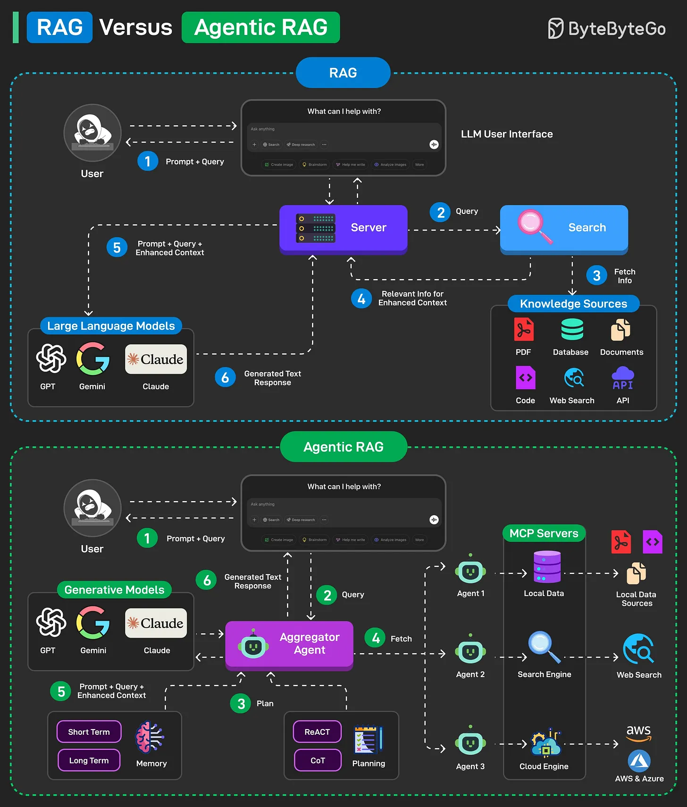

# 098 - RAG vs Agentic RAG

- Nguồn: ByteByteGo Big Archive System Design 2025
- Trang PDF: 208-209
- Ảnh minh họa: `../assets/098/figure-01.png`

## Hình minh họa

## Dịch sát

RAG (Retrieval Augmented Generation) là một phương pháp kết hợp information retrieval với large language model để generate answer. Dưới đây là cách RAG hoạt động ở high level:

1. Model retrieve relevant data từ data source rồi extract nó tới vector database từ pre-indexed model.

2. Augment prompt bằng cách retrieve information và merge nó với query prompt.

3. Một Large Language Model như GPT, Claude hoặc Gemini hiểu combined query và generate final response.

Traditional RAG có retrieval đơn giản, adaptability giới hạn và phụ thuộc vào static knowledge, khiến nó kém linh hoạt hơn với dynamic và real-time information.

Agentic RAG cải thiện điều này bằng cách đưa AI agent vào. Agent có thể đưa ra decision, chọn tool và thậm chí refine query để có response chính xác và linh hoạt hơn. Dưới đây là cách Agentic RAG hoạt động ở high level:

1. User query được chuyển tới AI Agent để xử lý.

2. Agent dùng short-term và long-term memory để track query context. Nó cũng formulate retrieval strategy và chọn tool phù hợp cho job.

3. Data fetching process có thể dùng các tool như vector search, multiple agents và MCP servers để gather relevant data từ knowledge base.

4. Agent sau đó combine retrieved data với query và system prompt. Nó pass data này tới LLM.

5. LLM process optimized input để trả lời query của user.

Câu hỏi dành cho bạn: Bạn sẽ thêm gì khác để hiểu RAG vs Agentic RAG tốt hơn?

## Dịch nội dung trong hình

- `RAG`: user prompt/query đi tới LLM user interface; search/retrieve lấy data từ knowledge source như PDF/document/database/web/API; retrieved data được ghép vào prompt; LLM như GPT/Gemini/Claude tạo response.
- `Agentic RAG`: user query đi vào generalization module/agent; agent có memory, planning và tool selection; agent có thể gọi aggregator agent, vector DB, MCP server, web search hoặc API source; sau đó final response được tạo qua LLM.
- Hình nhấn mạnh Agentic RAG có thêm memory, planning, reflection, short-term/long-term memory, multi-agent và tool orchestration.

## Tóm tắt & giải thích dễ hiểu

RAG truyền thống thường đi theo pipeline cố định: retrieve top-k document -> đưa vào prompt -> LLM trả lời. Agentic RAG thêm bước ra quyết định: query này nên dùng nguồn nào, có cần rewrite query không, có cần gọi tool/API không, có cần nhiều vòng retrieve không.

Agentic RAG mạnh hơn nhưng phức tạp hơn. Nó cần quản lý cost, latency, loop control, tool permission, observability và evaluation. Không phải bài toán nào cũng cần Agentic RAG; nhiều FAQ/document QA chỉ cần RAG đơn giản là đủ.

## Ví dụ thực tế - không nằm trong tài liệu gốc

Nếu user hỏi “chính sách nghỉ phép hiện tại là gì?”, RAG thường đủ: tìm document HR mới nhất rồi trả lời. Nếu user hỏi “so sánh chính sách nghỉ phép năm nay với năm ngoái và tạo email xin nghỉ theo lịch team”, Agentic RAG có thể cần đọc nhiều document, kiểm tra calendar, gọi tool email draft và tự lập kế hoạch nhiều bước.

## Thuật ngữ chính

- `RAG`: Retrieval-Augmented Generation.
- `Agentic RAG`: RAG có agent quyết định retrieval/tool strategy.
- `Vector search`: tìm đoạn liên quan bằng embedding.
- `Knowledge source`: nguồn tri thức như PDF, DB, web, API.
- `Short-term memory`: memory trong phiên/task hiện tại.
- `Long-term memory`: memory lưu lâu hơn qua nhiều phiên.
- `Tool orchestration`: điều phối nhiều tool để hoàn thành task.

## Câu hỏi ôn tập + trả lời + thinking học tập + liên hệ

> Đây là phần học tập thêm ở cuối file. Câu hỏi ưu tiên lấy từ tài liệu gốc và được trả lời trực tiếp; nếu bài không có câu hỏi riêng thì dùng tiêu đề/nội dung chính để tạo câu hỏi tự kiểm tra.

### Câu hỏi 1

**Nguồn câu hỏi:** Câu hỏi trong tài liệu gốc.

**Câu hỏi:** Bạn sẽ thêm gì khác để hiểu RAG vs Agentic RAG tốt hơn?

**Trả lời:** Danh sách sẽ đầy đủ hơn nếu thêm evaluation harness để đo chất lượng thay vì cảm tính; guardrails/policy để giảm prompt injection và output nguy hiểm; observability cho prompt, context, latency, cost và hallucination; và model routing theo độ khó/cost của request. Các mục này giúp bức tranh đầy đủ hơn vì chúng chạm vào phần triển khai/vận hành mà bài gốc chưa đi sâu. Ý chính đang có của bài là: RAG truyền thống thường đi theo pipeline cố định: retrieve top-k document -> đưa vào prompt -> LLM trả lời. Agentic RAG thêm bước ra quyết định: query này nên dùng nguồn nào, có cần rewrite query không, có cần gọi tool/API không, có cần nhiều vòng retrieve không.

**Thinking học tập + liên hệ:** Đừng thêm mục cho dài danh sách; với `RAG vs Agentic RAG`, chỉ thêm thứ mở ra một nhóm vấn đề mới hoặc giúp ra quyết định thiết kế tốt hơn. Lens chính là quality, latency, cost/token, privacy, cập nhật tri thức và rủi ro hallucination. Khi build AI app, hãy nối model với pipeline thật: data vào đâu, context lấy từ đâu, output được kiểm thế nào và chi phí tăng theo traffic ra sao. Khi ghi chú lại, hãy giải thích được các keyword: `RAG`, `Agentic RAG`, `Vector search`, `Knowledge source`, `Short-term memory`.
