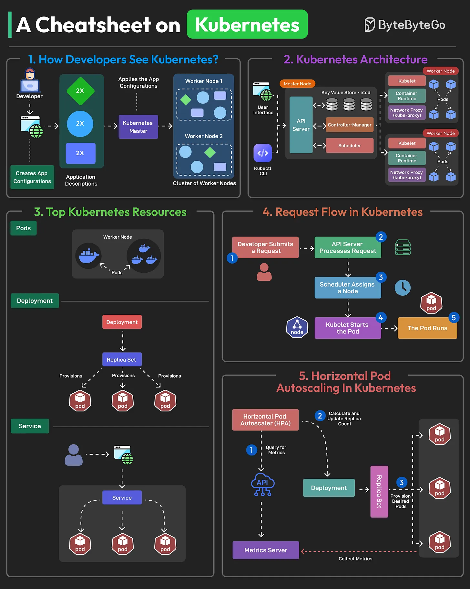

# 099 - Cheatsheet về Kubernetes

- Nguồn: ByteByteGo Big Archive System Design 2025
- Trang PDF: 210-211
- Ảnh minh họa: `../assets/099/figure-01.png`

## Hình minh họa

## Dịch sát

Kubernetes (K8S) là một open-source container orchestration platform, ban đầu được phát triển bởi Google và hiện được duy trì bởi Cloud Native Computing Foundation (CNCF).

Developer làm việc với Kubernetes tạo manifest file mô tả application của họ và chỉ định số instance, resource requirement và các configuration khác.

Kubernetes hoạt động bằng một control plane và một nhóm node. Control plane được deploy trên master node và quản lý overall state của cluster. Nó gồm các component như API Server, Etcd, Controller Manager và Scheduler.

Node là worker trong Kubernetes cluster. Mỗi node chứa các component như Kubelet và Kube-proxy, đồng thời chịu trách nhiệm chạy containerized application.

Một số Kubernetes resource hàng đầu là Pod, Deployment, Service và Persistent Volume.

1. Pod encapsulate một hoặc nhiều container.

2. Deployment là abstraction cấp cao hơn để quản lý Pod.

3. Service là abstraction cung cấp cách ổn định để expose và access một tập Pod.

4. Volume là storage resource giúp retain data giữa các lần pod restart hoặc recreate.

Horizontal Pod Autoscaler giúp scale số Pod trong Deployment, ReplicaSet hoặc StatefulSet dựa trên observed CPU utilization, memory usage hoặc custom metrics. Nó monitor resource usage và điều chỉnh số replica để match desired resource target.

Câu hỏi dành cho bạn: Bạn đã dùng Kubernetes trong project của mình chưa?

## Dịch nội dung trong hình

- `How Developers See Kubernetes`: developer tạo app configuration/manifest, Kubernetes master áp dụng configuration lên cluster worker nodes.
- `Kubernetes Architecture`: user interface hoặc `kubectl CLI` gọi API Server; master node gồm API Server, key-value store `etcd`, Controller Manager và Scheduler; worker node gồm Kubelet, container runtime, network proxy/kube-proxy và Pods.
- `Top Kubernetes Resources`: Pod, Deployment, Service; Deployment tạo ReplicaSet, ReplicaSet provision nhiều Pod; Service cung cấp endpoint ổn định tới nhiều Pod.
- `Request Flow`: developer submit request, API Server process request, Scheduler assign node, Kubelet start pod, pod runs.
- `Horizontal Pod Autoscaling`: HPA query metrics từ Metrics Server, tính/update replica count, Deployment/ReplicaSet provision desired pods.

## Tóm tắt & giải thích dễ hiểu

Kubernetes là control system cho container. Bạn khai báo desired state bằng YAML manifest, Kubernetes liên tục cố gắng đưa cluster về đúng trạng thái đó. Control plane ra quyết định; worker node chạy pod thật.

Điểm quan trọng khi học Kubernetes là hiểu các abstraction: Pod chạy container, Deployment quản lý rollout/replica, Service cung cấp địa chỉ ổn định, Volume giữ state, HPA tự động scale theo metric.

## Ví dụ thực tế - không nằm trong tài liệu gốc

Bạn muốn chạy API với 3 instance. Thay vì tự SSH vào 3 máy, bạn tạo Deployment `replicas: 3`, Service để expose API, và HPA để tăng replica khi CPU vượt ngưỡng. Nếu một pod chết, controller tạo pod mới để giữ desired state.

## Thuật ngữ chính

- `K8S`: viết tắt của Kubernetes.
- `Manifest`: file YAML khai báo resource.
- `Control plane`: lớp điều phối cluster.
- `Node`: máy worker chạy workload.
- `Pod`: đơn vị chạy container.
- `Deployment`: resource quản lý Pod/ReplicaSet.
- `Service`: endpoint ổn định tới Pod.
- `HPA`: Horizontal Pod Autoscaler.

## Câu hỏi ôn tập + trả lời + thinking học tập + liên hệ

> Đây là phần học tập thêm ở cuối file. Câu hỏi ưu tiên lấy từ tài liệu gốc và được trả lời trực tiếp; nếu bài không có câu hỏi riêng thì dùng tiêu đề/nội dung chính để tạo câu hỏi tự kiểm tra.

### Câu hỏi 1

**Nguồn câu hỏi:** Câu hỏi trong tài liệu gốc.

**Câu hỏi:** Bạn đã dùng Kubernetes trong project của mình chưa?

**Trả lời:** Với `Cheatsheet về Kubernetes`, cách liên hệ tốt nhất là chọn một workload nhỏ rồi kiểm chứng bằng số liệu thay vì chọn theo cảm tính. Nên kiểm bằng workload nhỏ trước: latency, độ ổn định, khả năng debug, cost và rủi ro vận hành. Phần cốt lõi cần đem theo từ bài là: Kubernetes là control system cho container. Bạn khai báo desired state bằng YAML manifest, Kubernetes liên tục cố gắng đưa cluster về đúng trạng thái đó. Control plane ra quyết định; worker node chạy pod thật. Điểm quan trọng khi học Kubernetes là hiểu các abstraction: Pod chạy container, Deployment quản lý rollout/replica, Service cung cấp địa chỉ ổn định, Volume giữ state, HPA tự động scale theo metric.

**Thinking học tập + liên hệ:** Khi tự liên hệ `Cheatsheet về Kubernetes`, hãy viết ra một project cụ thể, lý do chọn công nghệ và lỗi vận hành có thể xảy ra. Lens chính là độ phức tạp vận hành, rollback, cost, kỹ năng team, observability và blast radius khi hỏng. Khi đưa lên production, hãy map từng thành phần vào deploy, rollback, monitoring, alerting, secret, cost và ownership rõ ràng. Khi ghi chú lại, hãy giải thích được các keyword: `K8S`, `Manifest`, `Control plane`, `Node`, `Pod`.
