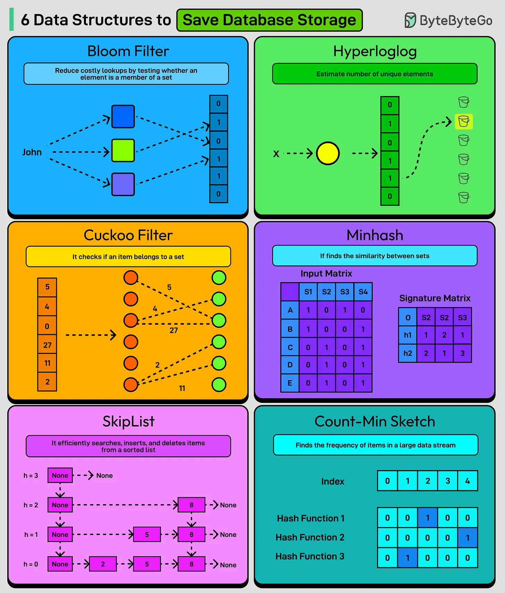

# 100 - 6 data structure giúp tiết kiệm storage

- Nguồn: ByteByteGo Big Archive System Design 2025
- Trang PDF: 212-213
- Ảnh minh họa: `../assets/100/figure-01.png`

## Hình minh họa

## Dịch sát

1. Bloom Filter
   Một probabilistic data structure dùng để test xem một element có phải member của một set hay không.

2. HyperLogLog
   Một algorithm xấp xỉ số lượng unique element trong multi-set bằng memory tối thiểu.

3. Cuckoo Filter
   Một lựa chọn space-efficient thay thế Bloom filter, hỗ trợ deletion và có lookup performance tốt hơn.

4. Minhash
   Một technique để ước lượng nhanh similarity giữa các large set bằng compressed hash signature.

5. SkipList
   Một layered linked list structure cho phép search, insert và delete nhanh.

6. Count-Min Sketch
   Một probabilistic data structure xấp xỉ frequency của item trong large data stream.

Câu hỏi dành cho bạn: Bạn sẽ thêm data structure nào khác vào danh sách?

## Dịch nội dung trong hình

- `Bloom Filter`: reduce space bằng bit array; có thể có false positive nhưng không có false negative.
- `HyperLogLog`: estimate cardinality/unique count bằng nhiều bucket/register.
- `Cuckoo Filter`: dùng fingerprint và multiple bucket để check membership, hỗ trợ delete.
- `Minhash`: input matrix tạo signature matrix để estimate similarity.
- `SkipList`: nhiều level linked list giúp search nhanh hơn linked list thường.
- `Count-Min Sketch`: dùng nhiều hash function và matrix counter để estimate item frequency.

## Tóm tắt & giải thích dễ hiểu

Các cấu trúc này tiết kiệm storage bằng cách chấp nhận đánh đổi: dùng xác suất, xấp xỉ hoặc tổ chức dữ liệu thông minh. Bloom Filter trả lời “có thể có” hoặc “chắc chắn không có”. HyperLogLog đếm approximate unique. Count-Min Sketch ước lượng tần suất. MinHash ước lượng độ giống nhau. SkipList tăng tốc thao tác ordered data.

Trong hệ thống lớn, approximate data structure rất hữu ích vì câu trả lời gần đúng nhưng nhanh/rẻ thường tốt hơn câu trả lời chính xác tuyệt đối mà tốn quá nhiều RAM.

## Ví dụ thực tế - không nằm trong tài liệu gốc

Một CDN có thể dùng Bloom Filter để kiểm tra URL có khả năng nằm trong cache không trước khi truy vấn storage đắt hơn. Hệ thống analytics có thể dùng HyperLogLog để ước lượng daily active users duy nhất mà không lưu toàn bộ user ID.

## Thuật ngữ chính

- `Probabilistic data structure`: cấu trúc dữ liệu xác suất.
- `False positive`: báo có dù thực tế không có.
- `False negative`: báo không có dù thực tế có.
- `Cardinality`: số lượng phần tử duy nhất.
- `Similarity`: độ tương tự giữa hai tập.
- `Frequency estimation`: ước lượng tần suất xuất hiện.
- `Space-efficient`: tiết kiệm bộ nhớ/lưu trữ.

## Câu hỏi ôn tập + trả lời + thinking học tập + liên hệ

> Đây là phần học tập thêm ở cuối file. Câu hỏi ưu tiên lấy từ tài liệu gốc và được trả lời trực tiếp; nếu bài không có câu hỏi riêng thì dùng tiêu đề/nội dung chính để tạo câu hỏi tự kiểm tra.

### Câu hỏi 1

**Nguồn câu hỏi:** Câu hỏi trong tài liệu gốc.

**Câu hỏi:** Bạn sẽ thêm data structure nào khác vào danh sách?

**Trả lời:** Có thể thêm `A* Search` cho tìm đường có heuristic trong bản đồ/game; `BFS/DFS` cho crawler, dependency graph và duyệt quan hệ; `Consistent Hashing` để phân phối key ổn định trong cache/database cluster; và `Bloom Filter` để kiểm tra membership nhanh với bộ nhớ thấp. Các mục này giúp bức tranh đầy đủ hơn vì chúng chạm vào phần triển khai/vận hành mà bài gốc chưa đi sâu. Ý chính đang có của bài là: Các cấu trúc này tiết kiệm storage bằng cách chấp nhận đánh đổi: dùng xác suất, xấp xỉ hoặc tổ chức dữ liệu thông minh. Bloom Filter trả lời “có thể có” hoặc “chắc chắn không có”. HyperLogLog đếm approximate unique. Count-Min Sketch ước lượng tần suất. MinHash ước lượng độ giống nhau. SkipList tăng tốc thao tác ordered data.

**Thinking học tập + liên hệ:** Đừng thêm mục cho dài danh sách; với `6 data structure giúp tiết kiệm storage`, chỉ thêm thứ mở ra một nhóm vấn đề mới hoặc giúp ra quyết định thiết kế tốt hơn. Lens chính là loại dữ liệu, kích thước input, latency mục tiêu, memory budget và sai số/lỗi có thể chấp nhận. Trong project thật, thuật toán thường ẩn sau search, cache, ranking, routing, queue hoặc storage; hiểu nó giúp dự đoán bottleneck trước khi hệ thống lớn lên. Khi ghi chú lại, hãy giải thích được các keyword: `Probabilistic data structure`, `False positive`, `False negative`, `Cardinality`, `Similarity`.
