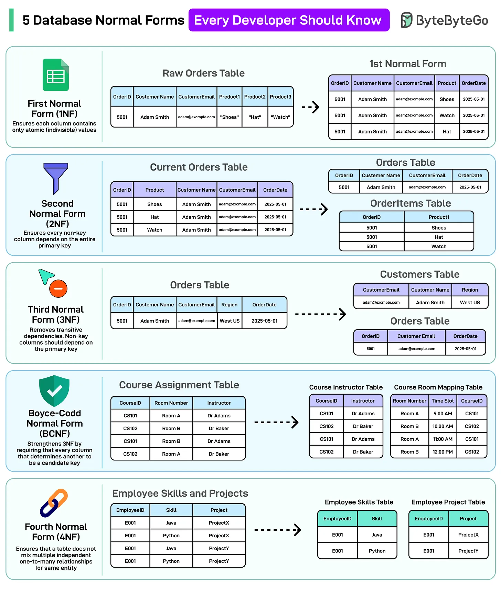
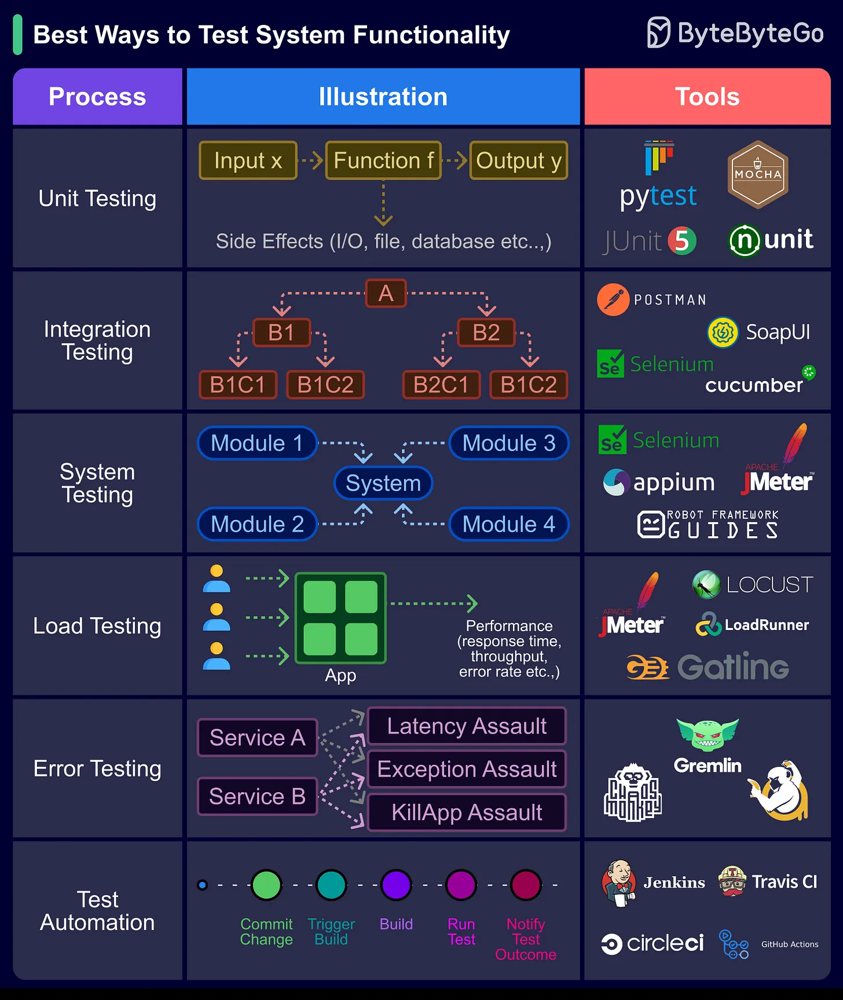

# 101 - 5 Database Normal Form mọi developer nên biết

- Nguồn: ByteByteGo Big Archive System Design 2025
- Trang PDF: 214-217
- Ảnh minh họa: `../assets/101/figure-01.png`, `../assets/101/figure-02.png`

## Hình minh họa

## Dịch sát

Normalization nhằm loại bỏ redundancy và enforce data integrity bằng cách tổ chức data thành các form logic, dựa trên dependency.

1. First Normal Form (1NF): Loại bỏ repeating group và bảo đảm atomic value trong mỗi column.

2. Second Normal Form (2NF): Loại bỏ partial dependency bằng cách bảo đảm tất cả non-key column phụ thuộc vào toàn bộ primary key.

3. Third Normal Form (3NF): Loại bỏ transitive dependency, bảo đảm non-key column chỉ phụ thuộc vào primary key.

4. Boyce-Codd Normal Form (BCNF): Tăng cường 3NF bằng cách loại bỏ anomaly tồn tại do overlapping candidate key. Nếu một column phụ thuộc vào một column khác, thì “column khác” đó phải đủ để identify duy nhất từng row.

5. Fourth Normal Form (4NF): Bảo đảm một table không trộn nhiều independent one-to-many relationship cho cùng một entity.

Câu hỏi dành cho bạn: Bạn sẽ thêm Normal Form nào khác vào danh sách?

Best ways to test system functionality

Testing system functionality là bước quan trọng trong software development và engineering process.

Nó bảo đảm system hoặc software application hoạt động như kỳ vọng, đáp ứng user requirement và vận hành reliable.

Dưới đây là các cách tốt nhất:

1. Unit Testing: Bảo đảm từng code component riêng lẻ hoạt động đúng khi isolation.

2. Integration Testing: Verify các phần khác nhau của system hoạt động mượt mà cùng nhau.

3. System Testing: Đánh giá toàn bộ system có tuân thủ user requirement và performance hay không.

4. Load Testing: Test khả năng system xử lý high workload và xác định performance issue.

5. Error Testing: Đánh giá cách software xử lý invalid input và error condition.

6. Test Automation: Tự động hóa test case execution để tăng efficiency, repeatability và giảm lỗi.

Câu hỏi dành cho bạn: Bạn approach testing system functionality trong software development hoặc engineering project của mình như thế nào?

Câu hỏi dành cho bạn: Release process của công ty bạn trông như thế nào?

## Dịch nội dung trong hình

- Hình 1: minh họa 1NF tách repeating/atomic value, 2NF tách partial dependency, 3NF tách transitive dependency, BCNF xử lý candidate key overlap và 4NF tách multiple independent relationships.
- Hình 2: testing functionality gồm process và tool: Unit Testing, Integration Testing, System Testing, Load Testing, Error Testing và Test Automation.
- Tool trong hình gồm pytest, JUnit, QUnit, Postman, SoapUI, Selenium/Cucumber/Appium, JMeter/Gatling/Locust, Gremlin, Jenkins, Travis CI, CircleCI và GitHub Actions.

## Tóm tắt & giải thích dễ hiểu

Normalization giúp schema ít trùng lặp và giảm anomaly khi insert/update/delete. 1NF xử lý atomicity, 2NF xử lý phụ thuộc vào một phần composite key, 3NF xử lý phụ thuộc bắc cầu, BCNF siết chặt candidate key, 4NF xử lý nhiều quan hệ một-nhiều độc lập trong cùng bảng.

Phần testing trong cùng file nhấn mạnh hệ thống không chỉ cần code đúng từng function mà còn cần kiểm tra tích hợp, toàn hệ thống, tải cao, lỗi bất thường và tự động hóa để release ổn định.

## Ví dụ thực tế - không nằm trong tài liệu gốc

Nếu bảng `orders` lưu cả `customer_name`, `customer_email`, `product_name`, `product_category` lặp lại ở nhiều row, update email hoặc category dễ bị lệch. Normalization tách `customers`, `products`, `orders`, `order_items` để mỗi fact có một nơi lưu chính. Sau đó test pipeline cần unit test price calculation, integration test checkout/payment, load test flash sale và error test payment gateway timeout.

## Thuật ngữ chính

- `Normalization`: chuẩn hóa schema để giảm redundancy.
- `Redundancy`: dữ liệu trùng lặp.
- `Atomic value`: giá trị không chia nhỏ thêm trong column.
- `Partial dependency`: phụ thuộc vào một phần khóa ghép.
- `Transitive dependency`: phụ thuộc bắc cầu qua non-key column.
- `Candidate key`: khóa ứng viên xác định row duy nhất.
- `Load testing`: kiểm tra dưới tải cao.

## Câu hỏi ôn tập + trả lời + thinking học tập + liên hệ

> Đây là phần học tập thêm ở cuối file. Câu hỏi ưu tiên lấy từ tài liệu gốc và được trả lời trực tiếp; nếu bài không có câu hỏi riêng thì dùng tiêu đề/nội dung chính để tạo câu hỏi tự kiểm tra.

### Câu hỏi 1

**Nguồn câu hỏi:** Câu hỏi trong tài liệu gốc.

**Câu hỏi:** Bạn sẽ thêm Normal Form nào khác vào danh sách?

**Trả lời:** Phần còn thiếu đáng cân nhắc là pre-commit hook/lint để chặn lỗi sớm; trunk-based development khi team cần release nhanh; branch protection và required checks; và reflog/revert strategy để cứu lỗi Git. Các mục này giúp bức tranh đầy đủ hơn vì chúng chạm vào phần triển khai/vận hành mà bài gốc chưa đi sâu. Ý chính đang có của bài là: Normalization giúp schema ít trùng lặp và giảm anomaly khi insert/update/delete. 1NF xử lý atomicity, 2NF xử lý phụ thuộc vào một phần composite key, 3NF xử lý phụ thuộc bắc cầu, BCNF siết chặt candidate key, 4NF xử lý nhiều quan hệ một-nhiều độc lập trong cùng bảng.

**Thinking học tập + liên hệ:** Danh sách trong `5 Database Normal Form mọi developer nên biết` nên được kiểm theo coverage: nó đã nói phần nào, thiếu phần nào và phần thiếu có làm thay đổi quyết định thiết kế không. Lens chính là feedback loop, rollback, collaboration, code review và mức tự động hóa phù hợp team. Khi áp dụng vào team thật, hãy nhìn developer workflow như một hệ thống: commit, review, test, deploy và rollback đều phải giảm rủi ro production. Khi ghi chú lại, hãy giải thích được các keyword: `Normalization`, `Redundancy`, `Atomic value`, `Partial dependency`, `Transitive dependency`.

### Câu hỏi 2

**Nguồn câu hỏi:** Câu hỏi trong tài liệu gốc.

**Câu hỏi:** Unit Testing: Bảo đảm từng code component riêng lẻ hoạt động đúng khi isolation.

**Trả lời:** Luồng tốt nhất là lần theo input tới output: request/dữ liệu đi vào đâu, qua thành phần nào, state đổi ở đâu và kết quả trả ra thế nào. Với `5 Database Normal Form mọi developer nên biết`, ý chính là: Normalization giúp schema ít trùng lặp và giảm anomaly khi insert/update/delete. 1NF xử lý atomicity, 2NF xử lý phụ thuộc vào một phần composite key, 3NF xử lý phụ thuộc bắc cầu, BCNF siết chặt candidate key, 4NF xử lý nhiều quan hệ một-nhiều độc lập trong cùng bảng.

**Thinking học tập + liên hệ:** Luồng trong `5 Database Normal Form mọi developer nên biết` nên được vẽ từ input tới output, kèm owner của từng bước và failure mode ở mỗi boundary. Lens chính là feedback loop, rollback, collaboration, code review và mức tự động hóa phù hợp team. Khi áp dụng vào team thật, hãy nhìn developer workflow như một hệ thống: commit, review, test, deploy và rollback đều phải giảm rủi ro production. Khi ghi chú lại, hãy giải thích được các keyword: `Normalization`, `Redundancy`, `Atomic value`, `Partial dependency`, `Transitive dependency`.

### Câu hỏi 3

**Nguồn câu hỏi:** Câu hỏi trong tài liệu gốc.

**Câu hỏi:** Integration Testing: Verify các phần khác nhau của system hoạt động mượt mà cùng nhau.

**Trả lời:** Điểm khác nhau nên nhìn từ boundary và trách nhiệm chính. Với `5 Database Normal Form mọi developer nên biết`, hãy tách rõ mỗi bên giải quyết vấn đề gì, dữ liệu đi qua đâu, ai sở hữu state và lỗi sẽ lan như thế nào. Ý chính để giữ lại là: Normalization giúp schema ít trùng lặp và giảm anomaly khi insert/update/delete. 1NF xử lý atomicity, 2NF xử lý phụ thuộc vào một phần composite key, 3NF xử lý phụ thuộc bắc cầu, BCNF siết chặt candidate key, 4NF xử lý nhiều quan hệ một-nhiều độc lập trong cùng bảng.

**Thinking học tập + liên hệ:** Khi so sánh trong `5 Database Normal Form mọi developer nên biết`, hãy tách responsibility, boundary, state, failure mode và cost vận hành thay vì chỉ so tên công nghệ. Lens chính là feedback loop, rollback, collaboration, code review và mức tự động hóa phù hợp team. Khi áp dụng vào team thật, hãy nhìn developer workflow như một hệ thống: commit, review, test, deploy và rollback đều phải giảm rủi ro production. Khi ghi chú lại, hãy giải thích được các keyword: `Normalization`, `Redundancy`, `Atomic value`, `Partial dependency`, `Transitive dependency`.

### Câu hỏi 4

**Nguồn câu hỏi:** Câu hỏi trong tài liệu gốc.

**Câu hỏi:** System Testing: Đánh giá toàn bộ system có tuân thủ user requirement và performance hay không.

**Trả lời:** Bài này muốn người đọc nắm: Normalization giúp schema ít trùng lặp và giảm anomaly khi insert/update/delete. 1NF xử lý atomicity, 2NF xử lý phụ thuộc vào một phần composite key, 3NF xử lý phụ thuộc bắc cầu, BCNF siết chặt candidate key, 4NF xử lý nhiều quan hệ một-nhiều độc lập trong cùng bảng. Khi áp dụng vào hệ thống thật, hãy kiểm thêm feedback loop, rollback, collaboration, code review và mức tự động hóa phù hợp team.

**Thinking học tập + liên hệ:** Khi học `5 Database Normal Form mọi developer nên biết`, hãy thử viết một checklist áp dụng vào project: input, output, owner, rủi ro và metric kiểm chứng. Lens chính là feedback loop, rollback, collaboration, code review và mức tự động hóa phù hợp team. Khi áp dụng vào team thật, hãy nhìn developer workflow như một hệ thống: commit, review, test, deploy và rollback đều phải giảm rủi ro production. Khi ghi chú lại, hãy giải thích được các keyword: `Normalization`, `Redundancy`, `Atomic value`, `Partial dependency`, `Transitive dependency`.

### Câu hỏi 5

**Nguồn câu hỏi:** Câu hỏi trong tài liệu gốc.

**Câu hỏi:** Load Testing: Test khả năng system xử lý high workload và xác định performance issue.

**Trả lời:** Nếu rút thành checklist thiết kế thì ý chính là: Normalization giúp schema ít trùng lặp và giảm anomaly khi insert/update/delete. 1NF xử lý atomicity, 2NF xử lý phụ thuộc vào một phần composite key, 3NF xử lý phụ thuộc bắc cầu, BCNF siết chặt candidate key, 4NF xử lý nhiều quan hệ một-nhiều độc lập trong cùng bảng. Khi áp dụng vào hệ thống thật, hãy kiểm thêm feedback loop, rollback, collaboration, code review và mức tự động hóa phù hợp team.

**Thinking học tập + liên hệ:** Liên hệ `5 Database Normal Form mọi developer nên biết` bằng một scenario thật sẽ giúp thấy trade-off rõ hơn so với chỉ đọc định nghĩa. Lens chính là feedback loop, rollback, collaboration, code review và mức tự động hóa phù hợp team. Khi áp dụng vào team thật, hãy nhìn developer workflow như một hệ thống: commit, review, test, deploy và rollback đều phải giảm rủi ro production. Khi ghi chú lại, hãy giải thích được các keyword: `Normalization`, `Redundancy`, `Atomic value`, `Partial dependency`, `Transitive dependency`.

### Câu hỏi 6

**Nguồn câu hỏi:** Câu hỏi trong tài liệu gốc.

**Câu hỏi:** Error Testing: Đánh giá cách software xử lý invalid input và error condition.

**Trả lời:** Sau bài này, phần đáng nhớ nhất là: Normalization giúp schema ít trùng lặp và giảm anomaly khi insert/update/delete. 1NF xử lý atomicity, 2NF xử lý phụ thuộc vào một phần composite key, 3NF xử lý phụ thuộc bắc cầu, BCNF siết chặt candidate key, 4NF xử lý nhiều quan hệ một-nhiều độc lập trong cùng bảng. Khi áp dụng vào hệ thống thật, hãy kiểm thêm feedback loop, rollback, collaboration, code review và mức tự động hóa phù hợp team.

**Thinking học tập + liên hệ:** Khi học `5 Database Normal Form mọi developer nên biết`, hãy thử viết một checklist áp dụng vào project: input, output, owner, rủi ro và metric kiểm chứng. Lens chính là feedback loop, rollback, collaboration, code review và mức tự động hóa phù hợp team. Khi áp dụng vào team thật, hãy nhìn developer workflow như một hệ thống: commit, review, test, deploy và rollback đều phải giảm rủi ro production. Khi ghi chú lại, hãy giải thích được các keyword: `Normalization`, `Redundancy`, `Atomic value`, `Partial dependency`, `Transitive dependency`.

### Câu hỏi 7

**Nguồn câu hỏi:** Câu hỏi trong tài liệu gốc.

**Câu hỏi:** Test Automation: Tự động hóa test case execution để tăng efficiency, repeatability và giảm lỗi.

**Trả lời:** Nếu rút thành checklist thiết kế thì ý chính là: Normalization giúp schema ít trùng lặp và giảm anomaly khi insert/update/delete. 1NF xử lý atomicity, 2NF xử lý phụ thuộc vào một phần composite key, 3NF xử lý phụ thuộc bắc cầu, BCNF siết chặt candidate key, 4NF xử lý nhiều quan hệ một-nhiều độc lập trong cùng bảng. Khi áp dụng vào hệ thống thật, hãy kiểm thêm feedback loop, rollback, collaboration, code review và mức tự động hóa phù hợp team.

**Thinking học tập + liên hệ:** Ôn tập `5 Database Normal Form mọi developer nên biết` bằng cách biến khái niệm thành quyết định thiết kế cụ thể: chọn gì, bỏ gì, đo gì và ai chịu trách nhiệm. Lens chính là feedback loop, rollback, collaboration, code review và mức tự động hóa phù hợp team. Khi áp dụng vào team thật, hãy nhìn developer workflow như một hệ thống: commit, review, test, deploy và rollback đều phải giảm rủi ro production. Khi ghi chú lại, hãy giải thích được các keyword: `Normalization`, `Redundancy`, `Atomic value`, `Partial dependency`, `Transitive dependency`.

### Câu hỏi 8

**Nguồn câu hỏi:** Câu hỏi trong tài liệu gốc.

**Câu hỏi:** Câu hỏi dành cho bạn: Bạn approach testing system functionality trong software development hoặc engineering project của mình như thế nào?

**Trả lời:** Luồng tốt nhất là lần theo input tới output: request/dữ liệu đi vào đâu, qua thành phần nào, state đổi ở đâu và kết quả trả ra thế nào. Với `5 Database Normal Form mọi developer nên biết`, ý chính là: Normalization giúp schema ít trùng lặp và giảm anomaly khi insert/update/delete. 1NF xử lý atomicity, 2NF xử lý phụ thuộc vào một phần composite key, 3NF xử lý phụ thuộc bắc cầu, BCNF siết chặt candidate key, 4NF xử lý nhiều quan hệ một-nhiều độc lập trong cùng bảng.

**Thinking học tập + liên hệ:** Luồng trong `5 Database Normal Form mọi developer nên biết` nên được vẽ từ input tới output, kèm owner của từng bước và failure mode ở mỗi boundary. Lens chính là feedback loop, rollback, collaboration, code review và mức tự động hóa phù hợp team. Khi áp dụng vào team thật, hãy nhìn developer workflow như một hệ thống: commit, review, test, deploy và rollback đều phải giảm rủi ro production. Khi ghi chú lại, hãy giải thích được các keyword: `Normalization`, `Redundancy`, `Atomic value`, `Partial dependency`, `Transitive dependency`.

### Câu hỏi 9

**Nguồn câu hỏi:** Câu hỏi trong tài liệu gốc.

**Câu hỏi:** Câu hỏi dành cho bạn: Release process của công ty bạn trông như thế nào?

**Trả lời:** Hãy tách flow thành các bước có state rõ ràng: request/dữ liệu đi vào đâu, qua thành phần nào, state đổi ở đâu và kết quả trả ra thế nào. Với `5 Database Normal Form mọi developer nên biết`, ý chính là: Normalization giúp schema ít trùng lặp và giảm anomaly khi insert/update/delete. 1NF xử lý atomicity, 2NF xử lý phụ thuộc vào một phần composite key, 3NF xử lý phụ thuộc bắc cầu, BCNF siết chặt candidate key, 4NF xử lý nhiều quan hệ một-nhiều độc lập trong cùng bảng.

**Thinking học tập + liên hệ:** Luồng trong `5 Database Normal Form mọi developer nên biết` nên được vẽ từ input tới output, kèm owner của từng bước và failure mode ở mỗi boundary. Lens chính là feedback loop, rollback, collaboration, code review và mức tự động hóa phù hợp team. Khi áp dụng vào team thật, hãy nhìn developer workflow như một hệ thống: commit, review, test, deploy và rollback đều phải giảm rủi ro production. Khi ghi chú lại, hãy giải thích được các keyword: `Normalization`, `Redundancy`, `Atomic value`, `Partial dependency`, `Transitive dependency`.

### Câu hỏi 10

**Nguồn câu hỏi:** Câu hỏi trong tài liệu gốc.

**Câu hỏi:** Bạn approach testing system functionality trong software development hoặc engineering project của mình như thế nào?

**Trả lời:** Luồng tốt nhất là lần theo input tới output: request/dữ liệu đi vào đâu, qua thành phần nào, state đổi ở đâu và kết quả trả ra thế nào. Với `5 Database Normal Form mọi developer nên biết`, ý chính là: Normalization giúp schema ít trùng lặp và giảm anomaly khi insert/update/delete. 1NF xử lý atomicity, 2NF xử lý phụ thuộc vào một phần composite key, 3NF xử lý phụ thuộc bắc cầu, BCNF siết chặt candidate key, 4NF xử lý nhiều quan hệ một-nhiều độc lập trong cùng bảng.

**Thinking học tập + liên hệ:** Luồng trong `5 Database Normal Form mọi developer nên biết` nên được vẽ từ input tới output, kèm owner của từng bước và failure mode ở mỗi boundary. Lens chính là feedback loop, rollback, collaboration, code review và mức tự động hóa phù hợp team. Khi áp dụng vào team thật, hãy nhìn developer workflow như một hệ thống: commit, review, test, deploy và rollback đều phải giảm rủi ro production. Khi ghi chú lại, hãy giải thích được các keyword: `Normalization`, `Redundancy`, `Atomic value`, `Partial dependency`, `Transitive dependency`.

### Câu hỏi 11

**Nguồn câu hỏi:** Câu hỏi trong tài liệu gốc.

**Câu hỏi:** Release process của công ty bạn trông như thế nào?

**Trả lời:** Hãy tách flow thành các bước có state rõ ràng: request/dữ liệu đi vào đâu, qua thành phần nào, state đổi ở đâu và kết quả trả ra thế nào. Với `5 Database Normal Form mọi developer nên biết`, ý chính là: Normalization giúp schema ít trùng lặp và giảm anomaly khi insert/update/delete. 1NF xử lý atomicity, 2NF xử lý phụ thuộc vào một phần composite key, 3NF xử lý phụ thuộc bắc cầu, BCNF siết chặt candidate key, 4NF xử lý nhiều quan hệ một-nhiều độc lập trong cùng bảng.

**Thinking học tập + liên hệ:** Luồng trong `5 Database Normal Form mọi developer nên biết` nên được vẽ từ input tới output, kèm owner của từng bước và failure mode ở mỗi boundary. Lens chính là feedback loop, rollback, collaboration, code review và mức tự động hóa phù hợp team. Khi áp dụng vào team thật, hãy nhìn developer workflow như một hệ thống: commit, review, test, deploy và rollback đều phải giảm rủi ro production. Khi ghi chú lại, hãy giải thích được các keyword: `Normalization`, `Redundancy`, `Atomic value`, `Partial dependency`, `Transitive dependency`.
