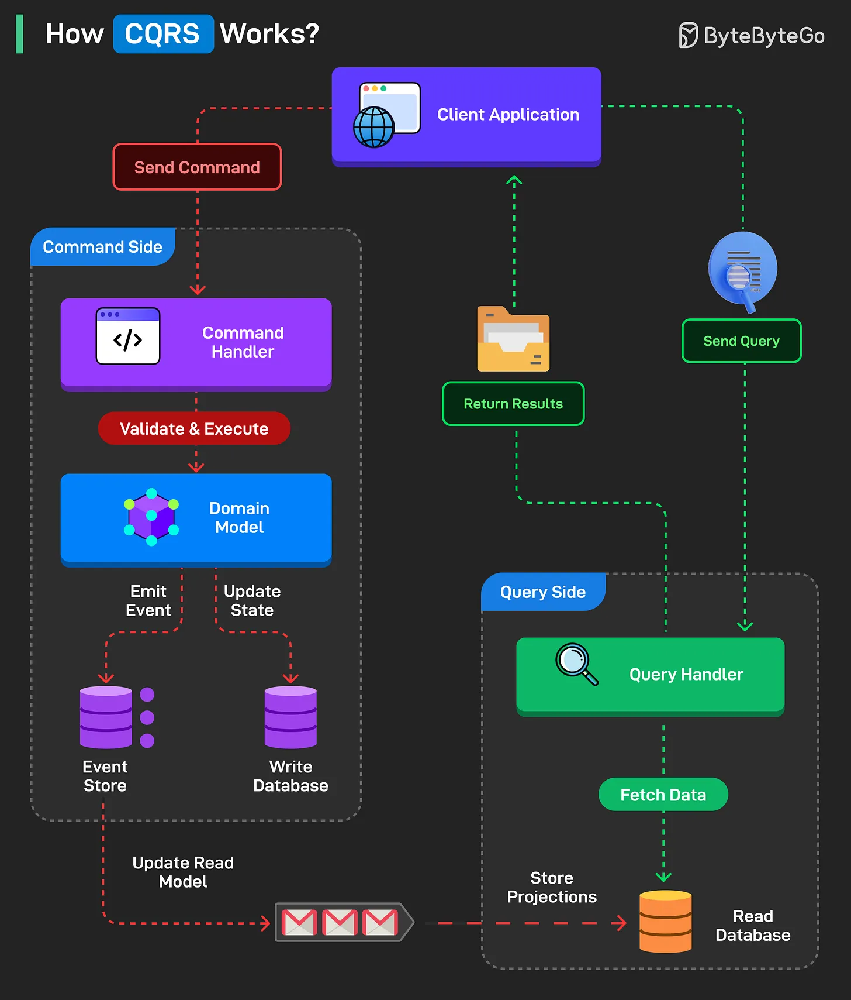

# 102 - CQRS hoạt động như thế nào?

- Nguồn: ByteByteGo Big Archive System Design 2025
- Trang PDF: 218-219
- Ảnh minh họa: `../assets/102/figure-01.png`

## Hình minh họa

## Dịch sát

CQRS (Command Query Responsibility Segregation) tách operation ghi (Command) và đọc (Query) để có scalability và maintainability tốt hơn.

Dưới đây là cách nó hoạt động:

1 - Client gửi command để update system state. Command Handler validate và execute logic bằng Domain Model.

2 - Change được lưu trong Write Database và cũng có thể được lưu vào Event Store. Event được emit để update Read Model asynchronously.

3 - Projection được lưu trong Read Database. Database này eventually consistent với Write Database.

4 - Ở query side, client gửi query để retrieve data.

5 - Query Handler fetch data từ Read Database, nơi chứa precomputed projection.

6 - Result được trả về client mà không hit write model hoặc write database.

Câu hỏi dành cho bạn: Bạn sẽ thêm gì để hiểu CQRS?

## Dịch nội dung trong hình

- `Command Side`: client application gửi command; `Command Handler` validate & execute; `Domain Model` emit event/update state; dữ liệu ghi vào `Event Store` và `Write Database`; event update read model.
- `Query Side`: client gửi query; `Query Handler` fetch data từ `Read Database`; read database lưu projection; result trả lại client.
- Read side và write side giao tiếp bất đồng bộ qua event/projection.

## Tóm tắt & giải thích dễ hiểu

CQRS tách đường ghi và đường đọc. Đường ghi tập trung vào business rule, validation và consistency. Đường đọc tập trung vào query nhanh, có thể dùng schema/projection tối ưu cho UI/report. Vì read model cập nhật async, dữ liệu đọc có thể trễ một chút so với write model.

CQRS phù hợp khi workload đọc/ghi khác biệt lớn, domain phức tạp hoặc cần nhiều read view tối ưu. Với CRUD app đơn giản, CQRS có thể là overkill.

## Ví dụ thực tế - không nằm trong tài liệu gốc

Trong hệ thống order, command `PlaceOrder` kiểm tra inventory, payment và rule nghiệp vụ rồi ghi vào write DB/event store. Read model có thể lưu sẵn view `OrderSummary` cho màn hình admin, giúp query nhanh mà không join nhiều bảng mỗi lần.

## Thuật ngữ chính

- `CQRS`: Command Query Responsibility Segregation.
- `Command`: yêu cầu thay đổi state.
- `Query`: yêu cầu đọc dữ liệu.
- `Command Handler`: xử lý command.
- `Query Handler`: xử lý query.
- `Projection`: read model được build từ dữ liệu/event.
- `Event Store`: kho lưu event.

