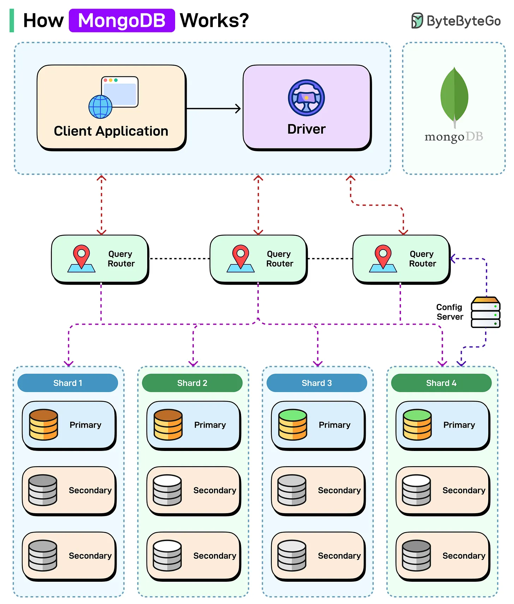

# 103 - MongoDB hoạt động như thế nào?

- Nguồn: ByteByteGo Big Archive System Design 2025
- Trang PDF: 220-221
- Ảnh minh họa: `../assets/103/figure-01.png`

## Hình minh họa

## Dịch sát

MongoDB là một NoSQL database phổ biến được thiết kế cho flexibility, scalability và high performance. Nó lưu data ở format giống JSON (BSON) và hỗ trợ horizontal scaling thông qua sharding và replication.

Dưới đây là cách nó hoạt động:

1. Client application kết nối qua MongoDB Driver để thực hiện read/write operation.

2. Query Router (`mongos`) đóng vai trò mediator, directing query tới shard phù hợp dựa trên shard key của data.

3. Config server lưu metadata và routing information. Điều này giúp query router locate data trên các shard.

4. Data được phân tán trên nhiều shard để hỗ trợ horizontal scaling.

5. Mỗi shard là một replica set gồm một primary node xử lý write và nhiều secondary node cho high availability và read scaling.

6. Nếu primary fail, một secondary sẽ được tự động elect để thay thế và duy trì availability.

Câu hỏi dành cho bạn: Bạn sẽ thêm gì để hiểu cách MongoDB hoạt động tốt hơn?

## Dịch nội dung trong hình

- `Client Application` dùng `Driver` để kết nối MongoDB.
- Request đi qua nhiều `Query Router`.
- `Config Server` lưu metadata/routing info.
- Data được chia thành `Shard 1`, `Shard 2`, `Shard 3`, `Shard 4`.
- Mỗi shard có `Primary` và nhiều `Secondary`, thể hiện replica set.

## Tóm tắt & giải thích dễ hiểu

MongoDB lưu document BSON linh hoạt hơn table row truyền thống. Để scale ngang, MongoDB chia data theo shard key. Query router dùng metadata từ config server để biết query nên đi tới shard nào. Mỗi shard lại là replica set để tăng availability.

Thiết kế shard key rất quan trọng. Shard key xấu có thể tạo hot shard, query fan-out nhiều shard hoặc khó scale khi data tăng.

## Ví dụ thực tế - không nằm trong tài liệu gốc

Một app log event có thể shard theo `tenant_id` hoặc `user_id` nếu query thường lọc theo tenant/user. Nếu shard theo timestamp đơn điệu, write mới có thể dồn vào một shard gây hot spot. Với read-heavy workload, secondary có thể phục vụ một số read nếu chấp nhận dữ liệu hơi trễ.

## Thuật ngữ chính

- `BSON`: Binary JSON format của MongoDB.
- `Shard`: phần dữ liệu được chia để scale ngang.
- `Shard key`: key quyết định document nằm ở shard nào.
- `mongos`: query router của MongoDB sharded cluster.
- `Config server`: lưu metadata sharding.
- `Replica set`: nhóm node sao chép dữ liệu.
- `Primary/Secondary`: node ghi chính và node replica.

## Câu hỏi ôn tập + trả lời + thinking học tập + liên hệ

> Đây là phần học tập thêm ở cuối file. Câu hỏi ưu tiên lấy từ tài liệu gốc và được trả lời trực tiếp; nếu bài không có câu hỏi riêng thì dùng tiêu đề/nội dung chính để tạo câu hỏi tự kiểm tra.

### Câu hỏi 1

**Nguồn câu hỏi:** Câu hỏi trong tài liệu gốc.

**Câu hỏi:** Bạn sẽ thêm gì để hiểu cách MongoDB hoạt động tốt hơn?

**Trả lời:** Có thể thêm query plan/EXPLAIN để biết bottleneck thật; transaction isolation để tránh race condition và dirty read; connection pooling/backpressure để database không bị quá tải; và cache invalidation strategy rõ ràng. Các mục này giúp bức tranh đầy đủ hơn vì chúng chạm vào phần triển khai/vận hành mà bài gốc chưa đi sâu. Ý chính đang có của bài là: MongoDB lưu document BSON linh hoạt hơn table row truyền thống. Để scale ngang, MongoDB chia data theo shard key. Query router dùng metadata từ config server để biết query nên đi tới shard nào. Mỗi shard lại là replica set để tăng availability. Thiết kế shard key rất quan trọng. Shard key xấu có thể tạo hot shard, query fan-out nhiều shard hoặc khó scale khi data tăng.

**Thinking học tập + liên hệ:** Đừng thêm mục cho dài danh sách; với `MongoDB hoạt động như thế nào?`, chỉ thêm thứ mở ra một nhóm vấn đề mới hoặc giúp ra quyết định thiết kế tốt hơn. Lens chính là read/write ratio, consistency, cardinality, query pattern, growth rate và recovery requirement. Khi gặp bài toán dữ liệu, hãy nối bài học với truy vấn nóng nhất, index thật sự được dùng, cache nào có thể stale và thời gian restore sau sự cố. Khi ghi chú lại, hãy giải thích được các keyword: `BSON`, `Shard`, `Shard key`, `mongos`, `Config server`.
