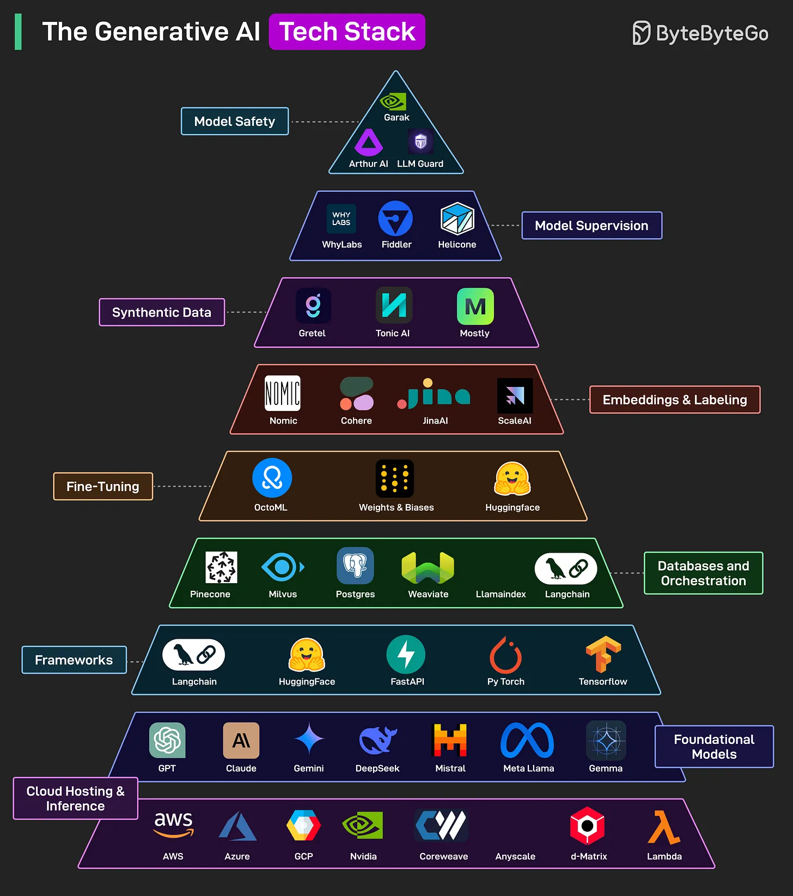

# 104 - Generative AI Tech Stack

- Nguồn: ByteByteGo Big Archive System Design 2025
- Trang PDF: 222-223
- Ảnh minh họa: `../assets/104/figure-01.png`

## Hình minh họa

## Dịch sát

GenAI chỉ các system có khả năng tạo content mới, chẳng hạn text, image, code hoặc music, bằng cách học pattern từ existing data. Dưới đây là các building block chính cho GenAI Tech Stack:

1. Cloud Hosting & Inference: Provider như AWS, GCP, Azure và Nvidia cung cấp infrastructure để chạy và scale AI workload.

2. Foundational Models: Core LLM như GPT, Claude, Mistral, Llama, Gemini, Deepseek được train trên massive data, tạo nền tảng cho tất cả GenAI application.

3. Frameworks: Tool như LangChain, PyTorch và Hugging Face giúp build, deploy và integrate model vào app.

4. Databases and Orchestration: Vector DB như Pinecone, Weaviate và orchestration tool như LangChain, LlamaIndex quản lý memory, retrieval và logic flow.

5. Fine-Tuning: Platform như Weights & Biases, OctoML và Hugging Face cho phép train model cho task hoặc domain cụ thể.

6. Embeddings and Labeling: Service như Cohere, Scale AI, Nomic và JinaAI giúp generate và label vector representation để power search và RAG system.

7. Synthetic Data: Tool như Gretel, Tonic AI và Mostly AI tạo artificial dataset để tăng cường training.

8. Model Supervision: Monitor model performance, bias và behavior. Tool như Fiddler, Helicone và WhyLabs hỗ trợ việc này.

9. Model Safety: Giúp bảo đảm deployment GenAI system có đạo đức, secure và safe. Solution như LLM Guard, Arthur AI và Garak hỗ trợ việc này.

Câu hỏi dành cho bạn: Bạn sẽ thêm gì khác vào danh sách này?

## Dịch nội dung trong hình

- `Cloud Hosting & Inference`: AWS, Azure, GCP, Nvidia, CoreWeave, Lambda, RunPod, Modal.
- `Foundational Models`: GPT, Claude, Gemini, DeepSeek, Mistral, Meta Llama, Gemma.
- `Frameworks`: LangChain, Hugging Face, FastAPI, PyTorch, TensorFlow.
- `Databases and Orchestration`: Pinecone, Milvus, Postgres, Weaviate, LlamaIndex, LangGraph.
- `Fine-Tuning`: OctoML, Weights & Biases, Hugging Face.
- `Embeddings & Labeling`: Nomic, Cohere, JinaAI, Scale AI.
- `Synthetic Data`: Gretel, Tonic AI, Mostly AI và các tool synthetic data khác.
- `Model Supervision`: Fiddler, Helicone, WhyLabs.
- `Model Safety`: Garak, Arthur AI, LLM Guard.

## Tóm tắt & giải thích dễ hiểu

GenAI production stack không chỉ có model. Bạn cần hạ tầng inference, model nền tảng, framework tích hợp, vector database/RAG, fine-tuning, embedding, dữ liệu synthetic, monitoring/supervision và safety guardrails. Mỗi lớp giải quyết một rủi ro khác nhau: latency, cost, quality, domain fit, dữ liệu, hallucination, bias và security.

Khi build thực tế, nên bắt đầu nhỏ: chọn model, build prompt/RAG, đo chất lượng, rồi mới thêm fine-tuning hoặc multi-agent nếu thật sự cần.

## Ví dụ thực tế - không nằm trong tài liệu gốc

Một GenAI app tạo mô tả sản phẩm có thể dùng GPT/Claude, backend FastAPI, vector DB cho brand guideline, embedding để retrieve context, Helicone để observe cost/latency, LLM Guard để lọc prompt injection và Weights & Biases để theo dõi fine-tuning nếu cần.

## Thuật ngữ chính

- `GenAI`: Generative AI.
- `Inference`: chạy model để tạo output.
- `Foundational model`: model nền tảng train trên dữ liệu lớn.
- `Fine-tuning`: train thêm cho domain/task cụ thể.
- `Embedding`: vector biểu diễn dữ liệu.
- `Synthetic data`: dữ liệu nhân tạo.
- `Model supervision`: theo dõi hành vi/chất lượng model.
- `Model safety`: kiểm soát rủi ro an toàn/bảo mật/đạo đức.

## Câu hỏi ôn tập + trả lời + thinking học tập + liên hệ

> Đây là phần học tập thêm ở cuối file. Câu hỏi ưu tiên lấy từ tài liệu gốc và được trả lời trực tiếp; nếu bài không có câu hỏi riêng thì dùng tiêu đề/nội dung chính để tạo câu hỏi tự kiểm tra.

### Câu hỏi 1

**Nguồn câu hỏi:** Câu hỏi trong tài liệu gốc.

**Câu hỏi:** Bạn sẽ thêm gì khác vào danh sách này?

**Trả lời:** Có thể thêm evaluation harness để đo chất lượng thay vì cảm tính; guardrails/policy để giảm prompt injection và output nguy hiểm; observability cho prompt, context, latency, cost và hallucination; và model routing theo độ khó/cost của request. Các mục này giúp bức tranh đầy đủ hơn vì chúng chạm vào phần triển khai/vận hành mà bài gốc chưa đi sâu. Ý chính đang có của bài là: GenAI production stack không chỉ có model. Bạn cần hạ tầng inference, model nền tảng, framework tích hợp, vector database/RAG, fine-tuning, embedding, dữ liệu synthetic, monitoring/supervision và safety guardrails. Mỗi lớp giải quyết một rủi ro khác nhau: latency, cost, quality, domain fit, dữ liệu, hallucination, bias và security.

**Thinking học tập + liên hệ:** Danh sách trong `Generative AI Tech Stack` nên được kiểm theo coverage: nó đã nói phần nào, thiếu phần nào và phần thiếu có làm thay đổi quyết định thiết kế không. Lens chính là quality, latency, cost/token, privacy, cập nhật tri thức và rủi ro hallucination. Khi build AI app, hãy nối model với pipeline thật: data vào đâu, context lấy từ đâu, output được kiểm thế nào và chi phí tăng theo traffic ra sao. Khi ghi chú lại, hãy giải thích được các keyword: `GenAI`, `Inference`, `Foundational model`, `Fine-tuning`, `Embedding`.
