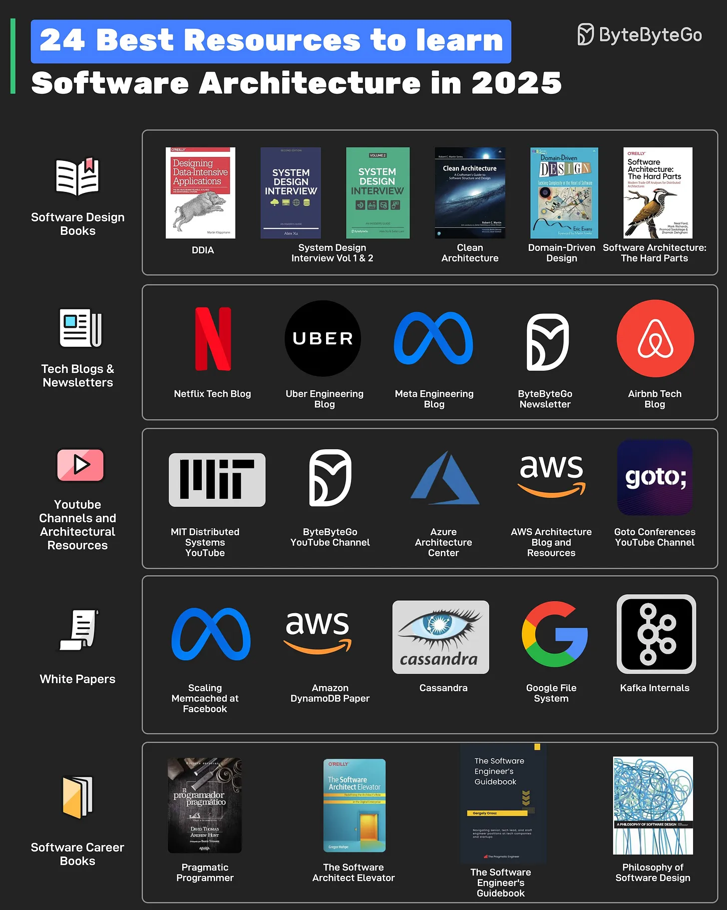

# 105 - 24 nguồn tốt để học Software Architecture trong năm 2025

- Nguồn: ByteByteGo Big Archive System Design 2025
- Trang PDF: 224-225
- Ảnh minh họa: `../assets/105/figure-01.png`

## Hình minh họa

## Dịch sát

Các resource có thể được chia thành nhiều type khác nhau như:

1. Software Design Books
   Một số book có thể giúp ích là DDIA, System Design Volume 1 & 2, Clean Architecture, Domain-Driven Design và Software Architecture: the Hard Parts.

2. Tech Blogs and Newsletters
   Đọc technical blog của các công ty như Netflix, Uber, Meta và Airbnb. Ngoài ra, ByteByteGo newsletter cung cấp insight về software design mỗi tuần.

3. YouTube Channels and Architectural Resources
   YouTube channel như MIT Distributed Systems, Goto Conferences và ByteByteGo có thể giúp học software architecture và system design. Azure Architecture Center và AWS Architecture Blog cũng là các resource quan trọng.

4. WhitePapers
   Để có insight sâu hơn, đọc các whitepaper như Facebook Memcache Scaling, Cassandra, Amazon DynamoDB, Kafka và Google File System.

5. Software Career Books
   Một Software Architect cũng cần phát triển holistic skills. Các book về khía cạnh software career như Pragmatic Programmer, The Software Architect Elevator, The Software Engineer's Guidebook và Philosophy of Software Design có thể giúp ích.

Câu hỏi dành cho bạn: Bạn sẽ thêm resource nào khác vào danh sách?

## Dịch nội dung trong hình

- `Software Design Books`: DDIA, System Design Interview Vol. 1 & 2, Clean Architecture, Domain-Driven Design, Software Architecture: The Hard Parts.
- `Tech Blogs & Newsletters`: Netflix Tech Blog, Uber Engineering Blog, Meta Engineering Blog, ByteByteGo Newsletter, Airbnb Tech Blog.
- `YouTube Channels and Architectural Resources`: MIT Distributed Systems, ByteByteGo YouTube Channel, Azure Architecture Center, AWS Architecture Blog and Resources, GOTO Conferences YouTube Channel.
- `White Papers`: Facebook Memcached at Facebook, Amazon DynamoDB Paper, Cassandra, Google File System, Kafka.
- `Software Career Books`: Pragmatic Programmer, The Software Architect Elevator, The Software Engineer's Guidebook, Philosophy of Software Design.

## Tóm tắt & giải thích dễ hiểu

Học software architecture nên kết hợp ba nguồn: sách để có nền tảng, engineering blog/whitepaper để học quyết định thực tế ở scale lớn, và video/newsletter để cập nhật dễ hơn. Architecture không chỉ là pattern; nó còn là trade-off, teamwork, communication và khả năng đưa hệ thống tiến hóa theo thời gian.

## Ví dụ thực tế - không nằm trong tài liệu gốc

Một lộ trình học tốt: đọc DDIA để hiểu data system, Clean Architecture/DDD để hiểu boundary, xem MIT Distributed Systems để nắm consensus/failure, đọc Netflix/Uber/Meta blog để thấy production trade-off, rồi tự thiết kế case như URL shortener, payment system hoặc notification platform.

## Thuật ngữ chính

- `Software architecture`: cấu trúc cấp cao và trade-off của hệ thống.
- `DDIA`: Designing Data-Intensive Applications.
- `Whitepaper`: tài liệu kỹ thuật chuyên sâu.
- `Domain-Driven Design`: thiết kế theo domain nghiệp vụ.
- `Clean Architecture`: kiến trúc tách dependency theo layer/boundary.
- `System design`: thiết kế hệ thống đáp ứng requirement.
- `Trade-off`: đánh đổi giữa nhiều mục tiêu.

## Câu hỏi ôn tập + trả lời + thinking học tập + liên hệ

> Đây là phần học tập thêm ở cuối file. Câu hỏi ưu tiên lấy từ tài liệu gốc và được trả lời trực tiếp; nếu bài không có câu hỏi riêng thì dùng tiêu đề/nội dung chính để tạo câu hỏi tự kiểm tra.

### Câu hỏi 1

**Nguồn câu hỏi:** Câu hỏi trong tài liệu gốc.

**Câu hỏi:** Bạn sẽ thêm resource nào khác vào danh sách?

**Trả lời:** Phần còn thiếu đáng cân nhắc là capacity estimation trước khi chọn kiến trúc; SLO/NFR rõ cho latency, availability và durability; graceful degradation khi dependency hỏng; và data ownership và service boundary. Các mục này giúp bức tranh đầy đủ hơn vì chúng chạm vào phần triển khai/vận hành mà bài gốc chưa đi sâu. Ý chính đang có của bài là: Học software architecture nên kết hợp ba nguồn: sách để có nền tảng, engineering blog/whitepaper để học quyết định thực tế ở scale lớn, và video/newsletter để cập nhật dễ hơn. Architecture không chỉ là pattern; nó còn là trade-off, teamwork, communication và khả năng đưa hệ thống tiến hóa theo thời gian.

**Thinking học tập + liên hệ:** Danh sách trong `24 nguồn tốt để học Software Architecture trong năm 2025` nên được kiểm theo coverage: nó đã nói phần nào, thiếu phần nào và phần thiếu có làm thay đổi quyết định thiết kế không. Lens chính là requirement, constraint, traffic, dữ liệu, failure mode và khả năng vận hành của team. Khi gặp system design thật, hãy biến khái niệm thành quyết định: boundary ở đâu, data flow thế nào, bottleneck nào đến trước và rollback ra sao. Khi ghi chú lại, hãy giải thích được các keyword: `Software architecture`, `DDIA`, `Whitepaper`, `Domain-Driven Design`, `Clean Architecture`.
