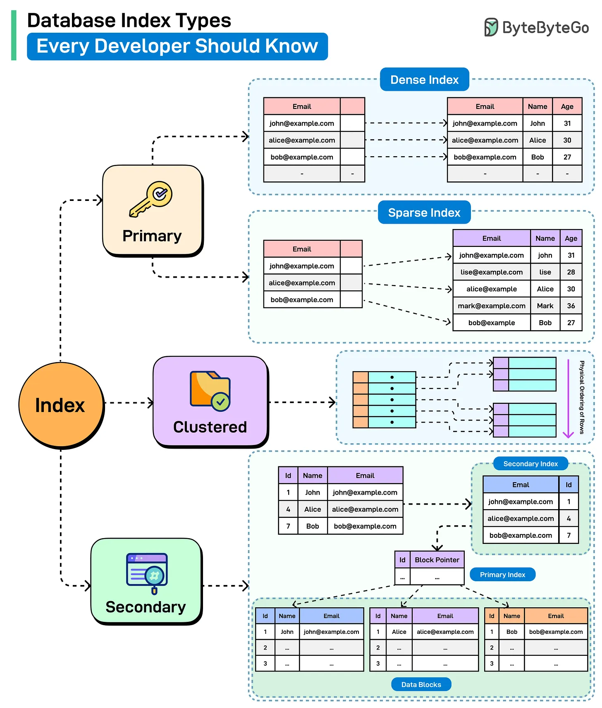

# 106 - Các loại database index mọi developer nên biết

- Nguồn: ByteByteGo Big Archive System Design 2025
- Trang PDF: 226-227
- Ảnh minh họa: `../assets/106/figure-01.png`

## Hình minh họa

## Dịch sát

Database index là một derived structure map column value tới physical location của row trong table. Hãy xem một số key index type:

1. Primary Index
   Index này được tự động tạo khi primary key được define trên table. Index như vậy có thể dense cũng như sparse, dù sparse được prefer trong hầu hết scenario. Dense index chứa một entry cho mỗi row trong table. Ngược lại, sparse index chỉ chứa entry cho một số row trong table.

2. Clustered Index
   Clustered index quyết định physical order của row trong table. Chỉ một clustered index có thể tồn tại trên một table vì data chỉ có thể được lưu theo một order tại một thời điểm. Nó rất tốt cho range query, ordered scan và I/O efficiency.

3. Secondary Index
   Non-clustered index là một structure riêng biệt giữ bản copy của một hoặc nhiều column cùng với pointer tới row thật trong table. Nó không ảnh hưởng tới cách data được lưu vật lý, và nó có thể dùng primary index để locate record.

Câu hỏi dành cho bạn: Bạn sẽ thêm index type nào khác vào danh sách?

## Dịch nội dung trong hình

- `Index` chia thành `Primary`, `Clustered`, `Secondary`.
- `Primary`: minh họa dense index có entry cho từng row và sparse index có entry cho một số block/range.
- `Clustered`: dữ liệu table được sắp theo index key; phù hợp scan/range.
- `Secondary`: index phụ trỏ tới primary index hoặc block pointer để tìm row thật.

## Tóm tắt & giải thích dễ hiểu

Index giúp database tìm row nhanh hơn bằng cách lưu cấu trúc tra cứu phụ. Primary index thường gắn với khóa chính. Clustered index ảnh hưởng tới thứ tự lưu vật lý nên chỉ có một. Secondary/non-clustered index là cấu trúc riêng, giúp query theo column khác nhưng cần thêm bước lookup về row thật.

Index tăng tốc read nhưng làm write chậm hơn và tốn storage vì mỗi insert/update/delete có thể phải cập nhật index. Vì vậy không nên tạo index bừa bãi.

## Ví dụ thực tế - không nằm trong tài liệu gốc

Nếu bảng `orders` thường query theo `user_id` và `created_at`, index `(user_id, created_at)` có thể giúp lấy lịch sử đơn hàng nhanh. Nhưng nếu thêm index cho mọi column, write order sẽ chậm và database tốn thêm disk/RAM.

## Thuật ngữ chính

- `Index`: cấu trúc tra cứu giúp tìm dữ liệu nhanh.
- `Primary index`: index gắn với primary key.
- `Dense index`: có entry cho mỗi row.
- `Sparse index`: chỉ có entry cho một số row/block.
- `Clustered index`: quyết định thứ tự lưu vật lý.
- `Secondary index`: index phụ không quyết định thứ tự lưu.
- `Range query`: query theo khoảng giá trị.

