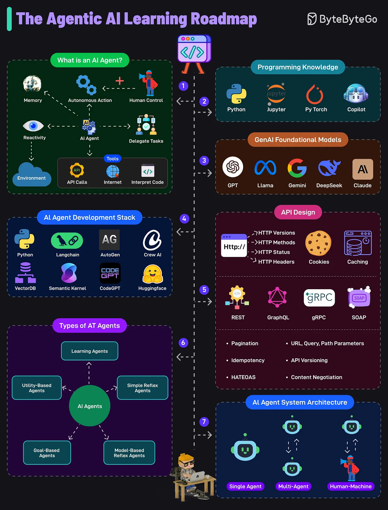

# 107 - Roadmap học Agentic AI

- Nguồn: ByteByteGo Big Archive System Design 2025
- Trang PDF: 228-229
- Ảnh minh họa: `../assets/107/figure-01.png`

## Hình minh họa

## Dịch sát

1. AI Agent là một system có khả năng autonomous action, phản ứng với environment, dùng tool như API, Internet, code, v.v. và có thể làm việc dưới human guidance.

2. Để build AI agent, cần biết các tool như Python, Jupyter, PyTorch và GitHub Copilot. Những tool này hỗ trợ coding, experimentation và integration với AI library/API.

3. GenAI Foundational Models
   Familiarity với các large model như GPT, Gemini, LLaMa, DeepSeek và Claude là thiết yếu. Các model này cung cấp base intelligence mà agent có thể dùng cho reasoning, generation và understanding.

4. AI Agent Development Stack
   Tool như Langchain, AutoGen, Crew AI, và framework như Semantic Kernel và Hugging Face power agent workflow. Các component này quản lý task, memory và external tool integration trong agent pipeline.

5. API Design
   Hiểu API design approach như REST, GraphQL, gRPC và SOAP là rất quan trọng để build interoperable agent. Key concept gồm HTTP method, status code, versioning, cookie, header và caching.

6. Type of AI Agents
   Học về nhiều loại AI agent, chẳng hạn simple reflex, model-based reflex, goal-based, utility-based và learning agent. Mỗi loại khác nhau về complexity.

7. AI Agent System Architecture
   AI agent có thể operate như single agent, trong multi-agent system hoặc trong human-machine collaboration. Architecture phụ thuộc vào use case.

Câu hỏi dành cho bạn: Bạn sẽ thêm gì khác vào AI Agent Learning Roadmap?

## Dịch nội dung trong hình

- `What is an AI Agent?`: memory, autonomous action, human control, reactivity, environment, delegate tasks, tools gồm API calls, internet và interpret code.
- `Programming Knowledge`: Python, Jupyter, PyTorch, Copilot.
- `GenAI Foundational Models`: GPT, Llama, Gemini, DeepSeek, Claude.
- `AI Agent Development Stack`: Python, LangChain, AutoGen, Crew AI, VectorDB, Semantic Kernel, CodeGPT, Hugging Face.
- `API Design`: HTTP versions/methods/status/headers, cookies, caching, REST, GraphQL, gRPC, SOAP, pagination, idempotency, HATEOAS, URL/query/path parameters, API versioning, content negotiation.
- `Types of AI Agents`: learning, utility-based, simple reflex, goal-based, model-based reflex.
- `AI Agent System Architecture`: single agent, multi-agent, human-machine.

## Tóm tắt & giải thích dễ hiểu

Học Agentic AI cần đi từ nền tảng lập trình và model, rồi tới tool/framework, API design và kiến trúc agent. Agent không chỉ là prompt dài; nó là vòng lặp nhận goal, quan sát context, lập kế hoạch, gọi tool, đánh giá kết quả và có thể hỏi người khi cần.

API design đặc biệt quan trọng vì agent mạnh lên nhờ tool. Tool/API càng rõ schema, auth, error code và idempotency thì agent càng dễ dùng an toàn.

## Ví dụ thực tế - không nằm trong tài liệu gốc

Một roadmap thực hành: viết Python script gọi LLM, thêm function calling/tool use, kết nối vector DB, xây workflow LangGraph/CrewAI nhỏ, gọi API thật có auth, thêm human approval cho action nguy hiểm, rồi log/evaluate từng run để cải thiện chất lượng.

## Thuật ngữ chính

- `Agentic AI`: AI có khả năng hành động theo mục tiêu bằng tool/workflow.
- `Autonomous action`: hành động tự động.
- `Human guidance`: hướng dẫn/duyệt từ con người.
- `Agent framework`: framework xây workflow agent.
- `VectorDB`: database lưu/search embedding vector.
- `Idempotency`: request lặp lại không gây side effect trùng.
- `Human-machine collaboration`: phối hợp người và AI.

## Câu hỏi ôn tập + trả lời + thinking học tập + liên hệ

> Đây là phần học tập thêm ở cuối file. Câu hỏi ưu tiên lấy từ tài liệu gốc và được trả lời trực tiếp; nếu bài không có câu hỏi riêng thì dùng tiêu đề/nội dung chính để tạo câu hỏi tự kiểm tra.

### Câu hỏi 1

**Nguồn câu hỏi:** Câu hỏi trong tài liệu gốc.

**Câu hỏi:** Bạn sẽ thêm gì khác vào AI Agent Learning Roadmap?

**Trả lời:** Nên bổ sung evaluation harness để đo chất lượng thay vì cảm tính; guardrails/policy để giảm prompt injection và output nguy hiểm; observability cho prompt, context, latency, cost và hallucination; và model routing theo độ khó/cost của request. Các mục này giúp bức tranh đầy đủ hơn vì chúng chạm vào phần triển khai/vận hành mà bài gốc chưa đi sâu. Ý chính đang có của bài là: Học Agentic AI cần đi từ nền tảng lập trình và model, rồi tới tool/framework, API design và kiến trúc agent. Agent không chỉ là prompt dài; nó là vòng lặp nhận goal, quan sát context, lập kế hoạch, gọi tool, đánh giá kết quả và có thể hỏi người khi cần. API design đặc biệt quan trọng vì agent mạnh lên nhờ tool. Tool/API càng rõ schema, auth, error code và idempotency thì agent càng dễ dùng an toàn.

**Thinking học tập + liên hệ:** Đừng thêm mục cho dài danh sách; với `Roadmap học Agentic AI`, chỉ thêm thứ mở ra một nhóm vấn đề mới hoặc giúp ra quyết định thiết kế tốt hơn. Lens chính là quality, latency, cost/token, privacy, cập nhật tri thức và rủi ro hallucination. Khi build AI app, hãy nối model với pipeline thật: data vào đâu, context lấy từ đâu, output được kiểm thế nào và chi phí tăng theo traffic ra sao. Khi ghi chú lại, hãy giải thích được các keyword: `Agentic AI`, `Autonomous action`, `Human guidance`, `Agent framework`, `VectorDB`.
