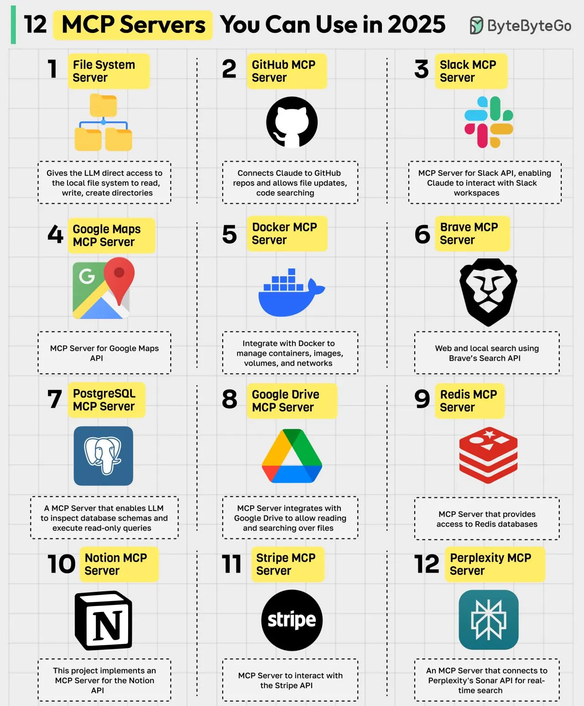

# 108 - 12 MCP Server bạn có thể dùng trong năm 2025

- Nguồn: ByteByteGo Big Archive System Design 2025
- Trang PDF: 230-231
- Ảnh minh họa: `../assets/108/figure-01.png`

## Hình minh họa

## Dịch sát

MCP (Model Context Protocol) là một open standard giúp đơn giản hóa cách AI model, đặc biệt là LLM, tương tác với external data source, tool và service. Một MCP server đóng vai trò như cầu nối giữa các AI model này và external tool. Dưới đây là các MCP server hàng đầu:

1. File System MCP Server
   Cho phép LLM truy cập trực tiếp local file system để đọc, ghi và tạo directory.

2. GitHub MCP Server
   Kết nối Claude với GitHub repo và cho phép update file, search code.

3. Slack MCP Server
   MCP Server cho Slack API, cho phép Claude tương tác với Slack workspace.

4. Google Maps MCP Server
   MCP Server cho Google Maps API.

5. Docker MCP Server
   Tích hợp với Docker để quản lý container, image, volume và network.

6. Brave MCP Server
   Web search và local search bằng Brave Search API.

7. PostgreSQL MCP Server
   MCP server cho phép LLM inspect database schema và execute read-only query.

8. Google Drive MCP Server
   MCP server tích hợp với Google Drive để cho phép đọc và search file.

9. Redis MCP Server
   MCP Server cung cấp quyền truy cập Redis database.

10. Notion MCP Server
    Project này triển khai MCP server cho Notion API.

11. Stripe MCP Server
    MCP Server để tương tác với Stripe API.

12. Perplexity MCP Server
    MCP Server kết nối tới Perplexity Sonar API cho real-time search.

Câu hỏi dành cho bạn: Bạn sẽ thêm MCP Server nào khác vào danh sách?

## Dịch nội dung trong hình

Hình liệt kê 12 MCP server giống phần text: File System, GitHub, Slack, Google Maps, Docker, Brave, PostgreSQL, Google Drive, Redis, Notion, Stripe và Perplexity. Mỗi MCP server mở một nhóm capability cho AI model: file, repo, workspace chat, bản đồ, container, search, database, drive/document, cache, Notion workspace, thanh toán và real-time web search.

## Tóm tắt & giải thích dễ hiểu

MCP giúp chuẩn hóa cách AI app kết nối tool bên ngoài. Thay vì hard-code integration riêng cho từng tool, một MCP server cung cấp interface rõ ràng để LLM/agent gọi tool, đọc resource hoặc lấy context. Đây là lớp rất quan trọng khi xây agent production vì nó giúp kiểm soát quyền, logging và phạm vi hành động.

Bài này trùng chủ đề với bài 074 trong cùng archive, nhưng vẫn được dịch thành file riêng để giữ đúng cấu trúc PDF.

## Ví dụ thực tế - không nằm trong tài liệu gốc

Một agent phân tích incident có thể dùng GitHub MCP để đọc code liên quan, PostgreSQL MCP để query read-only dữ liệu lỗi, Slack MCP để tóm tắt discussion và Perplexity/Brave MCP để tra cứu thông tin bên ngoài. Mỗi server nên được cấp quyền tối thiểu để giảm rủi ro.

## Thuật ngữ chính

- `MCP`: Model Context Protocol.
- `MCP Server`: server cung cấp tool/resource cho AI app.
- `Tool`: khả năng gọi hành động bên ngoài.
- `Read-only`: chỉ đọc, không sửa dữ liệu.
- `Permission`: quyền được cấp cho tool/server.
- `Real-time search`: tìm kiếm thông tin cập nhật theo thời gian thực.
- `External data source`: nguồn dữ liệu ngoài model.

## Câu hỏi ôn tập + trả lời + thinking học tập + liên hệ

> Đây là phần học tập thêm ở cuối file. Câu hỏi ưu tiên lấy từ tài liệu gốc và được trả lời trực tiếp; nếu bài không có câu hỏi riêng thì dùng tiêu đề/nội dung chính để tạo câu hỏi tự kiểm tra.

### Câu hỏi 1

**Nguồn câu hỏi:** Câu hỏi trong tài liệu gốc.

**Câu hỏi:** Bạn sẽ thêm MCP Server nào khác vào danh sách?

**Trả lời:** Nên bổ sung evaluation harness để đo chất lượng thay vì cảm tính; guardrails/policy để giảm prompt injection và output nguy hiểm; observability cho prompt, context, latency, cost và hallucination; và model routing theo độ khó/cost của request. Các mục này giúp bức tranh đầy đủ hơn vì chúng chạm vào phần triển khai/vận hành mà bài gốc chưa đi sâu. Ý chính đang có của bài là: MCP giúp chuẩn hóa cách AI app kết nối tool bên ngoài. Thay vì hard-code integration riêng cho từng tool, một MCP server cung cấp interface rõ ràng để LLM/agent gọi tool, đọc resource hoặc lấy context. Đây là lớp rất quan trọng khi xây agent production vì nó giúp kiểm soát quyền, logging và phạm vi hành động.

**Thinking học tập + liên hệ:** Đừng thêm mục cho dài danh sách; với `12 MCP Server bạn có thể dùng trong năm 2025`, chỉ thêm thứ mở ra một nhóm vấn đề mới hoặc giúp ra quyết định thiết kế tốt hơn. Lens chính là quality, latency, cost/token, privacy, cập nhật tri thức và rủi ro hallucination. Khi build AI app, hãy nối model với pipeline thật: data vào đâu, context lấy từ đâu, output được kiểm thế nào và chi phí tăng theo traffic ra sao. Khi ghi chú lại, hãy giải thích được các keyword: `MCP`, `MCP Server`, `Tool`, `Read-only`, `Permission`.
