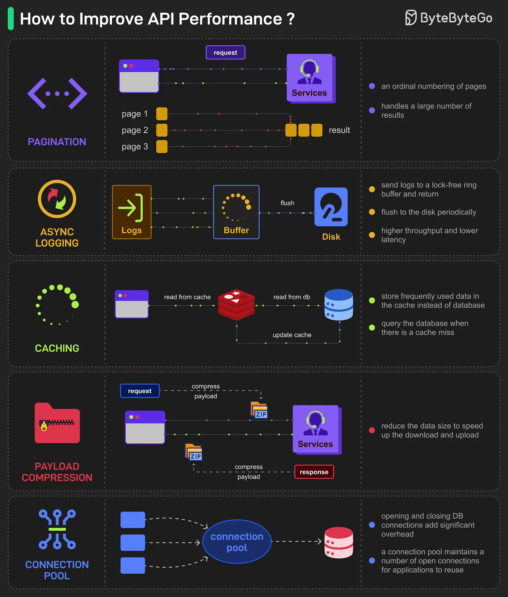

# 109 - 5 cách phổ biến để cải thiện API performance

- Nguồn: ByteByteGo Big Archive System Design 2025
- Trang PDF: 232-233
- Ảnh minh họa: `../assets/109/figure-01.png`

## Hình minh họa

## Dịch sát

- Result Pagination:
  Phương pháp này được dùng để optimize large result set bằng cách stream chúng trở lại client, cải thiện service responsiveness và user experience.

- Asynchronous Logging:
  Cách tiếp cận này gửi log tới lock-free buffer và return ngay lập tức, thay vì xử lý disk ở mọi call. Log được flush định kỳ xuống disk, giảm đáng kể I/O overhead.

- Data Caching:
  Data được truy cập thường xuyên có thể được lưu trong cache để tăng tốc retrieval. Client kiểm tra cache trước khi query database; các data storage solution như Redis cho access nhanh hơn nhờ in-memory storage.

- Payload Compression:
  Để giảm thời gian truyền data, request và response có thể được compress, ví dụ dùng gzip, giúp upload và download nhanh hơn.

- Connection Pooling:
  Technique này dùng một pool các connection đang mở để quản lý database interaction, giúp giảm overhead liên quan tới việc mở và đóng connection mỗi lần cần load data. Pool quản lý lifecycle của connection để dùng resource hiệu quả.

Câu hỏi dành cho bạn: Bạn dùng cách nào khác để cải thiện API performance?

## Dịch nội dung trong hình

- `Pagination`: gửi result theo page, ví dụ page 1/page 2/page 3, thay vì trả toàn bộ data một lần.
- `Async Logging`: ghi log vào buffer/lock-free ring rồi flush xuống disk theo batch.
- `Caching`: đọc từ cache như Redis trước, nếu miss mới đọc database và update cache.
- `Payload Compression`: compress request/response payload bằng gzip để giảm data truyền qua mạng.
- `Connection Pool`: tái sử dụng connection đã mở thay vì liên tục open/close connection tới database.

## Tóm tắt & giải thích dễ hiểu

API chậm thường do payload quá lớn, DB bị gọi quá nhiều, I/O log blocking, mỗi request mở connection mới hoặc trả quá nhiều dữ liệu. Năm cách trong bài tập trung giảm work per request: chia nhỏ kết quả, ghi log bất đồng bộ, cache dữ liệu nóng, nén payload và tái sử dụng connection.

Không nên tối ưu mù. Cần đo latency theo từng đoạn: network, gateway, app, DB, cache, serialization, logging. Sau đó tối ưu đúng bottleneck.

## Ví dụ thực tế - không nằm trong tài liệu gốc

API `GET /orders` nên dùng `limit`/`cursor`, cache danh mục sản phẩm trong Redis, bật gzip/br cho JSON lớn, dùng connection pool 20-50 connection tùy DB và ghi access log qua queue/buffer thay vì sync write từng request.

## Thuật ngữ chính

- `Pagination`: phân trang dữ liệu.
- `Asynchronous logging`: ghi log bất đồng bộ.
- `Cache`: bộ nhớ tạm để đọc nhanh.
- `Payload compression`: nén payload request/response.
- `Connection pool`: nhóm connection tái sử dụng.
- `I/O overhead`: chi phí đọc/ghi thiết bị hoặc network.
- `Latency`: độ trễ phản hồi.

## Câu hỏi ôn tập + trả lời + thinking học tập + liên hệ

> Đây là phần học tập thêm ở cuối file. Câu hỏi ưu tiên lấy từ tài liệu gốc và được trả lời trực tiếp; nếu bài không có câu hỏi riêng thì dùng tiêu đề/nội dung chính để tạo câu hỏi tự kiểm tra.

### Câu hỏi 1

**Nguồn câu hỏi:** Câu hỏi trong tài liệu gốc.

**Câu hỏi:** Bạn dùng cách nào khác để cải thiện API performance?

**Trả lời:** Nên bổ sung idempotency key cho API ghi dữ liệu hoặc payment; OpenAPI/contract validation để giảm sai lệch client-server; correlation id/distributed tracing để debug production; và threat modeling theo OWASP API Top 10. Các mục này giúp bức tranh đầy đủ hơn vì chúng chạm vào phần triển khai/vận hành mà bài gốc chưa đi sâu. Ý chính đang có của bài là: API chậm thường do payload quá lớn, DB bị gọi quá nhiều, I/O log blocking, mỗi request mở connection mới hoặc trả quá nhiều dữ liệu. Năm cách trong bài tập trung giảm work per request: chia nhỏ kết quả, ghi log bất đồng bộ, cache dữ liệu nóng, nén payload và tái sử dụng connection.

**Thinking học tập + liên hệ:** Khi bài hỏi còn thiếu gì trong `5 cách phổ biến để cải thiện API performance`, hãy so danh sách hiện tại với nhu cầu production: scale, debug, security, cost và vận hành. Lens chính là actor, trust boundary, dữ liệu nhạy cảm, lifetime của token/key, quyền truy cập và cơ chế revoke. Khi làm API thật, một endpoint chạy được chưa đủ; phải kiểm thêm abuse, audit log, error leakage, rate limit và quyền ở service chứa dữ liệu. Khi ghi chú lại, hãy giải thích được các keyword: `Pagination`, `Asynchronous logging`, `Cache`, `Payload compression`, `Connection pool`.
