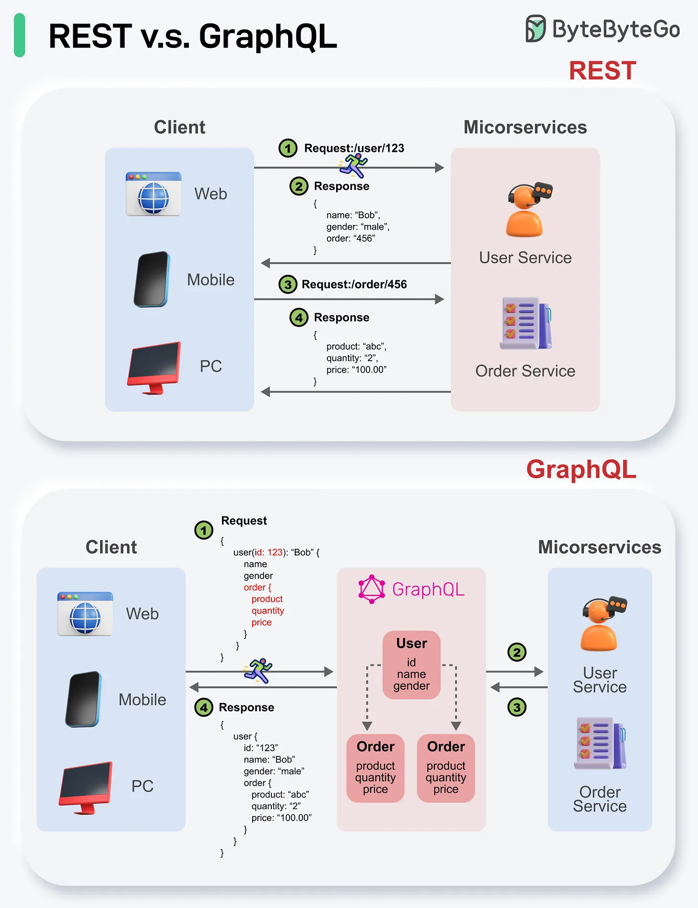

# 110 - REST API vs GraphQL

- Nguồn: ByteByteGo Big Archive System Design 2025
- Trang PDF: 234-235
- Ảnh minh họa: `../assets/110/figure-01.png`

## Hình minh họa

## Dịch sát

Khi nói tới API design, REST và GraphQL mỗi bên có điểm mạnh và điểm yếu riêng.

REST

- Dùng standard HTTP method như GET, POST, PUT, DELETE cho CRUD operation.
- Hoạt động tốt khi bạn cần interface đơn giản, thống nhất giữa các service/application riêng biệt.
- Caching strategy dễ implement.
- Nhược điểm là có thể cần nhiều roundtrip để assemble related data từ các endpoint riêng biệt.

GraphQL

- Cung cấp một endpoint duy nhất để client query đúng data họ cần.
- Client chỉ định exact field cần thiết trong nested query, và server trả optimized payload chỉ chứa các field đó.
- Hỗ trợ Mutation để modify data và Subscription cho real-time notification.
- Rất tốt để aggregate data từ nhiều source và phù hợp với frontend requirement thay đổi nhanh.
- Tuy nhiên, nó chuyển complexity sang client side và có thể cho phép abusive query nếu không được safeguard đúng cách.
- Caching strategy có thể phức tạp hơn REST.

Lựa chọn tốt nhất giữa REST và GraphQL phụ thuộc vào requirement cụ thể của application và development team. GraphQL phù hợp với frontend need phức tạp hoặc thường xuyên thay đổi, còn REST phù hợp với application ưu tiên contract đơn giản và nhất quán.

## Dịch nội dung trong hình

- `REST`: client web/mobile/PC gọi nhiều endpoint như `/user/123` và `/order/456`; response trả về JSON riêng cho từng microservice như User Service, Order Service.
- `GraphQL`: client gửi một query tới GraphQL endpoint, chỉ lấy các field cần như user id/name/gender/product info; GraphQL layer aggregate data từ User Service và Order Service rồi trả response đúng shape.

## Tóm tắt & giải thích dễ hiểu

REST giống nhiều cửa rõ ràng, mỗi endpoint đại diện một resource. GraphQL giống một cửa linh hoạt, client mô tả chính xác dữ liệu cần lấy. REST dễ cache, debug và enforce contract. GraphQL giảm over-fetching/under-fetching nhưng cần kiểm soát query depth, complexity, auth field-level và caching.

Không nên chọn GraphQL chỉ vì mới hơn. Nếu API public đơn giản và contract ổn định, REST rất tốt. Nếu frontend cần dữ liệu nested từ nhiều service và thay đổi liên tục, GraphQL có thể đáng giá.

## Ví dụ thực tế - không nằm trong tài liệu gốc

Mobile home screen cần user profile, cart count, recommendation và notification. Với REST, client có thể phải gọi 4 endpoint. Với GraphQL, client gửi một query duy nhất lấy đúng field cần. Nhưng server phải chặn query quá sâu để tránh làm sập backend.

## Thuật ngữ chính

- `REST`: API style dựa trên HTTP resource.
- `GraphQL`: query language/API runtime cho dữ liệu có schema.
- `Mutation`: GraphQL operation thay đổi data.
- `Subscription`: GraphQL real-time update.
- `Over-fetching`: lấy nhiều dữ liệu hơn cần.
- `Under-fetching`: phải gọi thêm API vì thiếu dữ liệu.
- `Query complexity`: độ phức tạp/tốn tài nguyên của query.

