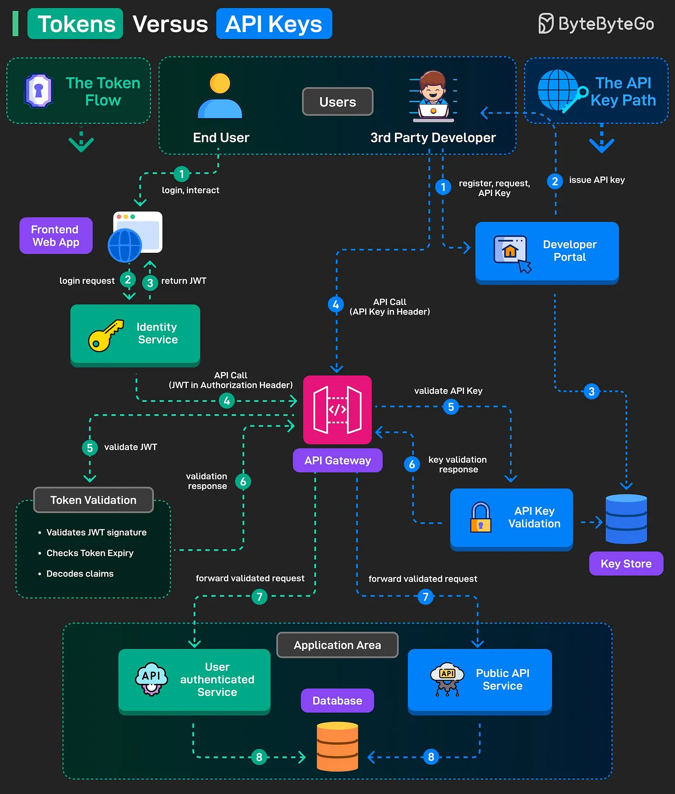

# 111 - Token vs API Key

- Nguồn: ByteByteGo Big Archive System Design 2025
- Trang PDF: 236-237
- Ảnh minh họa: `../assets/111/figure-01.png`

## Hình minh họa

## Dịch sát

Cả token như JWT và API key đều được dùng cho authentication và authorization, nhưng chúng phục vụ các mục đích khác nhau. Hãy hiểu simplified flow cho cả hai.

The Token Flow

1. End user login vào frontend web application.

2. Login credential được gửi tới Identity Service.

3. Khi authentication thành công, JWT token được issue và trả về.

4. Frontend gọi API với JWT trong Authorization header.

5. API Gateway intercept request và validate JWT gồm signature, expiry và claims.

6. Nếu valid, gateway gửi validation response.

7. Validated request được forward tới user-authenticated service.

8. Service process request và tương tác với database để trả result.

The API Key Flow

1. Third-party developer đăng ký trên Developer Portal.

2. Portal issue một API Key.

3. Key cũng được lưu trong secure key store để verification sau này.

4. Developer app gửi API request tương lai với API Key trong header.

5. API Gateway intercept request và gửi key tới API Key Validation service.

6. Validation service verify key từ key store và respond.

7. Với API key valid, gateway forward request tới public API service.

8. Service process request và access database khi cần.

Câu hỏi dành cho bạn: Bạn sẽ thêm gì khác vào phần giải thích?

## Dịch nội dung trong hình

- `Token Flow`: end user login qua frontend web app, Identity Service phát JWT, API Gateway validate JWT qua Token Validation rồi forward request tới user authenticated service.
- `Token Validation`: validate JWT signature, check token expiry và decode claims.
- `API Key Path`: third-party developer đăng ký/lấy API key qua Developer Portal; key lưu trong Key Store; app gửi API call với API key trong header; API Gateway gọi API Key Validation rồi forward tới Public API Service.

## Tóm tắt & giải thích dễ hiểu

Token thường đại diện cho một user/session/context cụ thể, có thời hạn và claim như user id, role, scope. API key thường đại diện cho một application/developer/project, dùng để định danh client app, quota, billing hoặc truy cập public API.

API key không nên được xem là đủ để xác thực user cuối. Với API gọi thay mặt user, token như OAuth access token/JWT phù hợp hơn. Với third-party integration server-to-server, API key có thể dùng nhưng cần rate limit, rotation, scope và secret storage đúng.

## Ví dụ thực tế - không nằm trong tài liệu gốc

Ứng dụng mobile gọi API nội bộ sau khi user login nên dùng access token. Một partner gọi public API để lấy catalog có thể dùng API key gắn với account partner. Nếu partner cần truy cập dữ liệu user, thường nên dùng OAuth flow để user consent và cấp token scoped.

## Thuật ngữ chính

- `Token`: credential có thể chứa claim/context.
- `API key`: key định danh app/developer/project.
- `JWT`: JSON Web Token.
- `Claim`: thông tin trong token.
- `Scope`: phạm vi quyền.
- `API Gateway`: cổng kiểm soát request.
- `Key rotation`: thay/luân phiên key định kỳ.

## Câu hỏi ôn tập + trả lời + thinking học tập + liên hệ

> Đây là phần học tập thêm ở cuối file. Câu hỏi ưu tiên lấy từ tài liệu gốc và được trả lời trực tiếp; nếu bài không có câu hỏi riêng thì dùng tiêu đề/nội dung chính để tạo câu hỏi tự kiểm tra.

### Câu hỏi 1

**Nguồn câu hỏi:** Câu hỏi trong tài liệu gốc.

**Câu hỏi:** Bạn sẽ thêm gì khác vào phần giải thích?

**Trả lời:** Nên bổ sung idempotency key cho API ghi dữ liệu hoặc payment; OpenAPI/contract validation để giảm sai lệch client-server; correlation id/distributed tracing để debug production; và threat modeling theo OWASP API Top 10. Các mục này giúp bức tranh đầy đủ hơn vì chúng chạm vào phần triển khai/vận hành mà bài gốc chưa đi sâu. Ý chính đang có của bài là: Token thường đại diện cho một user/session/context cụ thể, có thời hạn và claim như user id, role, scope. API key thường đại diện cho một application/developer/project, dùng để định danh client app, quota, billing hoặc truy cập public API. API key không nên được xem là đủ để xác thực user cuối. Với API gọi thay mặt user, token như OAuth access token/JWT phù hợp hơn. Với third-party integration server-to-server, API key có thể dùng nhưng cần rate limit, rotation, scope và secret storage đúng.

**Thinking học tập + liên hệ:** Khi bài hỏi còn thiếu gì trong `Token vs API Key`, hãy so danh sách hiện tại với nhu cầu production: scale, debug, security, cost và vận hành. Lens chính là actor, trust boundary, dữ liệu nhạy cảm, lifetime của token/key, quyền truy cập và cơ chế revoke. Khi làm API thật, một endpoint chạy được chưa đủ; phải kiểm thêm abuse, audit log, error leakage, rate limit và quyền ở service chứa dữ liệu. Khi ghi chú lại, hãy giải thích được các keyword: `Token`, `API key`, `JWT`, `Claim`, `Scope`.
