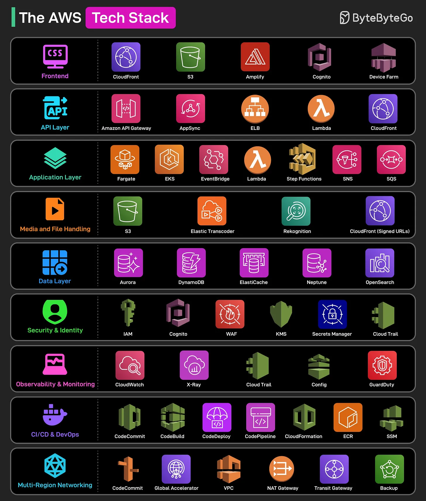

# 112 - AWS Tech Stack

- Nguồn: ByteByteGo Big Archive System Design 2025
- Trang PDF: 238-239
- Ảnh minh họa: `../assets/112/figure-01.png`

## Hình minh họa

## Dịch sát

1. Frontend
   Static website được host trên S3 và served globally qua CloudFront để có low latency. Các service khác hỗ trợ frontend development gồm Amplify, Cognito và Device Farm.

2. API Layer
   API Gateway và AppSync expose REST và GraphQL API với built-in security và throttling. Các service khác hoạt động trong area này là Lambda, ELB và CloudFront.

3. Application Layer
   Layer này host business logic. Một số service quan trọng trong layer này là Fargate, EKS, Lambda, EventBridge, Step Functions, SNS và SQS.

4. Media and File Handling
   Media được upload lên S3, transcode qua Elastic Transcoder và analyze bằng Rekognition cho moderation. CloudFront signed URL bảo đảm delivery video và file an toàn tới authenticated user.

5. Data Layer
   Các service chính cho layer này là Aurora, DynamoDB, ElastiCache, Neptune và OpenSearch.

6. Security and Identity
   Một số AWS service hỗ trợ layer này là IAM, Cognito, WAF, KMS, Secrets Manager và CloudTrail.

7. Observability and Monitoring
   CloudWatch monitor log, metric và alarm. X-Ray cung cấp tracing cho request path. CloudTrail capture API call. Config bảo đảm compliance, và GuardDuty detect security threat.

8. CI/CD and DevOps
   Các service chính dùng trong layer này là CodeCommit, CodeBuild, CodeDeploy, CodePipeline, CloudFormation, ECR và SSM.

9. Multi-Region Networking
   Route 53 và Global Accelerator bảo đảm DNS nhanh và global routing. VPC segment network trong khi NAT và Transit Gateway xử lý secure traffic flow. AWS Backup cung cấp disaster recovery cross-region.

Câu hỏi dành cho bạn: Bạn sẽ thêm service nào khác vào danh sách?

## Dịch nội dung trong hình

Hình chia AWS stack theo layer: Frontend (CSS/static, CloudFront, S3, Amplify, Cognito, Device Farm), API Layer (API Gateway, AppSync, ELB, Lambda, CloudFront), Application Layer (Fargate, EKS, EventBridge, Lambda, Step Functions, SNS, SQS), Media/File Handling (S3, Elastic Transcoder, Rekognition, CloudFront signed URL), Data Layer (Aurora, DynamoDB, ElastiCache, Neptune, OpenSearch), Security/Identity (IAM, Cognito, WAF, KMS, Secrets Manager, CloudTrail), Observability/Monitoring (CloudWatch, X-Ray, CloudTrail, Config, GuardDuty), CI/CD/DevOps (CodeCommit, CodeBuild, CodeDeploy, CodePipeline, CloudFormation, ECR, SSM), Multi-Region Networking (Route 53, Global Accelerator, VPC, NAT Gateway, Transit Gateway, Backup).

## Tóm tắt & giải thích dễ hiểu

AWS stack có thể nhìn như các lớp của một production app: frontend/CDN, API gateway, compute/business logic, media handling, data, security, observability, CI/CD và networking multi-region. Khi thiết kế, nên bắt đầu từ requirement rồi chọn service, không chọn service vì danh sách dài.

## Ví dụ thực tế - không nằm trong tài liệu gốc

Một app video nhỏ có thể dùng S3 + CloudFront cho frontend/media, API Gateway + Lambda cho API, DynamoDB/Aurora cho data, Cognito cho auth, CloudWatch/X-Ray cho monitoring và CodePipeline/ECR/EKS nếu backend containerized.

## Thuật ngữ chính

- `S3`: object storage.
- `CloudFront`: CDN của AWS.
- `API Gateway`: managed API front door.
- `Lambda`: serverless function.
- `EKS`: managed Kubernetes.
- `IAM`: identity and access management.
- `CloudWatch`: monitoring/logging.
- `Route 53`: DNS service.

