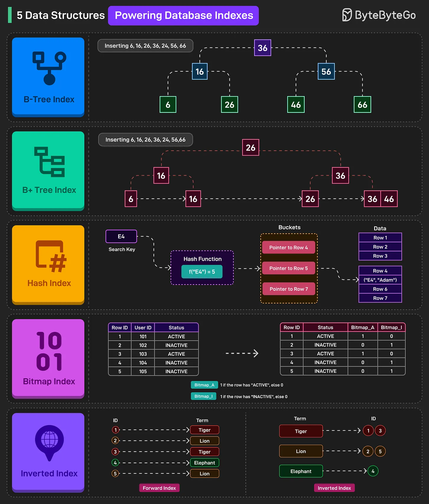

# 113 - 5 data structure giúp DB query cực nhanh

- Nguồn: ByteByteGo Big Archive System Design 2025
- Trang PDF: 240-241
- Ảnh minh họa: `../assets/113/figure-01.png`

## Hình minh họa

## Dịch sát

Data structure rất quan trọng với database index vì chúng quyết định data có thể được search, insert và retrieve hiệu quả đến đâu, ảnh hưởng trực tiếp tới query performance.

1. B-Tree Index
   B-Tree index dùng balanced tree structure, trong đó key và data pointer tồn tại ở internal node và leaf node. Chúng hỗ trợ range query và point query hiệu quả thông qua ordered traversal.

2. B+ Tree Index
   B+ Tree index lưu tất cả data pointer trong leaf node, còn internal node chỉ giữ key để dẫn hướng search. Leaf node được linked để range query nhanh bằng sequential access.

3. Hash Index
   Hash index áp dụng hash function lên search key để locate trực tiếp bucket có pointer tới data row. Chúng được optimize cho equality search nhưng không phù hợp range query.

4. Bitmap Index
   Bitmap index biểu diễn column value bằng bit array cho từng possible value, cho phép filtering nhanh qua bitwise operation. Chúng lý tưởng cho low-cardinality categorical data.

5. Inverted Index
   Inverted index map mỗi unique term tới danh sách row ID chứa term đó, cho phép full-text search nhanh.

## Dịch nội dung trong hình

- `B-Tree Index`: tree cân bằng với key ở nhiều level, hỗ trợ insert/search có thứ tự.
- `B+ Tree Index`: internal node giữ key, leaf node giữ data pointer và liên kết với nhau để scan range nhanh.
- `Hash Index`: search key đi qua hash function để tìm bucket rồi pointer tới row.
- `Bitmap Index`: mỗi giá trị column có bitmap riêng, query dùng phép AND/OR bitwise.
- `Inverted Index`: term như Tom/Lisa/Tiger/Elephant map tới document/row chứa term đó; có forward index và inverted index.

## Tóm tắt & giải thích dễ hiểu

Mỗi index data structure tối ưu cho pattern khác nhau. B/B+ tree tốt cho range và ordered query. Hash index tốt cho lookup chính xác. Bitmap index tốt cho column ít giá trị phân biệt như status/gender/flag. Inverted index tốt cho full-text search.

Chọn index phải dựa trên query pattern. Dùng sai index có thể tốn storage và làm write chậm nhưng không giúp query nhanh hơn.

## Ví dụ thực tế - không nằm trong tài liệu gốc

Database SQL thường dùng B+ tree cho index `created_at` để query theo khoảng ngày. Redis hash table tốt cho key lookup. Elasticsearch dùng inverted index để search text. Data warehouse có thể dùng bitmap index cho cột `status` có ít giá trị như ACTIVE/INACTIVE.

## Thuật ngữ chính

- `B-Tree`: cây cân bằng cho tìm kiếm có thứ tự.
- `B+ Tree`: biến thể B-Tree với data pointer ở leaf.
- `Hash index`: index dựa trên hash function.
- `Bitmap index`: index dùng bit array.
- `Inverted index`: index term -> document/row.
- `Point query`: query chính xác một key.
- `Range query`: query theo khoảng.

