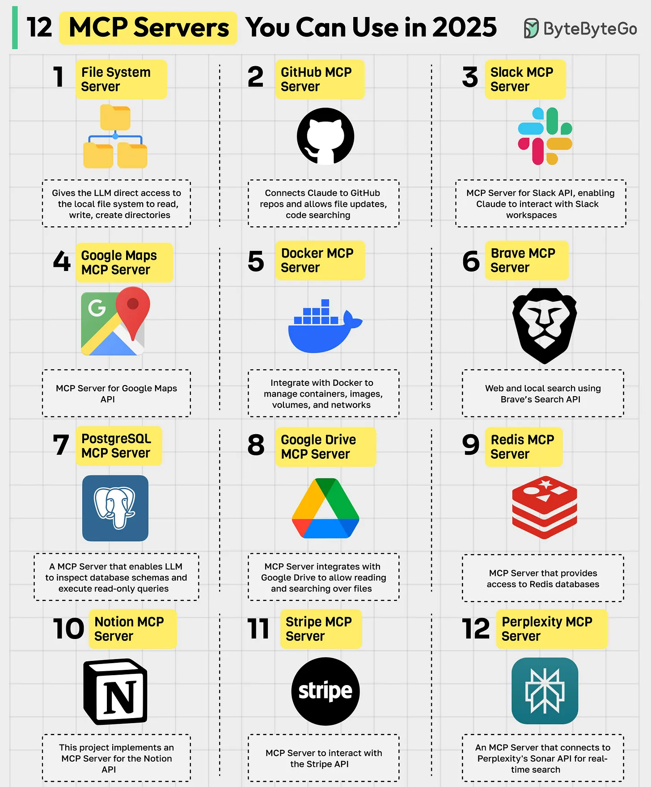

# 114 - 12 MCP Server bạn có thể dùng trong năm 2025

- Nguồn: ByteByteGo Big Archive System Design 2025
- Trang PDF: 242-243
- Ảnh minh họa: `../assets/114/figure-01.png`

## Hình minh họa

## Dịch sát

MCP (Model Context Protocol) là một open standard giúp đơn giản hóa cách AI model, đặc biệt là LLM, tương tác với external data source, tool và service. Một MCP server đóng vai trò như cầu nối giữa các AI model này và external tool. Dưới đây là các MCP server hàng đầu:

1. File System MCP Server
   Cho phép LLM truy cập trực tiếp local file system để đọc, ghi và tạo directory.

2. GitHub MCP Server
   Kết nối Claude với GitHub repo và cho phép update file, search code.

3. Slack MCP Server
   MCP Server cho Slack API, cho phép Claude tương tác với Slack workspace.

4. Google Maps MCP Server
   MCP Server cho Google Maps API.

5. Docker MCP Server
   Tích hợp với Docker để quản lý container, image, volume và network.

6. Brave MCP Server
   Web search và local search bằng Brave Search API.

7. PostgreSQL MCP Server
   MCP server cho phép LLM inspect database schema và execute read-only query.

8. Google Drive MCP Server
   MCP server tích hợp với Google Drive để cho phép đọc và search file.

9. Redis MCP Server
   MCP Server cung cấp quyền truy cập Redis database.

10. Notion MCP Server
    Project này triển khai MCP server cho Notion API.

11. Stripe MCP Server
    MCP Server để tương tác với Stripe API.

12. Perplexity MCP Server
    MCP Server kết nối tới Perplexity Sonar API cho real-time search.

Câu hỏi dành cho bạn: Bạn sẽ thêm MCP Server nào khác vào danh sách?

## Dịch nội dung trong hình

Hình liệt kê 12 MCP server: File System, GitHub, Slack, Google Maps, Docker, Brave, PostgreSQL, Google Drive, Redis, Notion, Stripe và Perplexity. Các ô mô tả capability tương ứng: file access, repo/code search, Slack workspace, maps API, Docker management, Brave search, database schema/read query, Drive file search, Redis access, Notion API, Stripe API và Perplexity real-time search.

## Tóm tắt & giải thích dễ hiểu

MCP chuẩn hóa việc nối AI model/agent với tool bên ngoài. Bài này lặp lại danh sách MCP server đã xuất hiện ở bài 074 và 108, nhưng vẫn được dịch riêng để giữ đúng thứ tự archive.

Trong production, điểm quan trọng là permission và audit. File system MCP, database MCP hoặc Stripe MCP đều có thể rất mạnh, nên cần giới hạn quyền theo workspace, read-only mode, scope và secret management.

## Ví dụ thực tế - không nằm trong tài liệu gốc

Một agent làm báo cáo tài chính có thể dùng Google Drive MCP để đọc file, PostgreSQL MCP để lấy số liệu read-only, Slack MCP để nhận context team và Stripe MCP để kiểm tra invoice. Tất cả quyền nên được cấp tối thiểu và log lại request.

## Thuật ngữ chính

- `MCP`: Model Context Protocol.
- `MCP Server`: server bridge giữa AI và tool.
- `Capability`: khả năng mà tool cung cấp.
- `Scope`: phạm vi quyền được phép.
- `Audit`: ghi nhận hành động để kiểm tra.
- `Secret management`: quản lý khóa/API secret an toàn.
- `Read-only mode`: chế độ chỉ đọc.

