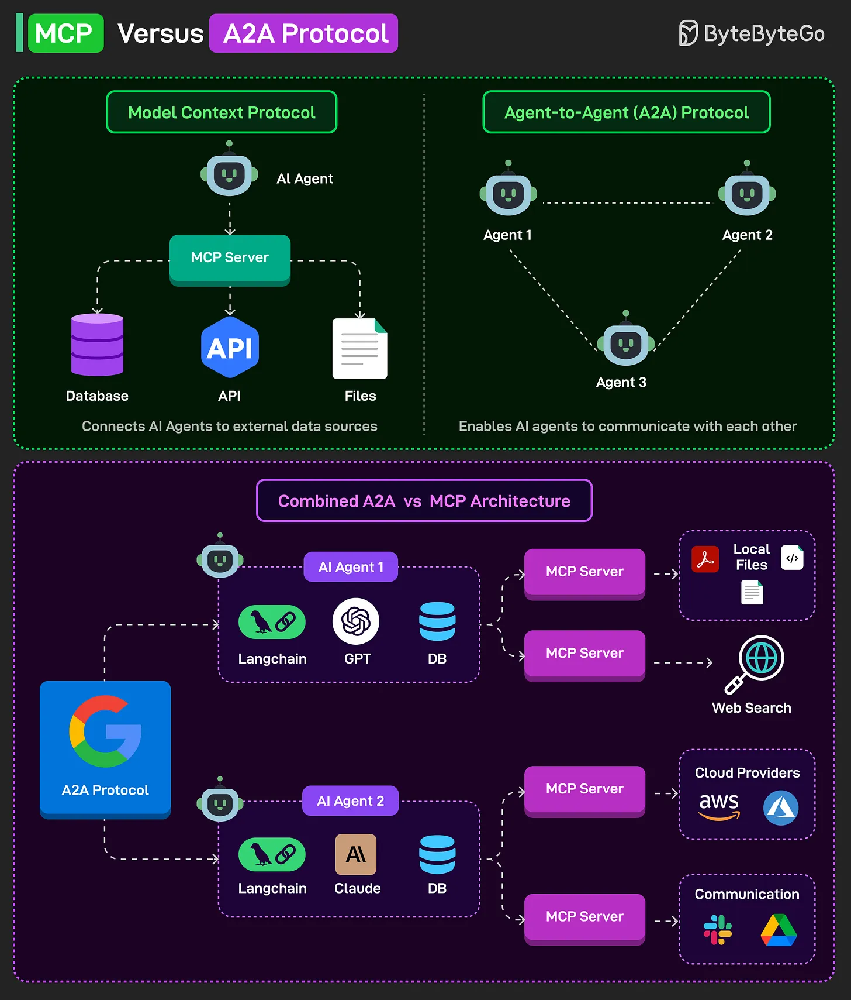

# 115 - MCP so với A2A Protocol

- Nguồn: ByteByteGo Big Archive System Design 2025
- Trang PDF: 244-245
- Ảnh minh họa: `../assets/115/figure-01.png`

## Hình minh họa

## Dịch sát

Model Context Protocol (MCP) kết nối AI agent với external data source, chẳng hạn database, API và file, thông qua MCP server, nhờ đó làm response giàu real-world context hơn.

Agent-to-Agent (A2A) Protocol của Google cho phép AI agent communicate và collaborate, giúp chúng delegate task, share result và enhance capability của nhau.

MCP và A2A có thể được combine thành một holistic architecture. Đây là cách nó có thể hoạt động:

1. Mỗi AI agent, dùng tool như Langchain với GPT hoặc Claude, kết nối tới external tool qua MCP server để access data.

2. External tool có thể bao gồm cloud API, local file, web search hoặc communication platform như Slack.

3. Đồng thời, AI agent có thể communicate với nhau bằng A2A protocol để coordinate action, share intermediate output và cùng solve complex task.

Architecture này cho phép cả external context phong phú qua MCP và decentralized agent collaboration qua A2A.

Câu hỏi dành cho bạn: Bạn sẽ thêm gì khác để hiểu capability của MCP vs A2A Protocol?

## Dịch nội dung trong hình

- `MCP`: AI Agent kết nối tới MCP Server, rồi MCP Server kết nối external source như database, API và file.
- `A2A Protocol`: Agent 1, Agent 2, Agent 3 communicate với nhau để phối hợp.
- `Combined A2A vs MCP Architecture`: nhiều AI agent dùng LangChain/GPT/Claude/DB; mỗi agent gọi MCP server để truy cập local files, web search, cloud providers, communication platform; các agent phối hợp qua A2A protocol.

## Tóm tắt & giải thích dễ hiểu

MCP trả lời câu hỏi “agent kết nối tool/data bên ngoài bằng cách nào?”. A2A trả lời câu hỏi “các agent nói chuyện và phối hợp với nhau bằng cách nào?”. Hai giao thức bổ sung cho nhau: MCP mở rộng context/capability theo chiều dọc vào external system, còn A2A mở rộng collaboration theo chiều ngang giữa agent.

## Ví dụ thực tế - không nằm trong tài liệu gốc

Trong incident response, Agent A đọc log qua MCP, Agent B đọc code qua GitHub MCP, Agent C phân tích metric. Ba agent trao đổi kết quả qua A2A để tạo root cause summary và đề xuất rollback. Human vẫn nên duyệt trước khi agent chạy action nguy hiểm.

## Thuật ngữ chính

- `MCP`: Model Context Protocol.
- `A2A`: Agent-to-Agent protocol.
- `External context`: dữ liệu/tool bên ngoài model.
- `Delegation`: giao task cho agent khác.
- `Intermediate output`: kết quả trung gian.
- `Decentralized collaboration`: phối hợp không qua một trung tâm duy nhất.
- `Holistic architecture`: kiến trúc kết hợp nhiều lớp/capability.

