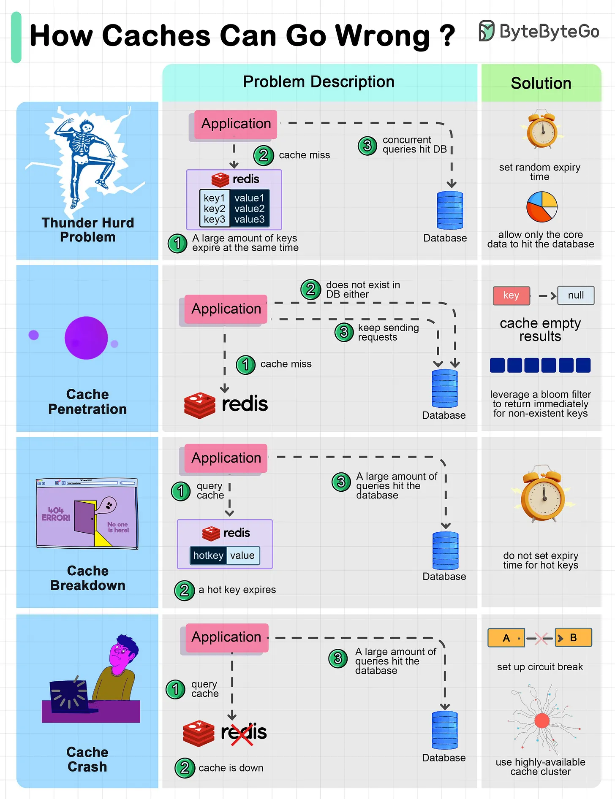

# 116 - Cache system có thể lỗi như thế nào?

- Nguồn: ByteByteGo Big Archive System Design 2025
- Trang PDF: 246-247
- Ảnh minh họa: `../assets/116/figure-01.png`

## Hình minh họa

## Dịch sát

Sơ đồ bên dưới cho thấy 4 case điển hình nơi cache có thể gặp vấn đề và solution tương ứng.

1. Thunder herd problem
   Điều này xảy ra khi một số lượng lớn key trong cache expire cùng lúc. Sau đó query request trực tiếp hit database, làm database quá tải.

   Có hai cách mitigate issue này: một là tránh set cùng expiry time cho các key bằng cách thêm random number vào configuration; cách còn lại là chỉ cho core business data hit database và ngăn non-core data access database cho tới khi cache được backup.

2. Cache penetration
   Điều này xảy ra khi key không tồn tại trong cache hoặc database. Application không thể retrieve relevant data từ database để update cache. Problem này tạo nhiều pressure lên cả cache và database.

   Để giải quyết, có hai suggestion. Một là cache null value cho non-existent key, tránh hit database. Cách còn lại là dùng bloom filter để check key existence trước; nếu key không tồn tại, chúng ta có thể tránh hit database.

3. Cache breakdown
   Điều này tương tự thunder herd problem. Nó xảy ra khi một hot key expire. Một lượng lớn request hit database.

   Vì hot key chiếm 80% query, chúng ta không set expiration time cho chúng.

4. Cache crash
   Điều này xảy ra khi cache down và tất cả request đi tới database.

   Có hai cách giải quyết problem này. Một là setup circuit breaker, và khi cache down, application service không thể visit cache hoặc database. Cách còn lại là setup cluster cho cache để cải thiện cache availability.

Câu hỏi dành cho bạn: Bạn đã gặp issue nào trong số này ở production chưa?

## Dịch nội dung trong hình

- `Thunder Herd Problem`: nhiều key expire cùng lúc, concurrent query miss cache và đổ vào database; solution là set random expiry time và chỉ cho core data hit DB.
- `Cache Penetration`: key không tồn tại, cache miss rồi DB miss liên tục; solution là cache empty/null result hoặc dùng Bloom Filter.
- `Cache Breakdown`: hot key expire, lượng lớn query cùng hit database; solution là không set expiry cho hot key hoặc refresh chủ động.
- `Cache Crash`: cache down, toàn bộ request đi vào database; solution là circuit breaker và high-available cache cluster.

## Tóm tắt & giải thích dễ hiểu

Cache làm hệ thống nhanh hơn nhưng cũng tạo failure mode riêng. Khi cache miss hàng loạt, database có thể bị đánh sập. Khi cache chứa null sai hoặc stale data, user có thể thấy dữ liệu không đúng. Vì vậy cache cần TTL strategy, jitter, protection cho hot key, Bloom Filter, circuit breaker và cluster/replication.

## Ví dụ thực tế - không nằm trong tài liệu gốc

Nếu toàn bộ product cache set TTL đúng 00:00, đến nửa đêm hàng triệu request có thể cùng miss và đổ vào database. Cách tốt hơn là TTL 1 giờ cộng random jitter 0-10 phút, pre-warm hot product và dùng singleflight/lock để chỉ một request rebuild cache.

## Thuật ngữ chính

- `Cache miss`: không tìm thấy dữ liệu trong cache.
- `TTL`: time to live của cache entry.
- `Jitter`: thêm ngẫu nhiên vào TTL để tránh expire đồng loạt.
- `Hot key`: key được truy cập cực nhiều.
- `Bloom Filter`: cấu trúc kiểm tra membership xác suất.
- `Circuit breaker`: ngắt luồng gọi khi downstream lỗi.
- `Singleflight`: gom nhiều request trùng thành một request rebuild.

## Câu hỏi ôn tập + trả lời + thinking học tập + liên hệ

> Đây là phần học tập thêm ở cuối file. Câu hỏi ưu tiên lấy từ tài liệu gốc và được trả lời trực tiếp; nếu bài không có câu hỏi riêng thì dùng tiêu đề/nội dung chính để tạo câu hỏi tự kiểm tra.

### Câu hỏi 1

**Nguồn câu hỏi:** Câu hỏi trong tài liệu gốc.

**Câu hỏi:** Bạn đã gặp issue nào trong số này ở production chưa?

**Trả lời:** Sau bài này, phần đáng nhớ nhất là: Cache làm hệ thống nhanh hơn nhưng cũng tạo failure mode riêng. Khi cache miss hàng loạt, database có thể bị đánh sập. Khi cache chứa null sai hoặc stale data, user có thể thấy dữ liệu không đúng. Vì vậy cache cần TTL strategy, jitter, protection cho hot key, Bloom Filter, circuit breaker và cluster/replication. Khi áp dụng vào hệ thống thật, hãy kiểm thêm read/write ratio, consistency, cardinality, query pattern, growth rate và recovery requirement.

**Thinking học tập + liên hệ:** Liên hệ `Cache system có thể lỗi như thế nào?` bằng một scenario thật sẽ giúp thấy trade-off rõ hơn so với chỉ đọc định nghĩa. Lens chính là read/write ratio, consistency, cardinality, query pattern, growth rate và recovery requirement. Khi gặp bài toán dữ liệu, hãy nối bài học với truy vấn nóng nhất, index thật sự được dùng, cache nào có thể stale và thời gian restore sau sự cố. Khi ghi chú lại, hãy giải thích được các keyword: `Cache miss`, `TTL`, `Jitter`, `Hot key`, `Bloom Filter`.
