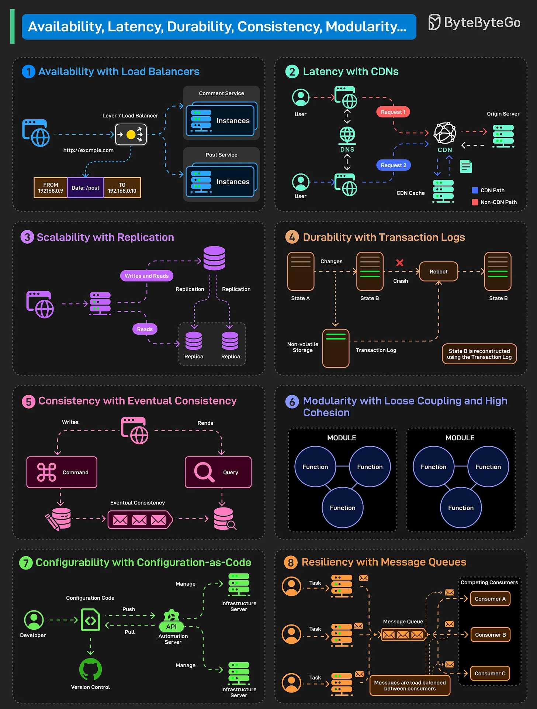

# 117 - 8 khái niệm System Design trong một diagram

- Nguồn: ByteByteGo Big Archive System Design 2025
- Trang PDF: 248-249
- Ảnh minh họa: `../assets/117/figure-01.png`

## Hình minh họa

## Dịch sát

Non-functional requirement định nghĩa quality attribute của một system, bảo đảm system hoạt động reliable trong điều kiện thực tế. Một số NFR chính, cùng implementation approach, như sau:

1. Availability with Load Balancers
   Availability bảo đảm system luôn operational và accessible với user.

   Dùng load balancer phân phối traffic qua nhiều service instance để loại bỏ single point of failure.

2. Latency with CDNs
   Latency chỉ time delay trong response của system đối với user request. CDN giảm latency bằng cách cache content gần user hơn.

3. Scalability with Replication
   Scalability là khả năng system xử lý increased load bằng cách thêm resource. Replication phân phối data qua nhiều node, cho throughput và workload cao hơn.

4. Durability with Transaction Log
   Durability bảo đảm một khi data đã commit, nó vẫn an toàn ngay cả khi failure xảy ra. Transaction log persist tất cả operation, cho phép system reconstruct state sau crash.

5. Consistency with Eventual Consistency
   Consistency nghĩa là tất cả user thấy cùng data. Eventual consistency cho phép khác biệt tạm thời, nhưng đồng bộ replica theo thời gian về consistent state.

6. Modularity with Loose Coupling and High Cohesion
   Modularity khuyến khích xây system với component được tách rõ và self-contained. Loose coupling và high cohesion giúp đạt điều đó.

7. Configurability
   Configurability cho phép system được adjust hoặc modify dễ dàng mà không thay đổi core logic. Configuration-as-Code quản lý infra và app setting bằng script có version control.

8. Resiliency with Message Queues
   Resiliency là khả năng system recover sau failure và tiếp tục vận hành mượt. Message queue decouple component và buffer task, cho phép retry.

Câu hỏi dành cho bạn: Bạn sẽ thêm NFR hoặc strategy nào khác vào danh sách?

## Dịch nội dung trong hình

Hình gom 8 concept: availability với load balancer, latency với CDN, scalability với replication, durability với transaction log, consistency với eventual consistency, modularity với loose coupling/high cohesion, configurability với configuration-as-code, resiliency với message queue.

## Tóm tắt & giải thích dễ hiểu

System design thường xoay quanh NFR. Functional requirement nói hệ thống làm gì; NFR nói hệ thống làm tốt đến mức nào trong thực tế. Load balancer, CDN, replication, transaction log, queue và config-as-code là các pattern/tool cụ thể để đạt NFR.

Điểm cần nhớ là các NFR có trade-off. Eventual consistency cải thiện availability/scalability nhưng có thể làm user thấy dữ liệu trễ. Queue tăng resiliency nhưng làm flow bất đồng bộ và khó debug hơn.

## Ví dụ thực tế - không nằm trong tài liệu gốc

Một hệ thống checkout cần availability cao qua load balancer, latency thấp qua CDN cho static asset, durability bằng transaction log/payment ledger, resiliency bằng queue cho email/invoice và configuration-as-code để rollout cấu hình payment provider an toàn.

## Thuật ngữ chính

- `NFR`: non-functional requirement.
- `Availability`: khả dụng.
- `Latency`: độ trễ.
- `Scalability`: khả năng mở rộng.
- `Durability`: dữ liệu bền vững sau commit.
- `Consistency`: tính nhất quán dữ liệu.
- `Loose coupling`: phụ thuộc lỏng.
- `High cohesion`: trách nhiệm trong module tập trung.

