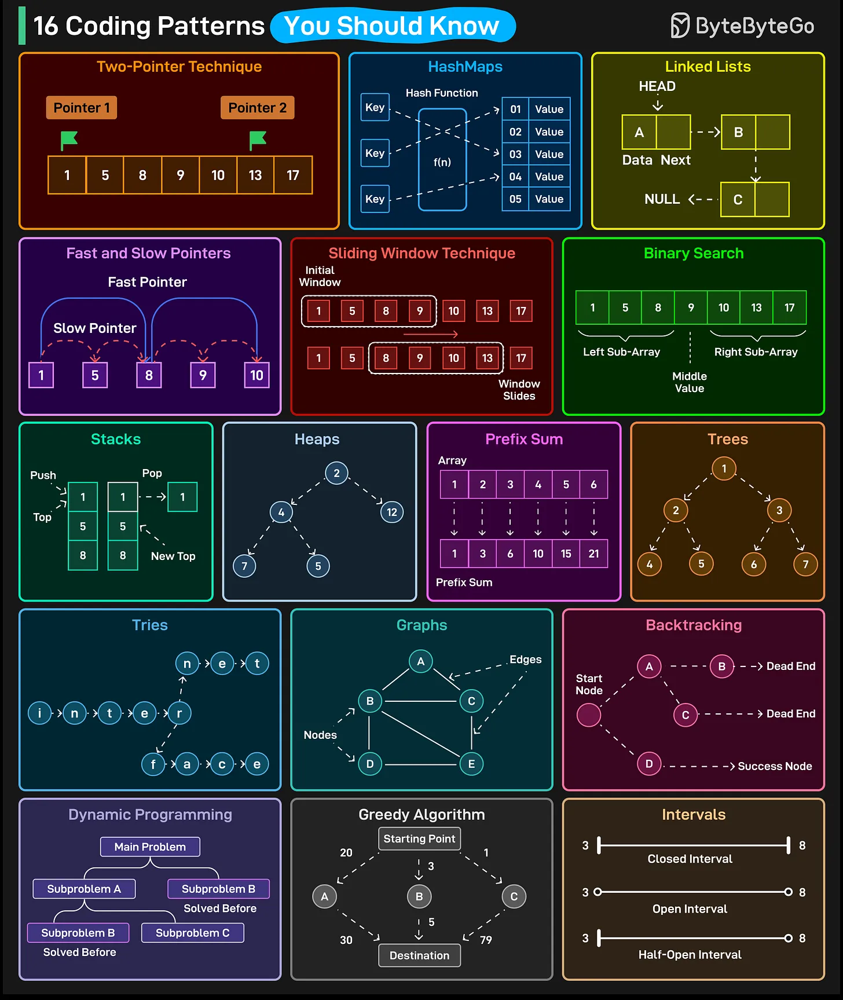

# 118 - 16 coding pattern giúp phỏng vấn dễ hơn

- Nguồn: ByteByteGo Big Archive System Design 2025
- Trang PDF: 250-251
- Ảnh minh họa: `../assets/118/figure-01.png`

## Hình minh họa

## Dịch sát

1. Two-Pointer Technique

2. HashMaps

3. Linked Lists

4. Fast and Slow Pointers

5. Sliding Window Technique

6. Binary Search

7. Stacks

8. Heaps

9. Prefix Sum

10. Trees

11. Tries

12. Graphs

13. Backtracking

14. Dynamic Programming

15. Greedy Algorithms

16. Intervals

Câu hỏi dành cho bạn: Bạn sẽ thêm coding pattern nào khác vào danh sách?

## Dịch nội dung trong hình

Hình minh họa 16 pattern: non-pointer technique/two pointers, hashmap, linked list, fast and slow pointers, sliding window, binary search, stack, heap, prefix sum, tree, trie, graph, backtracking, dynamic programming, greedy algorithm và intervals.

## Tóm tắt & giải thích dễ hiểu

Coding interview thường không kiểm tra thuộc lòng thuật toán rời rạc mà kiểm tra khả năng nhận dạng pattern. Nếu thấy array đã sort, nghĩ tới two pointers hoặc binary search. Nếu cần frequency/lookup nhanh, nghĩ tới hashmap. Nếu cần subarray/window, nghĩ tới sliding window/prefix sum. Nếu có state tối ưu chồng lắp, nghĩ tới dynamic programming.

## Ví dụ thực tế - không nằm trong tài liệu gốc

Problem “two sum” dùng hashmap. “Longest substring without repeating characters” dùng sliding window. “Detect cycle in linked list” dùng fast/slow pointers. “Merge intervals” dùng sort + intervals. “Word search” dùng backtracking. “Shortest path” dùng graph BFS/Dijkstra tùy trọng số.

## Thuật ngữ chính

- `Two pointers`: dùng hai con trỏ duyệt dữ liệu.
- `Sliding window`: cửa sổ trượt trên array/string.
- `Prefix sum`: tổng tiền tố để query range nhanh.
- `Heap`: priority queue.
- `Trie`: cây tiền tố.
- `Backtracking`: thử và quay lui.
- `Dynamic programming`: tối ưu bằng subproblem.
- `Greedy`: chọn tối ưu cục bộ.

