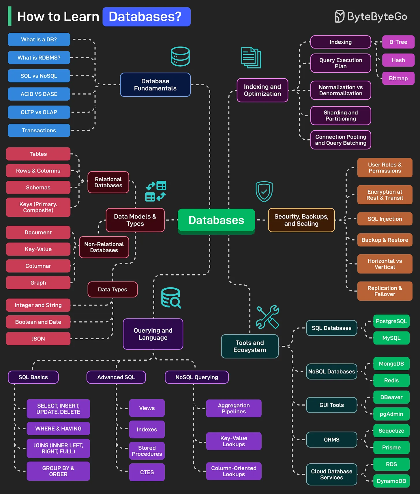

# 119 - Học Database như thế nào?

- Nguồn: ByteByteGo Big Archive System Design 2025
- Trang PDF: 252-253
- Ảnh minh họa: `../assets/119/figure-01.png`

## Hình minh họa

## Dịch sát

Database power mọi thứ từ website và app tới enterprise system. Dưới đây là learning map có thể giúp bạn master database:

1. Database Fundamentals
   Bao gồm các chủ đề như database là gì, RDBMS, SQL vs NoSQL, ACID vs BASE, OLTP vs OLAP, transaction và isolation level.

2. Data Models and Types
   Gồm các chủ đề như relational database, non-relational database và data type như Integer, String, Boolean, Date, JSON, v.v.

3. Querying and Language
   Bao gồm SQL Basics như SELECT, INSERT, v.v.; Advanced SQL như Views, Indexes, CTEs, v.v.; và NoSQL Querying như Aggregation và Key-Value Lookups.

4. Indexing and Optimization
   Gồm các chủ đề như Indexing gồm B-Tree, Hash và Bitmap, Query Execution Plans, Denormalization vs Normalization, Sharding, Connection Pooling và Query Batching.

5. Security, Backups, and Scaling
   Bao gồm User Roles, Permissions, Encryption, SQL Injection, High Availability gồm Replication và Failover, Horizontal vs Vertical Scaling.

6. Tools and Ecosystem
   Gồm các chủ đề như popular SQL database, NoSQL database, GUI tool, ORM, Cloud DB service như RDS, DynamoDB, Google Cloud SQL, v.v.

Câu hỏi dành cho bạn: Bạn sẽ thêm gì khác vào danh sách học database?

## Dịch nội dung trong hình

- `Database Fundamentals`: DB là gì, RDBMS, SQL vs NoSQL, ACID vs BASE, OLTP vs OLAP, Transactions.
- `Data Models & Types`: relational database với table/row/column/schema/key; non-relational database với document/key-value/columnar/graph; data type như integer/string/boolean/date/JSON.
- `Querying and Language`: SQL basics, advanced SQL, NoSQL querying, key-value lookups, aggregation pipeline, stored procedures, views, indexes, triggers, CTEs.
- `Indexing and Optimization`: B-Tree, Hash, Bitmap, query execution plan, normalization vs denormalization, sharding/partitioning, connection pooling, query batching.
- `Security, Backups, and Scaling`: user roles/permission, encryption, SQL injection, backup/restore, horizontal/vertical scaling, replication/failover.
- `Tools and Ecosystem`: SQL DB như PostgreSQL/MySQL; NoSQL DB như MongoDB/Redis; GUI tool như DBeaver/pgAdmin/SequelAce/Prisma; cloud DB như RDS/DynamoDB.

## Tóm tắt & giải thích dễ hiểu

Học database nên đi từ nguyên lý tới thực hành. Trước hết hiểu relational vs NoSQL, transaction, isolation và query. Sau đó học index/execution plan để tối ưu. Tiếp theo là security, backup, replication, scaling và tooling.

Database là trái tim của nhiều hệ thống, nên developer nên biết ít nhất cách thiết kế schema, viết query đúng, đọc execution plan, tạo index hợp lý và backup/restore cơ bản.

## Ví dụ thực tế - không nằm trong tài liệu gốc

Một bài tập tốt: thiết kế schema cho e-commerce, viết query order history, thêm index phù hợp, dùng `EXPLAIN ANALYZE`, mô phỏng deadlock/transaction isolation, backup/restore database local và thử replication bằng Docker Compose.

## Thuật ngữ chính

- `RDBMS`: relational database management system.
- `ACID`: atomicity, consistency, isolation, durability.
- `BASE`: basically available, soft state, eventual consistency.
- `OLTP`: workload giao dịch online.
- `OLAP`: workload phân tích.
- `CTE`: common table expression.
- `ORM`: object-relational mapping.
- `Failover`: chuyển sang node dự phòng khi lỗi.

