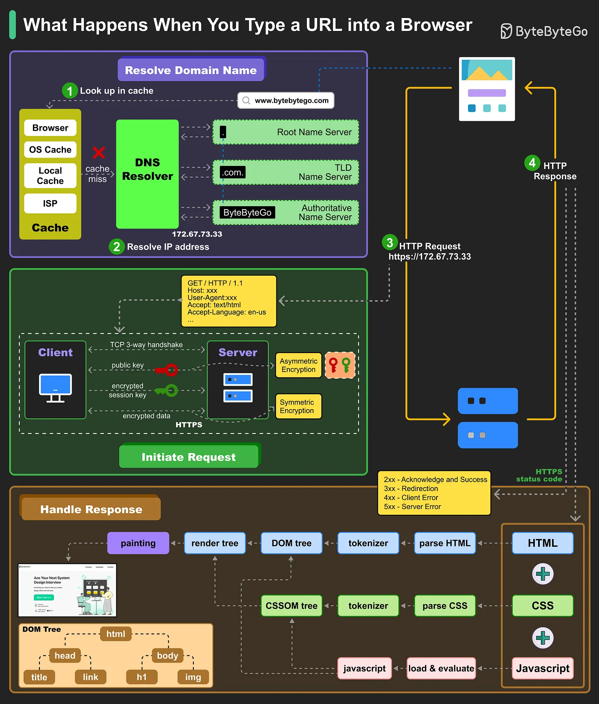

# 120 - Điều gì xảy ra khi bạn gõ URL vào trình duyệt?

- Nguồn: ByteByteGo Big Archive System Design 2025
- Trang PDF: 254-255
- Ảnh minh họa: `../assets/120/figure-01.png`

## Hình minh họa

## Dịch sát

Hãy xem process từng bước.

Step 1: User nhập một URL (`bytebytego.com`) vào browser và nhấn Enter. Việc đầu tiên cần làm là translate URL thành IP address. Mapping này thường được lưu trong cache, nên browser tìm IP address trong nhiều layer cache: browser cache, OS cache, local cache và ISP cache. Nếu browser không tìm được mapping trong cache, nó sẽ hỏi DNS (Domain Name System) resolver để resolve.

Step 2: Nếu IP address không được tìm thấy ở bất kỳ cache nào, browser đi tới DNS server để thực hiện recursive DNS lookup cho tới khi tìm được IP address.

Step 3: Bây giờ đã có IP address của server, browser gửi HTTP request tới server. Để access server resource an toàn, chúng ta nên luôn dùng HTTPS. Trước tiên nó thiết lập TCP connection với server thông qua TCP 3-way handshake. Sau đó server gửi public key tới client. Client dùng public key để encrypt session key và gửi tới server. Server dùng private key để decrypt session key. Client và server bây giờ có thể trao đổi encrypted data bằng session key.

Step 4: Server process request và gửi response trở lại. Với response thành công, status code là 200. Response có 3 phần: HTML, CSS và Javascript. Browser parse HTML và generate DOM tree. Nó cũng parse CSS và generate CSSOM tree. Sau đó nó combine DOM tree và CSSOM tree để render tree. Browser render content và display cho user.

## Dịch nội dung trong hình

- `Resolve Domain Name`: browser lookup cache qua browser/OS/local/ISP cache; nếu miss thì DNS resolver hỏi root name server, TLD name server và authoritative name server để lấy IP.
- `Initiate Request`: client thiết lập TCP 3-way handshake, thực hiện HTTPS/TLS với asymmetric encryption để trao đổi encrypted session key, rồi dùng symmetric encryption cho data.
- `HTTP Request`: ví dụ `GET / HTTP/1.1`, host, accept-language.
- `HTTP Response`: server trả HTTPS status code và data.
- `Handle Response`: browser parse HTML, tokenize, tạo DOM tree; parse CSS tạo CSSOM tree; combine thành render tree; load/evaluate JavaScript; painting hiển thị lên màn hình.

## Tóm tắt & giải thích dễ hiểu

Khi gõ URL, browser không “đi thẳng” tới website ngay. Nó phải resolve domain thành IP, thiết lập kết nối TCP, thiết lập HTTPS/TLS nếu dùng secure connection, gửi HTTP request, nhận response, rồi render HTML/CSS/JS thành giao diện.

Đây là một luồng rất hay để học system design vì nó chạm tới DNS, cache, TCP, TLS, HTTP, backend server và browser rendering engine.

## Ví dụ thực tế - không nằm trong tài liệu gốc

Nếu website load chậm, bottleneck có thể nằm ở DNS lookup lâu, TCP/TLS handshake nhiều round trip, server response chậm, payload quá lớn, JavaScript blocking render hoặc cache/CDN cấu hình kém. Vì vậy performance debugging cần đo từng phase bằng browser DevTools Network/Performance.

## Thuật ngữ chính

- `DNS`: Domain Name System.
- `Recursive lookup`: DNS resolver hỏi nhiều cấp server để tìm IP.
- `TCP 3-way handshake`: SYN, SYN-ACK, ACK.
- `TLS`: giao thức bảo mật cho HTTPS.
- `DOM`: Document Object Model.
- `CSSOM`: CSS Object Model.
- `Render tree`: cây dùng để layout/paint UI.
- `Status code 200`: HTTP response thành công.

## Ghi chú kỹ thuật - không nằm trong tài liệu gốc

Phần HTTPS trong bài là phiên bản giải thích đơn giản. TLS hiện đại thường dùng key exchange như ECDHE thay vì đơn giản là client tạo session key rồi mã hóa trực tiếp bằng public key từ certificate. Ý chính vẫn là thiết lập kênh an toàn rồi dùng symmetric encryption cho dữ liệu truyền tải.

