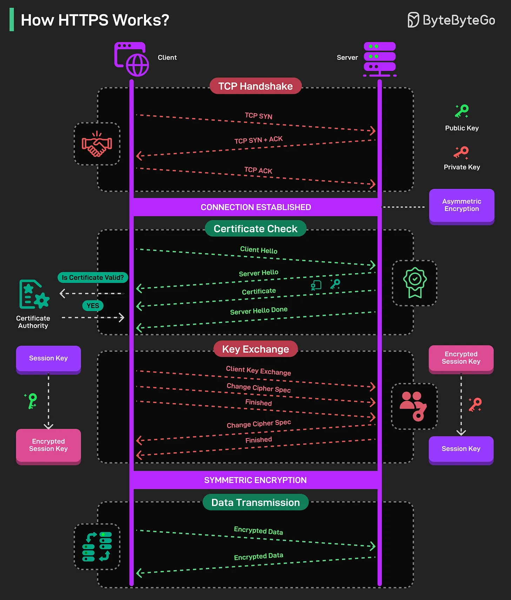

# 121 - HTTPS hoạt động như thế nào?

- Nguồn: ByteByteGo Big Archive System Design 2025
- Trang PDF: 256-257
- Ảnh minh họa: `../assets/121/figure-01.png`

## Hình minh họa

## Dịch sát

HTTPS bảo đảm giao tiếp an toàn giữa browser của bạn (client) và server của website bằng encryption.

1. TCP Handshake: Trước khi có bất kỳ secure communication nào, client và server trước tiên thiết lập basic connection bằng TCP handshake process. Ở thời điểm này, data chưa được encrypt.

2. Certificate Check: Stage này dùng để verify identity của server. Client bắt đầu TLS handshake bằng một “hello” message, trong đó offer các encryption algorithm được hỗ trợ. Server reply, chọn algorithm và gửi digital certificate, certificate này chứa public key. Client verify certificate để bảo đảm nó đến từ một Certificate Authority (CA) đáng tin cậy.

3. Key Exchange: Khi client validate certificate, nó bắt đầu key exchange process. Client dùng public key của server từ certificate để encrypt session key. Encrypted session key được gửi tới server, và server có thể decrypt bằng private key. Change cipher spec message báo hiệu rằng từ thời điểm này trở đi, tất cả message sẽ được encrypt bằng session key và cipher đã thỏa thuận. Step này dùng asymmetric encryption để exchange session key an toàn.

4. Data Transmission: Bây giờ, cả hai bên chuyển sang symmetric encryption nhanh hơn bằng shared session key. Message được encrypt và decrypt bằng cùng một key. Tất cả data exchange bây giờ an toàn và private.

Câu hỏi dành cho bạn: Bạn sẽ thêm gì nữa để giải thích HTTPS process?

## Dịch nội dung trong hình

- `TCP Handshake`: TCP SYN, TCP SYN + ACK, TCP ACK; sau đó connection established.
- `Certificate Check`: client hello, server hello, certificate, server hello done; client kiểm tra CA certificate có valid không.
- `Key Exchange`: client key exchange, change cipher spec, finished; encrypted session key được trao đổi.
- `Symmetric Encryption / Data Transmission`: data sau đó được truyền dưới dạng encrypted data bằng session key.
- Hình phân biệt public key, private key, session key và encrypted session key.

## Tóm tắt & giải thích dễ hiểu

HTTPS là HTTP chạy trên TLS. Nó giải quyết hai việc: xác thực server đúng là server bạn muốn kết nối, và mã hóa dữ liệu để người nghe lén không đọc được nội dung. Ban đầu dùng cơ chế bất đối xứng để thiết lập bí mật chung, sau đó dùng mã hóa đối xứng vì nhanh hơn cho dữ liệu thật.

## Ví dụ thực tế - không nằm trong tài liệu gốc

Khi browser gọi `https://bank.example`, certificate giúp browser biết server có đáng tin không. Sau TLS handshake, thông tin như cookie/session/payment data được mã hóa trên đường truyền. Nếu certificate hết hạn hoặc không khớp domain, browser sẽ cảnh báo.

## Thuật ngữ chính

- `HTTPS`: HTTP qua TLS.
- `TLS handshake`: quá trình thiết lập kết nối bảo mật.
- `Certificate Authority`: tổ chức phát hành certificate đáng tin.
- `Public key`: khóa công khai.
- `Private key`: khóa bí mật của server.
- `Session key`: khóa đối xứng dùng cho phiên.
- `Cipher`: thuật toán mã hóa.

## Ghi chú kỹ thuật - không nằm trong tài liệu gốc

Mô tả key exchange trong bài là cách giải thích đơn giản. TLS hiện đại thường dùng ephemeral key exchange như ECDHE để có forward secrecy, nhưng ý chính về certificate validation và symmetric encryption cho data transmission vẫn đúng.

## Câu hỏi ôn tập + trả lời + thinking học tập + liên hệ

> Đây là phần học tập thêm ở cuối file. Câu hỏi ưu tiên lấy từ tài liệu gốc và được trả lời trực tiếp; nếu bài không có câu hỏi riêng thì dùng tiêu đề/nội dung chính để tạo câu hỏi tự kiểm tra.

### Câu hỏi 1

**Nguồn câu hỏi:** Câu hỏi trong tài liệu gốc.

**Câu hỏi:** Bạn sẽ thêm gì nữa để giải thích HTTPS process?

**Trả lời:** Có thể thêm DNS caching/TTL và negative caching; TLS handshake/session resumption; CDN edge caching và origin shielding; và QUIC/HTTP/3 khi cần giảm latency. Các mục này giúp bức tranh đầy đủ hơn vì chúng chạm vào phần triển khai/vận hành mà bài gốc chưa đi sâu. Ý chính đang có của bài là: HTTPS là HTTP chạy trên TLS. Nó giải quyết hai việc: xác thực server đúng là server bạn muốn kết nối, và mã hóa dữ liệu để người nghe lén không đọc được nội dung. Ban đầu dùng cơ chế bất đối xứng để thiết lập bí mật chung, sau đó dùng mã hóa đối xứng vì nhanh hơn cho dữ liệu thật.

**Thinking học tập + liên hệ:** Khi bài hỏi còn thiếu gì trong `HTTPS hoạt động như thế nào?`, hãy so danh sách hiện tại với nhu cầu production: scale, debug, security, cost và vận hành. Lens chính là DNS, transport, TLS, HTTP, proxy/CDN, application timeout và observability theo từng layer. Khi debug production, hãy tách latency theo DNS lookup, TCP connect, TLS handshake, TTFB và download để không đoán mò. Khi ghi chú lại, hãy giải thích được các keyword: `HTTPS`, `TLS handshake`, `Certificate Authority`, `Public key`, `Private key`.
