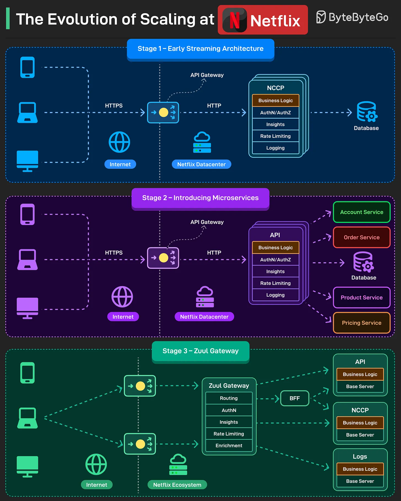

# 122 - Quá trình tiến hóa scaling tại Netflix

- Nguồn: ByteByteGo Big Archive System Design 2025
- Trang PDF: 258-259
- Ảnh minh họa: `../assets/122/figure-01.png`

## Hình minh họa

## Dịch sát

Trong nhiều năm, Netflix trải qua nhiều growth stage. Với mỗi stage, họ phải tiến hóa scaling approach.

1. Stage 1 (Early Streaming Architecture)
   Đây là kiến trúc 3-tier điển hình gồm client, API và database.

   API application được đặt tên là NCCP (Netflix Content Control Protocol). Nó là một monolithic application chứa toàn bộ functionality.

2. Stage 2 (Introducing Microservices)
   Khi nhiều feature được thêm vào, việc duy trì engineering velocity trở nên critical. Để hỗ trợ điều này, monolithic application được chia thành microservices.

   Feature được extract khỏi NCCP application và phát triển như các application riêng, nhưng orchestration logic vẫn nằm trong NCCP application.

3. Stage 3 (Zuul Gateway)
   Tiếp theo, Netflix split application. NCCP vẫn ở đó cho playback experience, trong khi các API khác bắt đầu xử lý feature khác.

   Zuul API Gateway được giới thiệu để giảm coupling giữa client và service.

Reference: Netflix TechBlog

Câu hỏi dành cho bạn: Bạn có biết nuance nào khác về cách Netflix scale tới level hiện tại không?

## Dịch nội dung trong hình

- `Stage 1 - Early Streaming Architecture`: client qua internet/API gateway gọi NCCP monolith, NCCP chứa business logic, authN/authZ, insights, rate limiting, logging rồi truy cập database.
- `Stage 2 - Introducing Microservices`: API gateway/NCCP vẫn giữ orchestration, nhưng một số feature được tách ra thành Account Service, Order Service, Product Service, Pricing Service.
- `Stage 3 - Zuul Gateway`: Zuul Gateway đảm nhiệm routing, authN, insights, rate limiting, enrichment; traffic tới BFF/API/NCCP/log services/base server.

## Tóm tắt & giải thích dễ hiểu

Netflix không nhảy thẳng từ monolith sang microservices hoàn chỉnh. Họ tiến hóa theo nhu cầu scale và tốc độ phát triển: bắt đầu với 3-tier monolith, tách dần feature thành service, rồi thêm gateway để giảm coupling giữa client và backend.

Điểm đáng học là migration architecture nên đi từng bước. Microservices không phải mục tiêu tự thân; nó là công cụ khi monolith bắt đầu cản trở team velocity, scaling hoặc fault isolation.

## Ví dụ thực tế - không nằm trong tài liệu gốc

Một startup video có thể bắt đầu bằng monolith để ship nhanh. Khi team tăng và domain playback, billing, recommendation, notification có scale/failure khác nhau, mới tách service. API Gateway/BFF giúp client không phải biết chi tiết từng service phía sau.

## Thuật ngữ chính

- `3-tier architecture`: client, application/API, database.
- `Monolith`: ứng dụng chứa nhiều chức năng trong một deployable.
- `Microservices`: nhiều service nhỏ độc lập hơn.
- `NCCP`: Netflix Content Control Protocol.
- `Zuul`: API Gateway của Netflix.
- `BFF`: Backend for Frontend.
- `Coupling`: mức độ phụ thuộc giữa component.

