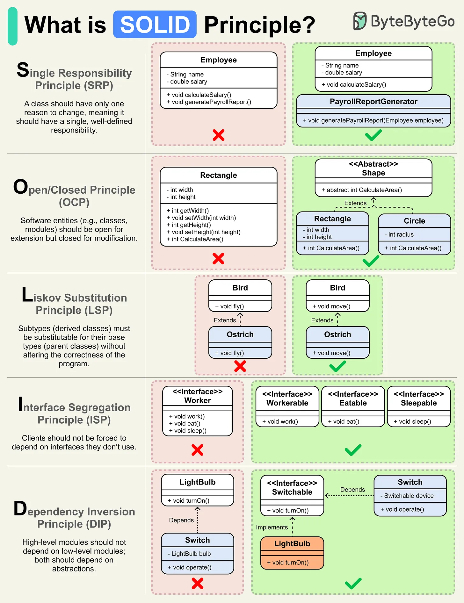

# 123 - SOLID Principle là gì?

- Nguồn: ByteByteGo Big Archive System Design 2025
- Trang PDF: 260-261
- Ảnh minh họa: `../assets/123/figure-01.png`

## Hình minh họa

## Dịch sát

SOLID cung cấp guideline để tạo software dễ hiểu, dễ modify và dễ extend.

SOLID acronym là:

S -> Single Responsibility Principle
O -> Open/Closed Principle
L -> Liskov Substitution Principle
I -> Interface Segregation Principle
D -> Dependency Inversion Principle

- Single Responsibility Principle (SRP) nói rằng một class chỉ nên có một lý do để thay đổi. Nói cách khác, nó nên có một responsibility hoặc task đơn lẻ, well-defined trong software system.

- Open/Closed Principle (OCP) nói rằng software entity như class nên open for extension nhưng closed for modification. Điều này nghĩa là bạn có thể thêm functionality mới mà không chỉnh sửa existing code.

- Liskov Substitution Principle (LSP) nói rằng object của derived class nên có thể thay thế object của base class mà không ảnh hưởng tới correctness của program.

- Interface Segregation Principle (ISP) nhấn mạnh rằng class hoặc component dùng interface không nên bị ép depend vào interface mà chúng không dùng.

- Dependency Inversion Principle (DIP) nói rằng high-level module hoặc class không nên depend vào low-level module; cả hai nên depend vào abstraction, chẳng hạn interface.

Câu hỏi dành cho bạn: SOLID principle nào bạn thấy hữu ích nhất hoặc khó nhất trong công việc development hằng ngày?

## Dịch nội dung trong hình

- `SRP`: class chỉ có một responsibility, ví dụ không trộn payroll calculation vào employee data class.
- `OCP`: class mở để extend nhưng đóng để modify, ví dụ thêm shape mới qua abstraction thay vì sửa logic cũ.
- `LSP`: subclass như Bird/Ostrich phải thay thế base class đúng hành vi; tránh ép class không bay phải implement `fly`.
- `ISP`: client không nên bị buộc depend vào method không dùng; tách interface work/eat/sleep.
- `DIP`: high-level module phụ thuộc abstraction như Switchable thay vì phụ thuộc trực tiếp LightBulb.

## Tóm tắt & giải thích dễ hiểu

SOLID giúp code dễ thay đổi khi requirement đổi. SRP giảm class quá nhiều trách nhiệm. OCP giảm sửa code cũ khi thêm behavior. LSP giữ inheritance an toàn. ISP tránh interface béo. DIP giúp business logic ít phụ thuộc framework/database/library cụ thể.

SOLID không phải luật tuyệt đối. Áp dụng quá mức có thể tạo quá nhiều abstraction. Dùng SOLID khi code bắt đầu có nhiều thay đổi, nhiều nhánh logic hoặc dependency khó test.

## Ví dụ thực tế - không nằm trong tài liệu gốc

Payment service nên depend vào interface `PaymentGateway`, không depend trực tiếp Stripe SDK trong business logic. Khi thêm PayPal, bạn thêm implementation mới thay vì sửa toàn bộ checkout flow. Đây là DIP + OCP trong thực tế.

## Thuật ngữ chính

- `SRP`: Single Responsibility Principle.
- `OCP`: Open/Closed Principle.
- `LSP`: Liskov Substitution Principle.
- `ISP`: Interface Segregation Principle.
- `DIP`: Dependency Inversion Principle.
- `Abstraction`: interface/contract che giấu implementation.
- `Coupling`: độ phụ thuộc giữa module.

