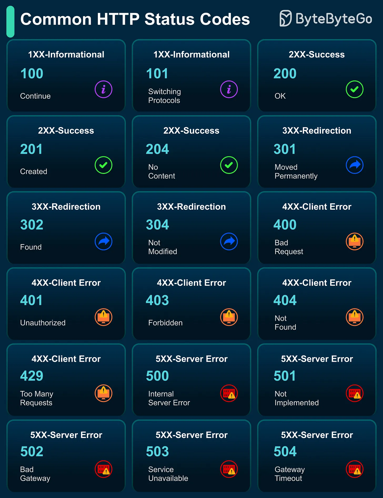

# 124 - Các HTTP status code phổ biến

- Nguồn: ByteByteGo Big Archive System Design 2025
- Trang PDF: 262-263
- Ảnh minh họa: `../assets/124/figure-01.png`

## Hình minh họa

## Dịch sát

HTTP status code được server issue để phản hồi request của client. Các response ngắn gọn này từ server cực kỳ hữu ích khi debug web app, mobile app hoặc API.

- 1xx Informational: Báo hiệu request của client đã được nhận, và processing tiếp tục, ví dụ 100 Continue.

- 2xx Success: Xác nhận request đã hoàn thành thành công, ví dụ 200 OK.

- 3xx Redirection: Yêu cầu client action, như follow redirect, ví dụ 301 Moved Permanently.

- 4xx Client Error: Cho biết request failure do client gây ra, ví dụ 404 Not Found.

- 5xx Server Error: Cho thấy server failure khi xử lý request, ví dụ 500 Internal Server Error.

Câu hỏi dành cho bạn: Category nào làm bạn dễ nhầm nhất, và vì sao?

## Dịch nội dung trong hình

- `100 Continue`, `101 Switching Protocols` thuộc nhóm 1xx informational.
- `200 OK`, `201 Created`, `204 No Content` thuộc nhóm 2xx success.
- `301 Moved Permanently`, `302 Found`, `304 Not Modified` thuộc nhóm 3xx redirection/cache.
- `400 Bad Request`, `401 Unauthorized`, `403 Forbidden`, `404 Not Found`, `429 Too Many Requests` thuộc nhóm 4xx client error.
- `500 Internal Server Error`, `501 Not Implemented`, `502 Bad Gateway`, `503 Service Unavailable`, `504 Gateway Timeout` thuộc nhóm 5xx server error.

## Tóm tắt & giải thích dễ hiểu

HTTP status code là contract giao tiếp giữa server và client. Client dùng code để quyết định retry, login lại, redirect, show error hay cache. API tốt nên dùng status code nhất quán, không trả `200 OK` cho mọi lỗi rồi nhét error trong body.

## Ví dụ thực tế - không nằm trong tài liệu gốc

Nếu user chưa login, API nên trả `401`. Nếu login rồi nhưng không đủ quyền, trả `403`. Nếu endpoint không tồn tại, trả `404`. Nếu client gọi quá nhiều, trả `429`. Nếu service downstream timeout, gateway có thể trả `504`.

## Thuật ngữ chính

- `HTTP status code`: mã trạng thái phản hồi HTTP.
- `2xx`: thành công.
- `3xx`: chuyển hướng/cache.
- `4xx`: lỗi phía client/request.
- `5xx`: lỗi phía server/downstream.
- `Retry`: thử lại request.
- `Redirect`: chuyển client tới URL khác.

