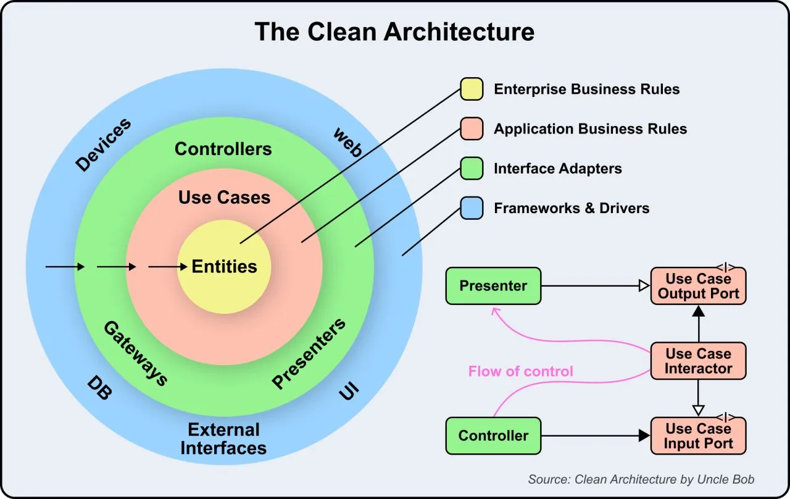

# 125 - Clean Architecture hoạt động như thế nào?

- Nguồn: ByteByteGo Big Archive System Design 2025
- Trang PDF: 264
- Ảnh minh họa: `../assets/125/figure-01.png`

## Hình minh họa

## Dịch sát

Clean Architecture là một cách tổ chức software application để chúng dễ hiểu, dễ maintain và dễ scale. Clean Architecture có 4 layer, mỗi layer có role rõ ràng. Dependency giữa các layer này luôn hướng vào trong, bảo đảm system loosely coupled, testable và maintainable.

Hãy xem các layer:

1. Entities: Đây là core rule và logic của business. Chúng đại diện cho phần stable nhất của system và độc lập với mọi external system hoặc framework.

2. Use Cases: Chúng định nghĩa operation cụ thể mà application của bạn có thể thực hiện. Chúng orchestrate flow of data giữa entity và external interface nhưng không quan tâm data được display hoặc stored như thế nào.

3. Interface Adapters: Layer này gồm Controller, Presenter và Gateway. Nó convert data từ outer layer như web, database hoặc UI thành form mà use case và entity có thể hiểu.

4. Frameworks and Drivers: Đây là external tool và system như database, web UI hoặc device. Chúng nằm ở ngoài cùng và depend vào inner layer.

Câu hỏi dành cho bạn: Bạn sẽ thêm gì để hiểu cách Clean Architecture hoạt động?

## Dịch nội dung trong hình

- Vòng trong cùng là `Entities`.
- Tiếp theo là `Use Cases`.
- Tiếp theo là `Interface Adapters` gồm Controllers, Presenters, Gateways.
- Ngoài cùng là `Frameworks & Drivers` gồm Web, UI, DB, Devices, External Interfaces.
- `Flow of control` đi qua Controller -> Use Case Input Port -> Use Case Interactor -> Use Case Output Port -> Presenter, nhưng dependency rule hướng vào trong.

## Tóm tắt & giải thích dễ hiểu

Clean Architecture bảo vệ business logic khỏi framework, database và UI. Domain/use case không nên biết request HTTP đến từ đâu, database là MySQL hay PostgreSQL, UI là web hay mobile. Outer layer adapt dữ liệu vào/ra cho inner layer.

Điểm cốt lõi là dependency direction: code bên trong không import code bên ngoài. Điều này giúp test use case dễ hơn và đổi framework ít ảnh hưởng business logic.

## Ví dụ thực tế - không nằm trong tài liệu gốc

Use case `CreateOrder` nhận input DTO, validate rule, gọi interface `OrderRepository` và `PaymentGateway`. Implementation cụ thể `PostgresOrderRepository` hoặc `StripePaymentGateway` nằm ở outer layer. Unit test có thể mock interface mà không cần database thật.

## Thuật ngữ chính

- `Entity`: business object/rule cốt lõi.
- `Use case`: nghiệp vụ ứng dụng cụ thể.
- `Controller`: adapter nhận input từ web/API.
- `Presenter`: adapter format output.
- `Gateway`: adapter tới external system/database.
- `Dependency rule`: dependency hướng vào trong.
- `Loose coupling`: giảm phụ thuộc giữa layer.

