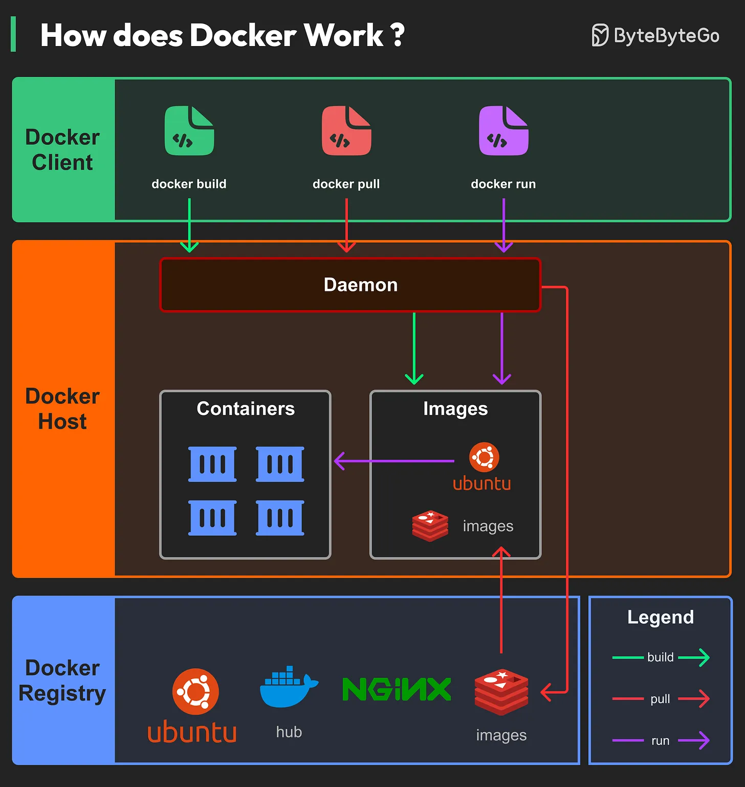

# 126 - Docker hoạt động như thế nào?

- Nguồn: ByteByteGo Big Archive System Design 2025
- Trang PDF: 265
- Ảnh minh họa: `../assets/126/figure-01.png`

## Hình minh họa

## Dịch sát

Architecture của Docker gồm ba component chính:

- Docker Client
  Đây là interface mà user tương tác. Nó giao tiếp với Docker daemon.

- Docker Host
  Tại đây, Docker daemon listen Docker API request và quản lý nhiều Docker object, bao gồm image, container, network và volume.

- Docker Registry
  Đây là nơi Docker image được lưu. Docker Hub, chẳng hạn, là một public registry được dùng rộng rãi.

## Dịch nội dung trong hình

- `Docker Client`: user chạy command như `docker build`, `docker pull`, `docker run`.
- `Docker Host`: Docker daemon nhận lệnh và quản lý `Containers` và `Images`.
- `Docker Registry`: lưu image như Ubuntu, Nginx, Redis; client/daemon có thể pull image từ registry.
- Legend: build, pull và run thể hiện luồng tạo image, tải image và chạy container.

## Tóm tắt & giải thích dễ hiểu

Docker giúp đóng gói application cùng dependency thành image, rồi chạy image đó thành container. Docker client chỉ là công cụ gửi lệnh. Docker daemon trên host làm việc thật: build image, pull image, tạo container, nối network, mount volume. Registry là kho chia sẻ image.

## Ví dụ thực tế - không nằm trong tài liệu gốc

Developer chạy `docker build -t api .` để tạo image, `docker push` lên registry, server production `docker pull` image đó và `docker run` thành container. Nhờ vậy môi trường chạy nhất quán hơn giữa local, staging và production.

## Thuật ngữ chính

- `Docker image`: template bất biến để tạo container.
- `Container`: instance đang chạy từ image.
- `Docker daemon`: process quản lý Docker object.
- `Docker registry`: kho lưu image.
- `Volume`: storage gắn vào container.
- `Network`: mạng kết nối container.
- `Docker Hub`: public registry phổ biến.

## Câu hỏi ôn tập + trả lời + thinking học tập + liên hệ

> Đây là phần học tập thêm ở cuối file. Câu hỏi ưu tiên lấy từ tài liệu gốc và được trả lời trực tiếp; nếu bài không có câu hỏi riêng thì dùng tiêu đề/nội dung chính để tạo câu hỏi tự kiểm tra.

### Câu hỏi 1

**Nguồn câu hỏi:** Suy ra từ tiêu đề/nội dung chính vì bài gốc không có câu hỏi riêng.

**Câu hỏi:** How does Docker Work?

**Trả lời:** Luồng tốt nhất là lần theo input tới output: request/dữ liệu đi vào đâu, qua thành phần nào, state đổi ở đâu và kết quả trả ra thế nào. Với `Docker hoạt động như thế nào?`, ý chính là: Docker giúp đóng gói application cùng dependency thành image, rồi chạy image đó thành container. Docker client chỉ là công cụ gửi lệnh. Docker daemon trên host làm việc thật: build image, pull image, tạo container, nối network, mount volume. Registry là kho chia sẻ image.

**Thinking học tập + liên hệ:** Luồng trong `Docker hoạt động như thế nào?` nên được vẽ từ input tới output, kèm owner của từng bước và failure mode ở mỗi boundary. Lens chính là độ phức tạp vận hành, rollback, cost, kỹ năng team, observability và blast radius khi hỏng. Khi đưa lên production, hãy map từng thành phần vào deploy, rollback, monitoring, alerting, secret, cost và ownership rõ ràng. Khi ghi chú lại, hãy giải thích được các keyword: `Docker image`, `Container`, `Docker daemon`, `Docker registry`, `Volume`.
