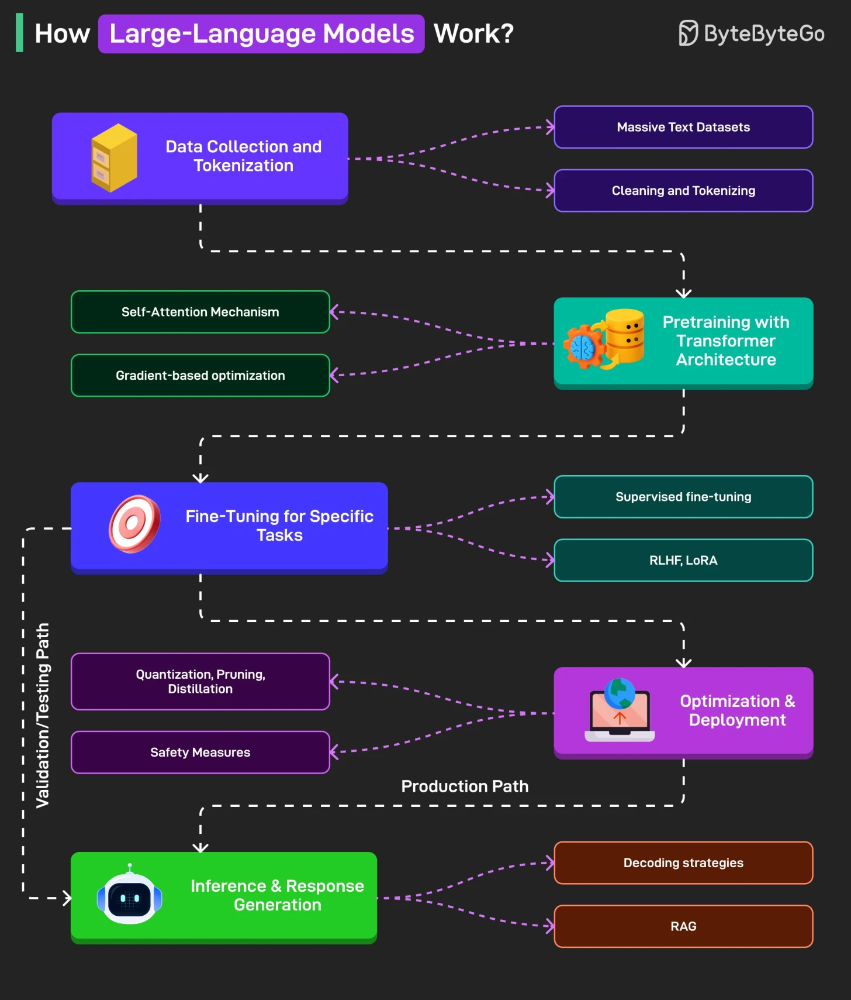

# 127 - Large Language Model hoạt động như thế nào?

- Nguồn: ByteByteGo Big Archive System Design 2025
- Trang PDF: 266-267
- Ảnh minh họa: `../assets/127/figure-01.png`

## Hình minh họa

## Dịch sát

1. Data Collection and Tokenization
   LLM bắt đầu bằng cách ingest khối lượng text khổng lồ từ các source như book, website và code. Text này được clean và chia thành unit nhỏ hơn gọi là token để chuẩn bị cho training.

2. Pre-training with Transformer Architecture
   Dùng transformer model và self-attention mechanism, system học cách predict next token trong một sequence. Process này adjust hàng tỷ parameter để phát triển hiểu biết rộng về language.

3. Fine-Tuning for Specific Tasks
   Pretrained model sau đó được tailor cho application cụ thể thông qua fine-tuning technique, align behavior của nó với human preference hoặc specialized task. Một số method là RLHF, LoRA, v.v.

4. Inference and Response Generation
   Model generate response dựa trên input prompt ở inference time bằng cách predict các token có khả năng tiếp theo cao nhất. Advanced strategy và retrieval mechanism có thể cải thiện fluency và factual accuracy.

5. Optimization and Deployment
   Trước deployment, model được compress và filter để bảo đảm speed, efficiency và safety. Sau đó nó được deploy trong environment như cloud platform và edge device cho real-world use.

Câu hỏi dành cho bạn: Bạn sẽ thêm gì khác vào high-level flow này?

## Dịch nội dung trong hình

- `Data Collection and Tokenization`: massive text dataset, cleaning và tokenizing.
- `Pre-training with Transformer Architecture`: self-attention mechanism và gradient-based optimization.
- `Fine-Tuning for Specific Tasks`: supervised fine-tuning, RLHF/LoRA.
- `Optimization & Deployment`: quantization, pruning, distillation và safety measures.
- `Inference & Response Generation`: decoding strategies và RAG; hình tách validation/training path và production path.

## Tóm tắt & giải thích dễ hiểu

LLM học ngôn ngữ bằng cách dự đoán token tiếp theo trên lượng dữ liệu rất lớn. Sau pre-training, model có kiến thức và pattern tổng quát. Fine-tuning/alignment giúp model làm theo instruction và phù hợp use case hơn. Khi inference, prompt được biến thành token, model dự đoán token tiếp theo từng bước để tạo response.

## Ví dụ thực tế - không nằm trong tài liệu gốc

Một công ty muốn chatbot nội bộ có thể dùng LLM đã pretrained, thêm RAG để lấy tài liệu công ty, fine-tune nhẹ nếu cần style/domain, rồi deploy qua API với logging, rate limit, caching và evaluation để kiểm soát chất lượng.

## Thuật ngữ chính

- `LLM`: Large Language Model.
- `Tokenization`: chia text thành token.
- `Pre-training`: train nền tảng trên dữ liệu lớn.
- `Self-attention`: cơ chế học quan hệ giữa token.
- `Fine-tuning`: tinh chỉnh cho task/domain.
- `RLHF`: Reinforcement Learning from Human Feedback.
- `LoRA`: low-rank adaptation.
- `Inference`: chạy model để sinh output.

## Câu hỏi ôn tập + trả lời + thinking học tập + liên hệ

> Đây là phần học tập thêm ở cuối file. Câu hỏi ưu tiên lấy từ tài liệu gốc và được trả lời trực tiếp; nếu bài không có câu hỏi riêng thì dùng tiêu đề/nội dung chính để tạo câu hỏi tự kiểm tra.

### Câu hỏi 1

**Nguồn câu hỏi:** Câu hỏi trong tài liệu gốc.

**Câu hỏi:** Bạn sẽ thêm gì khác vào high-level flow này?

**Trả lời:** Danh sách sẽ đầy đủ hơn nếu thêm evaluation harness để đo chất lượng thay vì cảm tính; guardrails/policy để giảm prompt injection và output nguy hiểm; observability cho prompt, context, latency, cost và hallucination; và model routing theo độ khó/cost của request. Các mục này giúp bức tranh đầy đủ hơn vì chúng chạm vào phần triển khai/vận hành mà bài gốc chưa đi sâu. Ý chính đang có của bài là: LLM học ngôn ngữ bằng cách dự đoán token tiếp theo trên lượng dữ liệu rất lớn. Sau pre-training, model có kiến thức và pattern tổng quát. Fine-tuning/alignment giúp model làm theo instruction và phù hợp use case hơn. Khi inference, prompt được biến thành token, model dự đoán token tiếp theo từng bước để tạo response.

**Thinking học tập + liên hệ:** Đừng thêm mục cho dài danh sách; với `Large Language Model hoạt động như thế nào?`, chỉ thêm thứ mở ra một nhóm vấn đề mới hoặc giúp ra quyết định thiết kế tốt hơn. Lens chính là quality, latency, cost/token, privacy, cập nhật tri thức và rủi ro hallucination. Khi build AI app, hãy nối model với pipeline thật: data vào đâu, context lấy từ đâu, output được kiểm thế nào và chi phí tăng theo traffic ra sao. Khi ghi chú lại, hãy giải thích được các keyword: `LLM`, `Tokenization`, `Pre-training`, `Self-attention`, `Fine-tuning`.
