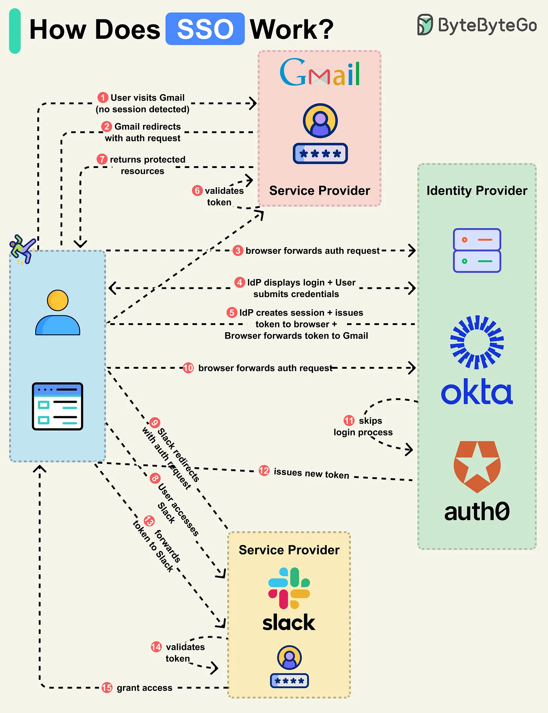

# 128 - SSO hoạt động như thế nào?

- Nguồn: ByteByteGo Big Archive System Design 2025
- Trang PDF: 268-269
- Ảnh minh họa: `../assets/128/figure-01.png`

## Hình minh họa

## Dịch sát

Single Sign-On (SSO) là một authentication scheme. Nó cho phép user login vào nhiều system khác nhau bằng một ID duy nhất.

Hãy đi qua một SSO login flow điển hình:

Step 1: User access protected resource trên một application như Gmail, đây là Service Provider (SP).

Step 2: Gmail server detect user chưa login và redirect browser tới Identity Provider (IdP) của công ty với authentication request.

Step 3: Browser gửi user tới IdP.

Step 4: IdP hiển thị login page để user nhập login credential.

Step 5: IdP tạo secure token và trả nó về browser. IdP cũng tạo session cho access tương lai. Browser forward token tới Gmail.

Step 6: Gmail validate token để bảo đảm nó đến từ IdP.

Step 7: Gmail trả protected resource cho browser dựa trên những gì user được phép access.

Flow này hoàn tất basic SSO login. Hãy xem điều gì xảy ra khi user navigate tới một SSO-integrated application khác, như Slack.

Step 8-9: User access Slack, và Slack server detect user chưa login. Nó redirect browser tới IdP với authentication request mới.

Step 10: Browser gửi user trở lại IdP.

Step 11-13: Vì user đã login với IdP, IdP skip login process và thay vào đó tạo token mới cho Slack. Token mới được gửi tới browser, browser forward nó tới Slack.

Step 14-15: Slack validate token và grant access cho user tương ứng.

Câu hỏi dành cho bạn: Bạn có muốn xem flow ví dụ cho application khác không?

## Dịch nội dung trong hình

- Gmail đóng vai trò `Service Provider`; Okta/Auth0 hoặc IdP công ty đóng vai trò `Identity Provider`.
- User vào Gmail, Gmail redirect sang IdP, user login, IdP issue token, browser gửi token về Gmail, Gmail validate token và trả protected resource.
- Khi user vào Slack sau đó, Slack cũng redirect sang IdP, nhưng IdP đã có session nên bỏ qua login, issue token riêng cho Slack; Slack validate token và grant access.

## Tóm tắt & giải thích dễ hiểu

SSO tách trách nhiệm login khỏi từng app. App như Gmail/Slack tin tưởng IdP để xác thực user. User login một lần ở IdP, sau đó các app khác có thể nhận token/assertion từ IdP mà không bắt user nhập lại mật khẩu.

SSO cải thiện trải nghiệm và quản trị bảo mật, nhưng IdP trở thành thành phần cực kỳ quan trọng. Nếu IdP lỗi hoặc bị compromise, nhiều app bị ảnh hưởng.

## Ví dụ thực tế - không nằm trong tài liệu gốc

Công ty dùng Okta cho Gmail, Slack, Jira và AWS Console. Khi nhân viên nghỉ việc, admin disable account ở Okta; quyền vào nhiều app bị thu hồi tập trung thay vì phải xóa từng app một.

## Thuật ngữ chính

- `SSO`: Single Sign-On.
- `SP`: Service Provider, ứng dụng cần xác thực.
- `IdP`: Identity Provider, nơi xác thực user.
- `Token`: bằng chứng xác thực/ủy quyền.
- `Session`: trạng thái login được duy trì.
- `SAML`: protocol SSO phổ biến trong enterprise.
- `OIDC`: OpenID Connect, SSO dựa trên OAuth2.

## Câu hỏi ôn tập + trả lời + thinking học tập + liên hệ

> Đây là phần học tập thêm ở cuối file. Câu hỏi ưu tiên lấy từ tài liệu gốc và được trả lời trực tiếp; nếu bài không có câu hỏi riêng thì dùng tiêu đề/nội dung chính để tạo câu hỏi tự kiểm tra.

### Câu hỏi 1

**Nguồn câu hỏi:** Câu hỏi trong tài liệu gốc.

**Câu hỏi:** Bạn có muốn xem flow ví dụ cho application khác không?

**Trả lời:** Hãy tách flow thành các bước có state rõ ràng: request/dữ liệu đi vào đâu, qua thành phần nào, state đổi ở đâu và kết quả trả ra thế nào. Với `SSO hoạt động như thế nào?`, ý chính là: SSO tách trách nhiệm login khỏi từng app. App như Gmail/Slack tin tưởng IdP để xác thực user. User login một lần ở IdP, sau đó các app khác có thể nhận token/assertion từ IdP mà không bắt user nhập lại mật khẩu. SSO cải thiện trải nghiệm và quản trị bảo mật, nhưng IdP trở thành thành phần cực kỳ quan trọng. Nếu IdP lỗi hoặc bị compromise, nhiều app bị ảnh hưởng.

**Thinking học tập + liên hệ:** Luồng trong `SSO hoạt động như thế nào?` nên được vẽ từ input tới output, kèm owner của từng bước và failure mode ở mỗi boundary. Lens chính là actor, trust boundary, dữ liệu nhạy cảm, lifetime của token/key, quyền truy cập và cơ chế revoke. Khi làm API thật, một endpoint chạy được chưa đủ; phải kiểm thêm abuse, audit log, error leakage, rate limit và quyền ở service chứa dữ liệu. Khi ghi chú lại, hãy giải thích được các keyword: `SSO`, `SP`, `IdP`, `Token`, `Session`.
