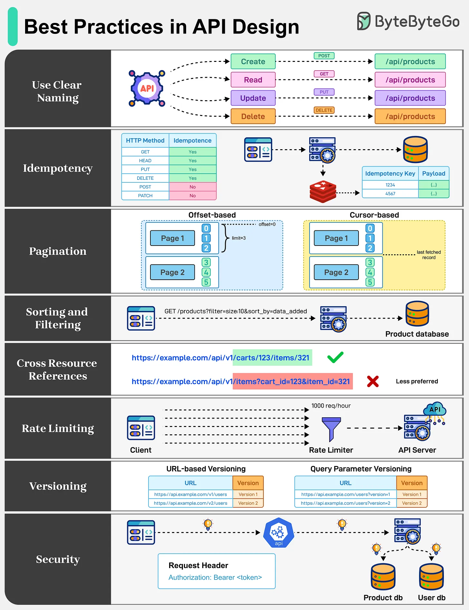

# 129 - Best practice trong API Design

- Nguồn: ByteByteGo Big Archive System Design 2025
- Trang PDF: 270-271
- Ảnh minh họa: `../assets/129/figure-01.png`

## Hình minh họa

## Dịch sát

API là xương sống của communication trên Internet. API được thiết kế tốt hoạt động consistent, predictable và grow without friction. Một số best practice cần ghi nhớ như sau:

1. Use Clear Naming: Khi build API, chọn name straightforward và logical. Hãy consistent và bám vào intuitive URL biểu thị collection.

2. Idempotency: API nên idempotent. Chúng bảo đảm retry an toàn bằng cách làm repeated request tạo ra cùng result, đặc biệt với POST operation.

3. Pagination: API nên hỗ trợ pagination để ngăn performance bottleneck và payload bloat. Một số pagination strategy phổ biến là offset-based và cursor-based.

4. Sorting and Filtering: Query string là cách hiệu quả để cho phép sorting và filtering API response. Điều này giúp developer dễ thấy filter và sort order nào đang được áp dụng.

5. Cross Resource References: Dùng linking rõ ràng giữa connected resource. Tránh query string quá dài làm API khó hiểu hơn.

6. Rate Limiting: Rate limiting được dùng để kiểm soát số request mà một user có thể gọi tới API trong một time frame nhất định. Điều này rất quan trọng để duy trì reliability và availability của API.

7. Versioning: Khi modify API endpoint, versioning đúng cách để support backward compatibility là quan trọng.

8. Security: API security là bắt buộc với API được thiết kế tốt. Dùng authentication và authorization đúng cách với API dùng API Keys, JWTs, OAuth2 và các mechanism khác.

Câu hỏi dành cho bạn: Chúng ta có bỏ sót điều gì quan trọng không?

## Dịch nội dung trong hình

- `Use Clear Naming`: endpoint resource như `/api/products`, HTTP method POST/GET/PUT/DELETE.
- `Idempotency`: bảng idempotency key lưu method, payload và response để retry an toàn.
- `Pagination`: offset-based và cursor-based pagination.
- `Sorting and Filtering`: query string như `?productName=...&sort_by=...`.
- `Cross Resource References`: link rõ ràng giữa cart/item, tránh URL/query quá phức tạp.
- `Rate Limiting`: client request qua rate limiter trước khi tới API server.
- `Versioning`: URL-based versioning và query parameter versioning.
- `Security`: dùng authorization header, Product DB và User DB phía sau.

## Tóm tắt & giải thích dễ hiểu

API tốt phải dễ đoán, dễ dùng và dễ tiến hóa. Naming rõ ràng giúp client hiểu resource. Idempotency giúp retry không tạo side effect trùng. Pagination/filter/sort kiểm soát payload. Rate limit bảo vệ hệ thống. Versioning và security giúp API sống lâu trong production.

## Ví dụ thực tế - không nằm trong tài liệu gốc

Tạo payment nên dùng `POST /v1/payments` với `Idempotency-Key`. Danh sách order nên dùng `GET /v1/orders?limit=20&cursor=...&status=paid`. API public nên có auth, scope, rate limit theo tenant và error response chuẩn.

## Thuật ngữ chính

- `Idempotency`: request lặp lại cho cùng kết quả logic.
- `Pagination`: phân trang.
- `Filtering`: lọc kết quả.
- `Sorting`: sắp xếp kết quả.
- `Rate limiting`: giới hạn tốc độ gọi API.
- `Versioning`: quản lý phiên bản API.
- `Backward compatibility`: tương thích với client cũ.

