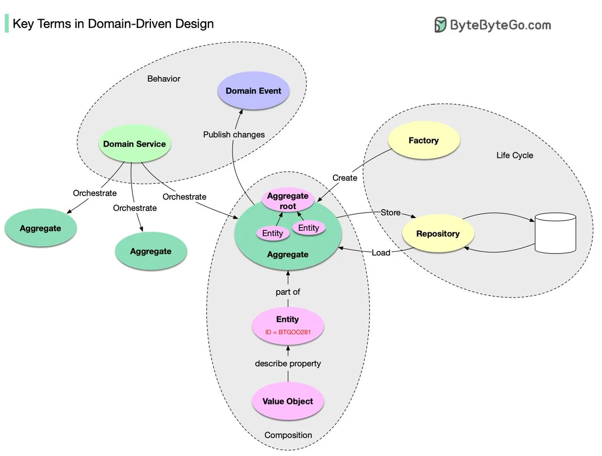

# 130 - Thuật ngữ chính trong Domain-Driven Design

- Nguồn: ByteByteGo Big Archive System Design 2025
- Trang PDF: 272-273
- Ảnh minh họa: `../assets/130/figure-01.png`

## Hình minh họa

## Dịch sát

Bạn đã nghe về Domain-Driven Design (DDD), một software design approach lớn chưa?

DDD được giới thiệu trong cuốn sách kinh điển của Eric Evans “Domain-Driven Design: Tackling Complexity in the Heart of Software”. Nó giải thích methodology để model một business phức tạp. Trong cuốn sách này có rất nhiều nội dung, nên tôi sẽ summarize phần cơ bản.

Composition của domain object:

- Entity: một domain object có ID và life cycle.

- Value Object: một domain object không có ID. Nó được dùng để describe property của Entity.

- Aggregate: một collection các Entity được bound với nhau bởi Aggregate Root, cũng là một entity. Nó là unit of storage.

Life cycle của domain object:

- Repository: storing và loading Aggregate.

- Factory: handling việc creation Aggregate.

Behavior của domain object:

- Domain Service: orchestrate nhiều Aggregate.

- Domain Event: mô tả điều đã xảy ra với Aggregate. Publication được public để người khác có thể consume và reconstruct nó.

Chúc mừng bạn đã đi tới đây. Bây giờ bạn biết các kiến thức cơ bản của DDD. Nếu muốn học thêm, tôi rất khuyến nghị cuốn sách. Nó có thể giúp đơn giản hóa complexity của software modeling.

Câu hỏi dành cho bạn: Bạn có biết cách check equality của hai Value Object không? Còn hai Entity thì sao?

## Dịch nội dung trong hình

- `Composition`: Entity là part of Aggregate; Value Object describe property của Entity; Aggregate Root boundary aggregate.
- `Life Cycle`: Factory create Aggregate; Repository store/load Aggregate.
- `Behavior`: Domain Service orchestrate Aggregate; Domain Event publish changes để component khác consume.

## Tóm tắt & giải thích dễ hiểu

DDD giúp model phần mềm theo ngôn ngữ nghiệp vụ. Entity được nhận diện bằng ID và có vòng đời. Value Object được so sánh bằng giá trị. Aggregate gom các object cần giữ invariant cùng nhau, với Aggregate Root là cổng truy cập. Repository che giấu persistence. Factory tạo object phức tạp. Domain Service xử lý logic không tự nhiên thuộc về một entity. Domain Event mô tả điều đã xảy ra trong domain.

## Ví dụ thực tế - không nằm trong tài liệu gốc

Trong hệ thống order, `Order` là Aggregate Root, `OrderItem` là entity bên trong aggregate, `Money` hoặc `Address` là Value Object. `OrderPlaced` là Domain Event. `OrderRepository` lưu/đọc order. `PricingService` có thể là Domain Service nếu pricing cần phối hợp nhiều aggregate/rule.

## Thuật ngữ chính

- `DDD`: Domain-Driven Design.
- `Entity`: object có identity.
- `Value Object`: object không identity, so sánh bằng value.
- `Aggregate`: cụm object giữ invariant.
- `Aggregate Root`: entity gốc kiểm soát aggregate.
- `Repository`: abstraction lưu/đọc aggregate.
- `Factory`: tạo object/aggregate phức tạp.
- `Domain Event`: sự kiện nghiệp vụ đã xảy ra.

