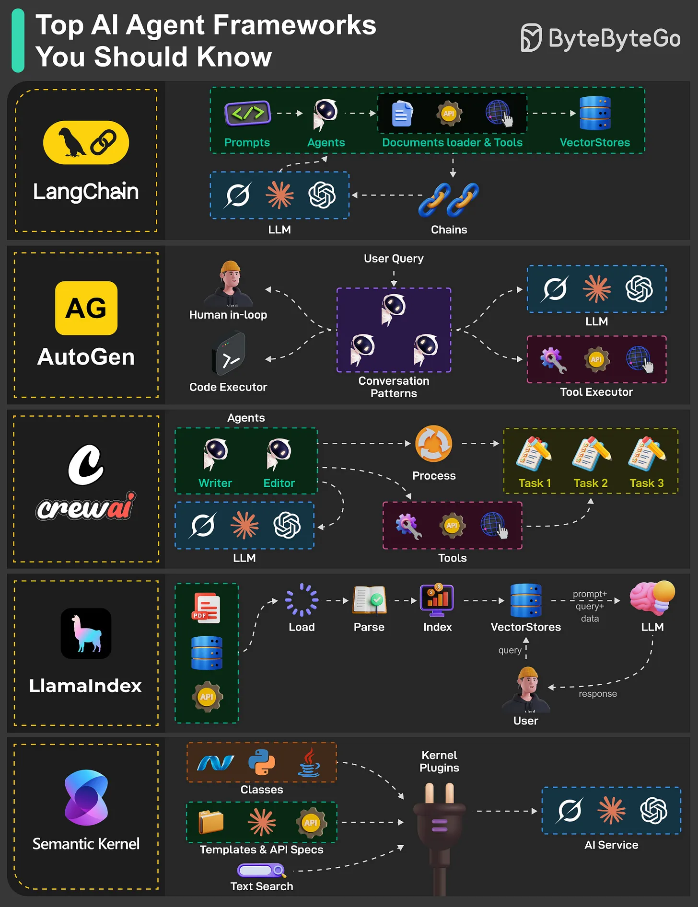

# 131 - Các AI Agent framework nên biết

- Nguồn: ByteByteGo Big Archive System Design 2025
- Trang PDF: 274-275
- Ảnh minh họa: `../assets/131/figure-01.png`

## Hình minh họa

## Dịch sát

Xây dựng smart, independent AI system dễ hơn với agent framework kết hợp large language model (LLM) với tool như API, web access hoặc code execution.

- LangChain
  LangChain giúp việc kết nối LLM với external tool như API và vector database trở nên đơn giản. Nó cho phép developer tạo chain để sequential task execution và document loader cho context-aware response.

- AutoGen
  AutoGen cho phép bạn develop AI agent có thể chat với nhau hoặc có human in the loop. Nó giống một collaborative workspace nơi agent có thể run code, pull data từ tool hoặc nhận human feedback để hoàn thành task.

- CrewAI
  Như tên gọi, CrewAI xoay quanh teamwork. Nó orchestrate team AI agent với role như writer và editor, xử lý task trong structured workflow. Nó sử dụng LLM và tool như API, Internet, code, v.v. để quản lý complex task execution và data flow hiệu quả.

- LlamaIndex
  Framework này index và query data từ document, API và vector store để enhance agent response. Nó parse và load data, cho phép LLM cung cấp context-aware answer, rất phù hợp cho enterprise document search system và intelligent assistant truy cập private knowledge base.

- Semantic Kernel
  Semantic Kernel kết nối AI service như OpenAI, Calude, Hugging Face models, v.v. với plugin-based architecture hỗ trợ skill, template và API integration cho workflow linh hoạt. Nó hỗ trợ text search và custom workflow cho application.

Câu hỏi dành cho bạn: Bạn đã khám phá hoặc dự định dùng AI agent framework nào?

## Dịch nội dung trong hình

- `LangChain`: prompts, agents, document loader & tool, vector stores, chains.
- `AutoGen`: user query, human-in-loop, code executor, conversation pattern, LLM và tool executor.
- `CrewAI`: agents như writer/editor, process, tools và tasks.
- `LlamaIndex`: load, parse, index, vector stores, LLM, user response.
- `Semantic Kernel`: classes, kernel plugins, templates/API specs, text search và AI service.

## Tóm tắt & giải thích dễ hiểu

Agent framework giúp xây workflow LLM có tool, memory, retrieval, multi-agent và human feedback. LangChain/LlamaIndex mạnh về chain/RAG/data integration. AutoGen/CrewAI mạnh về multi-agent collaboration. Semantic Kernel mạnh về plugin/enterprise integration.

Framework không thay thế thiết kế hệ thống. Production agent vẫn cần permission, observability, retry, timeout, cost control, test/evaluation và guardrails.

## Ví dụ thực tế - không nằm trong tài liệu gốc

Nếu build chatbot hỏi đáp tài liệu, LlamaIndex hoặc LangChain có thể phù hợp. Nếu build workflow marketing gồm researcher, writer, editor, CrewAI có thể dễ mô hình hóa. Nếu build agent enterprise gắn nhiều plugin/API .NET/Azure, Semantic Kernel có thể thuận tiện.

## Thuật ngữ chính

- `Agent framework`: framework xây workflow agent.
- `Chain`: chuỗi bước xử lý LLM/tool.
- `Document loader`: component nạp tài liệu.
- `Vector store`: kho lưu embedding.
- `Human in the loop`: con người tham gia duyệt/feedback.
- `Plugin-based architecture`: kiến trúc mở rộng bằng plugin.
- `Tool executor`: thành phần gọi tool/code/API.

## Ghi chú kỹ thuật - không nằm trong tài liệu gốc

Trong bản gốc có typo `Calude`; ngữ cảnh và hình cho thấy ý muốn nói `Claude`.

