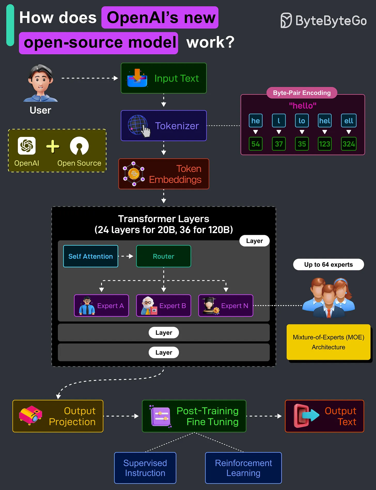

# 132 - GPT-OSS 120B và 20B của OpenAI hoạt động như thế nào?

- Nguồn: ByteByteGo Big Archive System Design 2025
- Trang PDF: 276-277
- Ảnh minh họa: `../assets/132/figure-01.png`

## Hình minh họa

## Dịch sát

OpenAI gần đây đã release hai LLM, GPT-OSS-120B (120 tỷ parameter) và GPT-OSS-20B (20 tỷ parameter). Đây là các model fully open-source và được cung cấp dưới Apache 2.0 license.

Các model này nhằm deliver strong real-world performance với cost thấp. Dưới đây là cách chúng hoạt động:

1. User cung cấp input, chẳng hạn một câu hỏi hoặc task. Ví dụ: “Explain quantum mechanics in a simple manner”.

2. Raw text được convert thành numerical token bằng Byte-Pair Encoding (BPE). BPE chia text thành các subword unit xuất hiện thường xuyên. Vì nó hoạt động ở byte level, nó có thể handle mọi input, bao gồm text, code, emoji và nhiều thứ khác.

3. Mỗi token được map tới một vector, tức một list number, bằng learned embedding table. Dạng vectorized này là thứ model hiểu và process.

4. Transformer layer là nơi computation thật sự xảy ra. 20B Model có 24 Transformer layer, và 120B Model có 36 Transformer layer. Mỗi layer gồm self-attention module, router và experts (MoE).

5. Self-attention module cho phép model hiểu relationship giữa các word trên toàn bộ input.

6. LLM dùng Mixture-of-Experts (MoE) architecture. Thay vì dùng tất cả model weight như model truyền thống, router chọn 2 “expert” tốt nhất từ một pool tối đa 64 expert tổng cộng. Mỗi expert là một feedforward network nhỏ được train để specialize vào một số loại input nhất định. Chỉ 2 expert được activate cho mỗi token, nhờ đó tiết kiệm compute trong khi cải thiện quality.

7. Sau khi đi qua tất cả layer, model project internal representation trở lại token probability, dự đoán word hoặc phrase tiếp theo.

8. Để làm raw model safe và helpful, nó trải qua supervised fine-tuning và reinforcement learning.

9. Cuối cùng, model generate response dựa trên predicted token, trả coherent output cho user dựa trên context.

Câu hỏi dành cho bạn: Bạn đã dùng open-source model của OpenAI chưa?

## Dịch nội dung trong hình

- User nhập `Input Text`.
- Text đi qua `Tokenizer`, dùng `Byte-Pair Encoding` để tạo token.
- Token được chuyển thành `Token Embeddings`.
- `Transformer Layers`: 24 layer cho 20B, 36 layer cho 120B; mỗi layer gồm Self Attention, Router và Expert A/B/N; MoE có tối đa 64 expert.
- Sau layer, model đi qua `Output Projection`, rồi `Post-Training Fine Tuning` gồm supervised instruction và reinforcement learning, cuối cùng tạo `Output Text`.

## Tóm tắt & giải thích dễ hiểu

Luồng LLM gồm tokenization, embedding, transformer computation, MoE routing, output projection và post-training alignment. Điểm nổi bật của MoE là không kích hoạt toàn bộ network cho mọi token; router chọn một số expert phù hợp, giúp giảm compute active mỗi token so với kích thước tổng của model.

Theo tư duy system design, MoE là trade-off giữa quality, latency, memory và serving complexity. Model có nhiều expert cần hạ tầng inference biết route token hiệu quả và giữ expert weights sẵn sàng.

## Ví dụ thực tế - không nằm trong tài liệu gốc

Nếu một prompt chứa cả code và văn bản tự nhiên, router có thể chọn expert khác nhau cho token liên quan tới code, reasoning hoặc language. Khi serving production, hệ thống cần batch request, quản lý GPU memory và tối ưu KV cache để giảm latency/cost.

## Thuật ngữ chính

- `BPE`: Byte-Pair Encoding.
- `Token`: đơn vị text/code mà model xử lý.
- `Embedding`: vector biểu diễn token.
- `Transformer layer`: layer tính toán chính trong LLM.
- `Self-attention`: cơ chế học quan hệ giữa token.
- `MoE`: Mixture-of-Experts.
- `Router`: module chọn expert cho token.
- `Output projection`: chuyển hidden state thành xác suất token.

