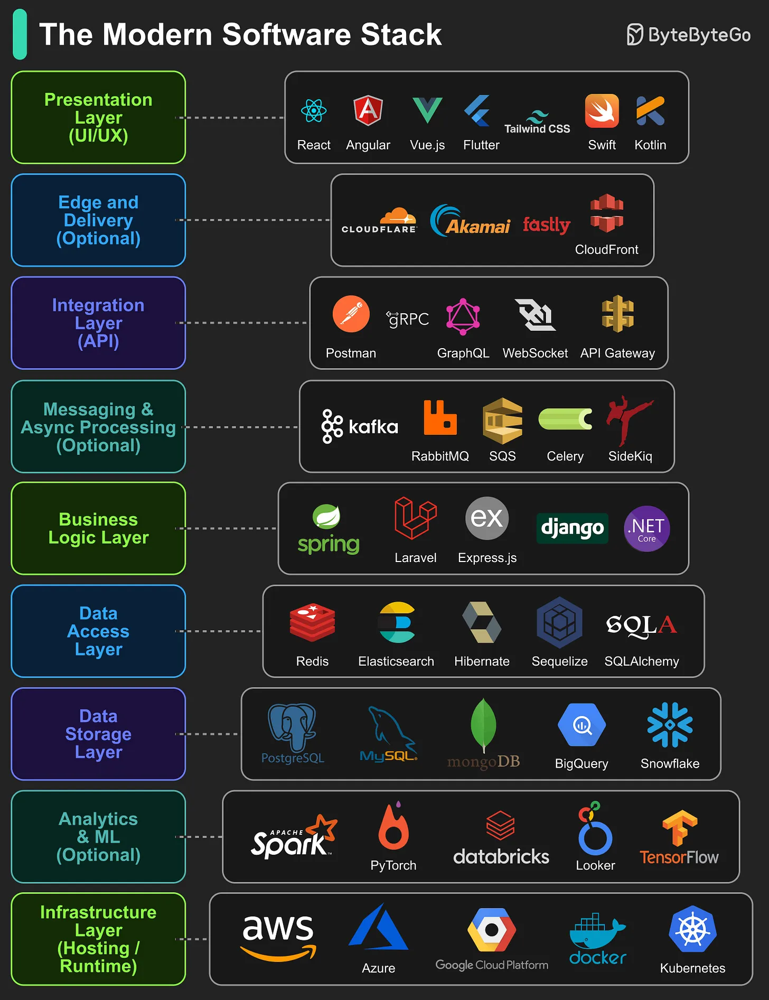

# 133 - Modern Software Stack

- Nguồn: ByteByteGo Big Archive System Design 2025
- Trang PDF: 278-279
- Ảnh minh họa: `../assets/133/figure-01.png`

## Hình minh họa

## Dịch sát

Trong thế giới ngày nay, build software nghĩa là làm việc qua nhiều layer, mỗi layer có role, tool và technology riêng. Dưới đây là 9 layer tạo nên hầu hết modern application:

1. Presentation Layer (UI/UX): Xử lý cách user tương tác với application, tập trung vào visual, layout và usability.

2. Edge and Delivery (Optional): Đưa content tới gần user hơn thông qua global delivery network, giảm latency và cải thiện performance.

3. Integration Layer (API): Định nghĩa cách các phần khác nhau của system communicate, cho phép interoperability giữa component.

4. Messaging & Async Processing (Optional): Xử lý task và event ở background để cải thiện scalability và responsiveness.

5. Business Logic Layer: Implement core rule, workflow và decision-making process của application.

6. Data Access Layer: Đóng vai trò bridge giữa application logic và stored data, bảo đảm retrieval hoặc update an toàn, hiệu quả.

7. Data Storage Layer: Store, organize và manage structured/unstructured data của application.

8. Analytics & ML (Optional): Analyze data để generate insight, prediction và intelligent feature.

9. Infrastructure Layer (Hosting / Runtime): Cung cấp computing environment và resource để deploy, run và scale application.

Câu hỏi dành cho bạn: Layer nào bạn nghĩ bị đánh giá thấp nhất trong modern software development?

## Dịch nội dung trong hình

- `Presentation Layer`: React, Angular, Vue.js, Flutter, Tailwind CSS, Swift, Kotlin.
- `Edge and Delivery`: Cloudflare, Akamai, Fastly, CloudFront.
- `Integration Layer`: Postman, gRPC, GraphQL, WebSocket, API Gateway.
- `Messaging & Async Processing`: Kafka, RabbitMQ, SQS, Celery, Sidekiq.
- `Business Logic Layer`: Spring, Laravel, Express.js, Django, .NET.
- `Data Access Layer`: Redis, Elasticsearch, Hibernate, Sequelize, SQLAlchemy.
- `Data Storage Layer`: PostgreSQL, MySQL, MongoDB, BigQuery, Snowflake.
- `Analytics & ML`: Spark, PyTorch, Databricks, Looker, TensorFlow.
- `Infrastructure Layer`: AWS, Azure, Google Cloud Platform, Docker, Kubernetes.

## Tóm tắt & giải thích dễ hiểu

Modern app thường là một stack nhiều lớp: UI cho người dùng, edge/CDN để delivery nhanh, API để tích hợp, message queue để xử lý bất đồng bộ, business logic cho nghiệp vụ, data access/storage cho dữ liệu, analytics/ML cho insight và infrastructure để chạy/scale.

Không phải app nào cũng cần đủ 9 layer ngay từ đầu. Nhưng khi hệ thống lớn lên, thiếu layer như observability, messaging hoặc data access boundary thường gây khó scale và khó debug.

## Ví dụ thực tế - không nằm trong tài liệu gốc

Một SaaS dashboard có thể dùng React/Tailwind ở UI, CloudFront ở edge, REST/GraphQL API, queue SQS cho report generation, Laravel/Spring cho business logic, Redis + ORM ở data access, PostgreSQL ở storage, BigQuery/Looker cho analytics và Kubernetes/AWS để deploy.

## Thuật ngữ chính

- `Software stack`: tập layer/tool tạo nên ứng dụng.
- `Presentation layer`: lớp giao diện.
- `Edge/CDN`: lớp phân phối gần user.
- `Integration layer`: lớp API/kết nối.
- `Async processing`: xử lý bất đồng bộ.
- `Data access`: lớp truy cập dữ liệu.
- `Infrastructure`: hạ tầng chạy ứng dụng.

