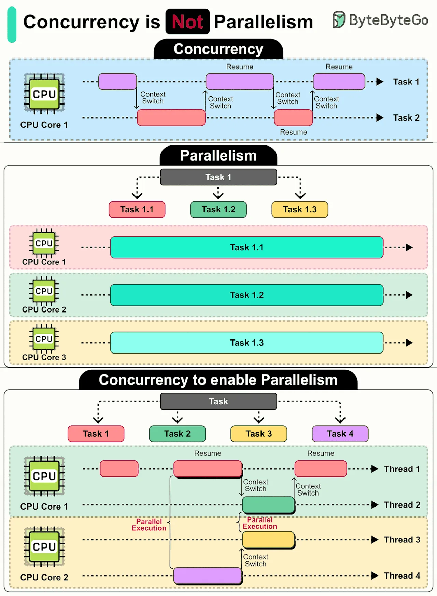

# 134 - Concurrency không phải Parallelism

- Nguồn: ByteByteGo Big Archive System Design 2025
- Trang PDF: 280-281
- Ảnh minh họa: `../assets/134/figure-01.png`

## Hình minh họa

## Dịch sát

Concurrency: Đây là một design approach trong đó các task có thể start, run và complete trong các khoảng thời gian overlapping, ngay cả trên một CPU core duy nhất. Nó nói về việc quản lý nhiều task cùng lúc.

CPU nhanh chóng switch giữa các task (context switching), tạo illusion rằng các task đang progress đồng thời, dù thực tế không phải vậy.

Concurrency rất tốt cho task có waiting, như I/O operation. Nó cho phép task khác progress trong lúc chờ, cải thiện overall efficiency.

Parallelism: Chỉ việc execute nhiều task đồng thời thật sự bằng nhiều CPU core.

Parallelism xuất sắc với heavy computation như data analysis hoặc rendering graphics, nơi task có thể được chia nhỏ và chạy đồng thời trên các core khác nhau.

How They Work Together

Điều quan trọng cần lưu ý là concurrency và parallelism là hai concept khác nhau nhưng liên quan chặt chẽ. Một concurrent program được thiết kế tốt có thể scale để dùng nhiều core cho parallelism khi cần.

Bằng cách hiểu khác biệt và interplay giữa concurrency và parallelism, chúng ta có thể design system hiệu quả hơn và tạo application có performance tốt hơn.

Câu hỏi dành cho bạn: Bạn từng gặp challenge nào với concurrency hoặc parallelism chưa?

## Dịch nội dung trong hình

- `Concurrency`: một CPU core context switch giữa Task 1 và Task 2; task có thể pause/resume xen kẽ.
- `Parallelism`: nhiều CPU core chạy Task 1.1, Task 1.2, Task 1.3 đồng thời.
- `Concurrency to enable parallelism`: nhiều thread/task được tổ chức concurrent; khi có nhiều core, một số phần có thể execute parallel.

## Tóm tắt & giải thích dễ hiểu

Concurrency là cấu trúc chương trình để xử lý nhiều việc đang diễn ra cùng lúc. Parallelism là chạy nhiều việc thật sự cùng lúc trên nhiều core. Một server async có thể concurrent trên một core khi chờ I/O; một job xử lý ảnh có thể parallel bằng cách chia ảnh cho nhiều core xử lý.

Concurrency giúp throughput khi nhiều task chờ network/disk. Parallelism giúp tốc độ khi task CPU-bound có thể chia nhỏ.

## Ví dụ thực tế - không nằm trong tài liệu gốc

Node.js xử lý nhiều HTTP request bằng event loop là concurrency mạnh cho I/O-bound workload. Python multiprocessing hoặc Java parallel stream chạy nhiều phép tính trên nhiều core là parallelism. Trong Go, goroutine tạo concurrency; runtime có thể chạy chúng parallel nếu `GOMAXPROCS` và CPU core cho phép.

## Thuật ngữ chính

- `Concurrency`: quản lý nhiều task overlapping.
- `Parallelism`: chạy nhiều task đồng thời thật sự.
- `Context switching`: chuyển ngữ cảnh giữa task/thread.
- `I/O-bound`: workload chủ yếu chờ I/O.
- `CPU-bound`: workload chủ yếu dùng CPU.
- `Thread`: luồng thực thi.
- `Core`: lõi CPU.

## Câu hỏi ôn tập + trả lời + thinking học tập + liên hệ

> Đây là phần học tập thêm ở cuối file. Câu hỏi ưu tiên lấy từ tài liệu gốc và được trả lời trực tiếp; nếu bài không có câu hỏi riêng thì dùng tiêu đề/nội dung chính để tạo câu hỏi tự kiểm tra.

### Câu hỏi 1

**Nguồn câu hỏi:** Câu hỏi trong tài liệu gốc.

**Câu hỏi:** Bạn từng gặp challenge nào với concurrency hoặc parallelism chưa?

**Trả lời:** Nếu đưa `Concurrency không phải Parallelism` vào stack, nên bắt đầu từ một use case hẹp, dễ rollback và có metric rõ. Nên kiểm bằng workload nhỏ trước: latency, độ ổn định, khả năng debug, cost và rủi ro vận hành. Phần cốt lõi cần đem theo từ bài là: Concurrency là cấu trúc chương trình để xử lý nhiều việc đang diễn ra cùng lúc. Parallelism là chạy nhiều việc thật sự cùng lúc trên nhiều core. Một server async có thể concurrent trên một core khi chờ I/O; một job xử lý ảnh có thể parallel bằng cách chia ảnh cho nhiều core xử lý.

**Thinking học tập + liên hệ:** Với `Concurrency không phải Parallelism`, trải nghiệm thật nên được đo bằng latency, độ ổn định, chi phí, khả năng debug và mức dễ rollback. Lens chính là DNS, transport, TLS, HTTP, proxy/CDN, application timeout và observability theo từng layer. Khi debug production, hãy tách latency theo DNS lookup, TCP connect, TLS handshake, TTFB và download để không đoán mò. Khi ghi chú lại, hãy giải thích được các keyword: `Concurrency`, `Parallelism`, `Context switching`, `I/O-bound`, `CPU-bound`.
