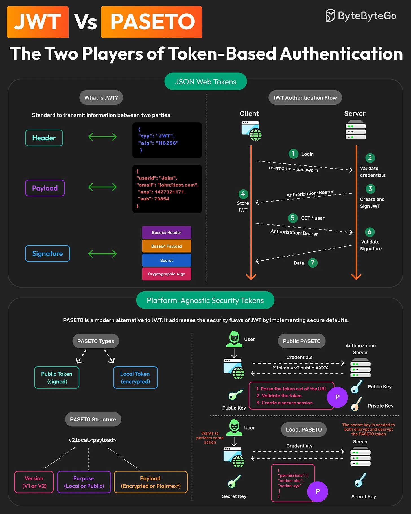

# 135 - JWT vs PASETO: hai người chơi của token-based authentication

- Nguồn: ByteByteGo Big Archive System Design 2025
- Trang PDF: 282-283
- Ảnh minh họa: `../assets/135/figure-01.png`

## Hình minh họa

## Dịch sát

Token-based authentication đã trở nên khá phổ biến qua nhiều năm. Theo truyền thống, JWT thống trị không gian này.

Nhưng hiện tại, một người chơi mới đang tạo chú ý: PASETO, hay Platform-Agnostic Security Tokens.

Vậy khác biệt giữa hai bên là gì?

1. JWTs
   JWT hay JSON Web Tokens là một open standard để truyền thông tin an toàn giữa hai bên.

   Một JWT gồm Header, Payload và Signature.

   JWT có thể được dùng để implement stateless authentication giữa client và server application.

2. PASETO
   PASETO là một modern alternative cho JWT. Nó xử lý security flaw của JWT bằng secure default.

   Khác với JWT, PASETO enforce các algorithm mạnh và đúng về cryptography, giảm rủi ro vulnerability.

   Một PASETO thường gồm Version, Purpose và Payload. Có hai loại PASETO:

   - Public PASETO: Được sign bằng asymmetric cryptography và bảo đảm integrity của data, nhưng không bảo đảm confidentiality.
   - Local PASETO: Được encrypt bằng symmetric encryption algorithm, bảo đảm confidentiality của data chứa trong token.

Câu hỏi dành cho bạn: Bạn đã dùng JWT hoặc PASETO trong application chưa?

## Dịch nội dung trong hình

- `JWT`: structure gồm Header, Payload, Signature; dùng trong authentication flow client/server.
- `PASETO`: structure gồm Version, Purpose và Payload.
- `Public PASETO`: signed token, server verify bằng public key; bảo vệ integrity.
- `Local PASETO`: encrypted token, dùng shared secret key; bảo vệ confidentiality.

## Tóm tắt & giải thích dễ hiểu

JWT linh hoạt và phổ biến nhưng vì quá linh hoạt nên dễ cấu hình sai thuật toán hoặc xử lý signature không đúng. PASETO cố tình giảm lựa chọn nguy hiểm bằng secure defaults: token local là encrypted, token public là signed.

Nếu hệ sinh thái/framework của bạn đã hỗ trợ JWT tốt, JWT vẫn rất thực tế. Nếu muốn API token có default an toàn hơn và ít footgun crypto hơn, PASETO đáng cân nhắc.

## Ví dụ thực tế - không nằm trong tài liệu gốc

Access token public giữa auth service và nhiều microservice có thể dùng signed token để service verify mà không cần biết private key. Nếu token chứa dữ liệu nhạy cảm cần giữ kín với client, local PASETO/encrypted token phù hợp hơn signed-only JWT.

## Thuật ngữ chính

- `JWT`: JSON Web Token.
- `PASETO`: Platform-Agnostic Security Tokens.
- `Signature`: chữ ký bảo vệ integrity.
- `Encryption`: mã hóa bảo vệ confidentiality.
- `Public token`: token signed bằng asymmetric key.
- `Local token`: token encrypted bằng symmetric key.
- `Secure defaults`: mặc định an toàn, ít cấu hình nguy hiểm.

## Câu hỏi ôn tập + trả lời + thinking học tập + liên hệ

> Đây là phần học tập thêm ở cuối file. Câu hỏi ưu tiên lấy từ tài liệu gốc và được trả lời trực tiếp; nếu bài không có câu hỏi riêng thì dùng tiêu đề/nội dung chính để tạo câu hỏi tự kiểm tra.

### Câu hỏi 1

**Nguồn câu hỏi:** Câu hỏi trong tài liệu gốc.

**Câu hỏi:** Bạn đã dùng JWT hoặc PASETO trong application chưa?

**Trả lời:** Trong project thật, `JWT vs PASETO: hai người chơi của token-based authentication` đáng dùng/thử khi bài toán khớp với nhu cầu cụ thể và team đo được kết quả. Nên kiểm bằng workload nhỏ trước: latency, độ ổn định, khả năng debug, cost và rủi ro vận hành. Phần cốt lõi cần đem theo từ bài là: JWT linh hoạt và phổ biến nhưng vì quá linh hoạt nên dễ cấu hình sai thuật toán hoặc xử lý signature không đúng. PASETO cố tình giảm lựa chọn nguy hiểm bằng secure defaults: token local là encrypted, token public là signed. Nếu hệ sinh thái/framework của bạn đã hỗ trợ JWT tốt, JWT vẫn rất thực tế. Nếu muốn API token có default an toàn hơn và ít footgun crypto hơn, PASETO đáng cân nhắc.

**Thinking học tập + liên hệ:** Câu hỏi trải nghiệm trong `JWT vs PASETO: hai người chơi của token-based authentication` nên quy về adoption: dùng cho workload nào, đo thành công bằng metric nào và có đáng giữ lâu dài trong stack không. Lens chính là actor, trust boundary, dữ liệu nhạy cảm, lifetime của token/key, quyền truy cập và cơ chế revoke. Khi làm API thật, một endpoint chạy được chưa đủ; phải kiểm thêm abuse, audit log, error leakage, rate limit và quyền ở service chứa dữ liệu. Khi ghi chú lại, hãy giải thích được các keyword: `JWT`, `PASETO`, `Signature`, `Encryption`, `Public token`.
