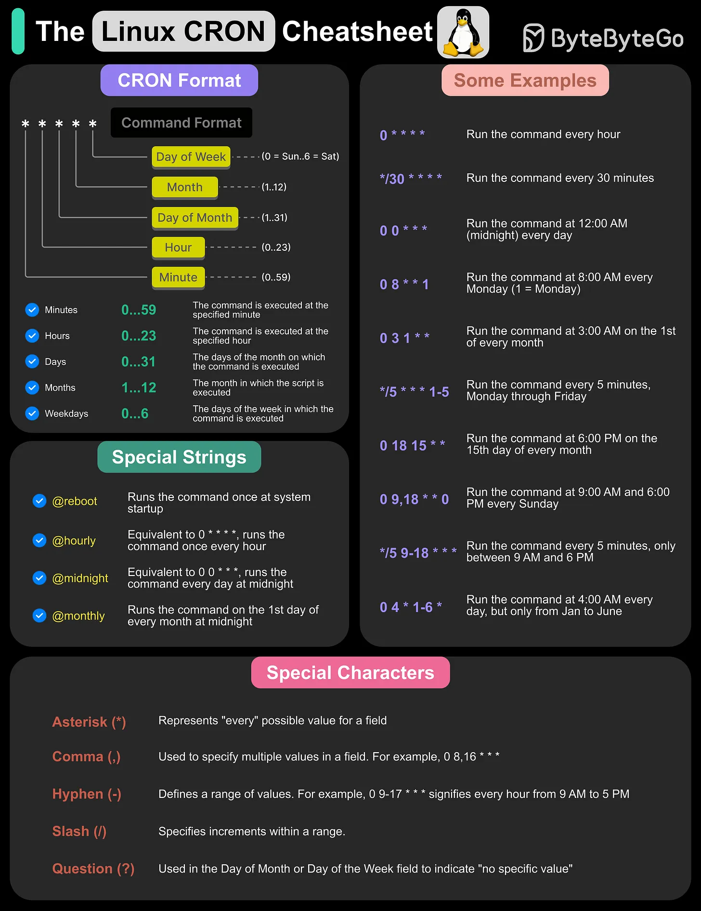

# 136 - Cheatsheet Linux Cron

- Nguồn: ByteByteGo Big Archive System Design 2025
- Trang PDF: 284-285
- Ảnh minh họa: `../assets/136/figure-01.png`

## Hình minh họa

## Dịch sát

Cron là time-based job scheduler cho phép user automate repetitive task bằng cách chạy command hoặc script theo interval được chỉ định. Nó dùng Cron expression, một syntax định nghĩa schedule, gồm năm field: minute, hour, day, month, weekday.

Cron được dùng rộng rãi cho system maintenance, backup, log rotation và automation các task như gửi email hoặc chạy script theo interval đều đặn. Trong cheatsheet này, chúng ta bao phủ:

1. The Cron Format

2. Some Cron Examples

3. Special Cron Strings

4. Special characters

Câu hỏi dành cho bạn: Bạn đã dùng Cron chưa?

## Dịch nội dung trong hình

- `Cron Format`: `* * * * * command`, gồm minute, hour, day of month, month, day of week.
- Range thường gặp: minute `0-59`, hour `0-23`, day `0-31`, month `1-12`, weekday `0-6`.
- `Special Strings`: `@reboot`, `@hourly`, `@midnight`, `@monthly`.
- `Special Characters`: `*` đại diện mọi giá trị, `,` liệt kê nhiều giá trị, `-` chỉ range, `/` chỉ bước lặp, `?` dùng cho day-of-month/day-of-week khi không chỉ định cụ thể.
- Ví dụ trong hình minh họa chạy mỗi giờ, mỗi 30 phút, mỗi ngày lúc 12:00 AM, mỗi thứ Hai 8:00 AM, ngày đầu mỗi tháng, mỗi 5 phút thứ Sáu, khoảng 6:00-6:15 PM, mỗi ngày 9:00 AM và 6:00 PM, mỗi 5 phút chỉ từ 9 AM tới 5 PM, hoặc 4:00 AM mỗi 1 và 15 hằng tháng.

## Tóm tắt & giải thích dễ hiểu

Cron là công cụ chạy việc định kỳ trên Linux/Unix. Nó rất phù hợp cho backup, dọn log, gửi report, sync dữ liệu hoặc chạy batch job nhỏ. Tuy nhiên cron không tự giải quyết retry phức tạp, dependency giữa job, distributed lock hoặc observability tốt.

## Ví dụ thực tế - không nằm trong tài liệu gốc

Một job backup có thể chạy lúc 2 giờ sáng mỗi ngày bằng cron, ghi log ra file và alert nếu exit code khác 0. Với hệ thống nhiều server, nên dùng scheduler tập trung hoặc lock như Redis/Postgres advisory lock để tránh nhiều instance chạy cùng job.

## Thuật ngữ chính

- `Cron`: scheduler chạy command theo lịch.
- `Cron expression`: biểu thức lịch chạy.
- `crontab`: file/danh sách job cron.
- `Log rotation`: xoay/vệ sinh log.
- `Exit code`: mã kết quả command.
- `Distributed lock`: khóa phân tán tránh chạy trùng job.
- `Scheduler`: bộ lập lịch.

## Câu hỏi ôn tập + trả lời + thinking học tập + liên hệ

> Đây là phần học tập thêm ở cuối file. Câu hỏi ưu tiên lấy từ tài liệu gốc và được trả lời trực tiếp; nếu bài không có câu hỏi riêng thì dùng tiêu đề/nội dung chính để tạo câu hỏi tự kiểm tra.

### Câu hỏi 1

**Nguồn câu hỏi:** Câu hỏi trong tài liệu gốc.

**Câu hỏi:** Bạn đã dùng Cron chưa?

**Trả lời:** Trong project thật, `Cheatsheet Linux Cron` đáng dùng/thử khi bài toán khớp với nhu cầu cụ thể và team đo được kết quả. Nên kiểm bằng workload nhỏ trước: latency, độ ổn định, khả năng debug, cost và rủi ro vận hành. Phần cốt lõi cần đem theo từ bài là: Cron là công cụ chạy việc định kỳ trên Linux/Unix. Nó rất phù hợp cho backup, dọn log, gửi report, sync dữ liệu hoặc chạy batch job nhỏ. Tuy nhiên cron không tự giải quyết retry phức tạp, dependency giữa job, distributed lock hoặc observability tốt.

**Thinking học tập + liên hệ:** Câu hỏi trải nghiệm trong `Cheatsheet Linux Cron` nên quy về adoption: dùng cho workload nào, đo thành công bằng metric nào và có đáng giữ lâu dài trong stack không. Lens chính là độ phức tạp vận hành, rollback, cost, kỹ năng team, observability và blast radius khi hỏng. Khi đưa lên production, hãy map từng thành phần vào deploy, rollback, monitoring, alerting, secret, cost và ownership rõ ràng. Khi ghi chú lại, hãy giải thích được các keyword: `Cron`, `Cron expression`, `crontab`, `Log rotation`, `Exit code`.
