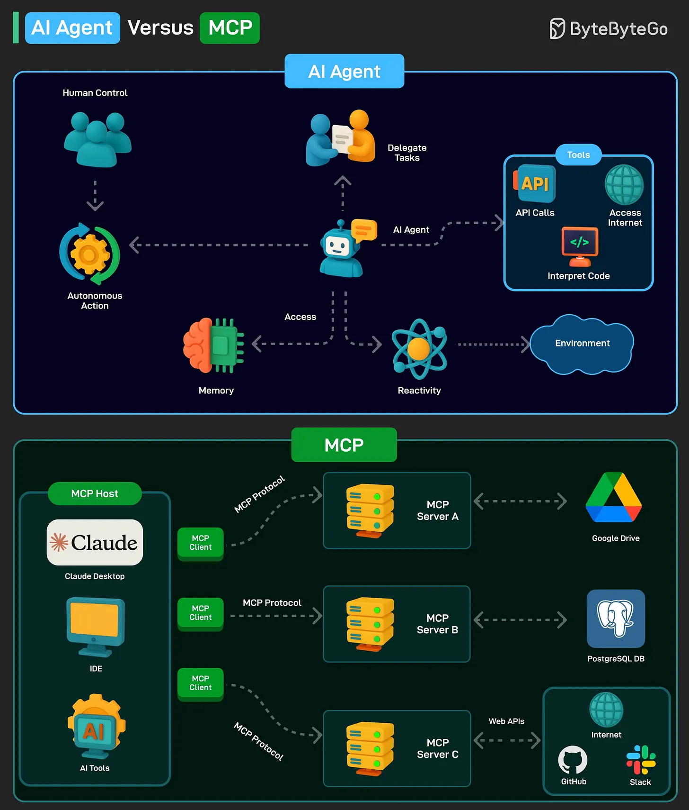

# 137 - AI Agent so với MCP

- Nguồn: ByteByteGo Big Archive System Design 2025
- Trang PDF: 286-287
- Ảnh minh họa: `../assets/137/figure-01.png`

## Hình minh họa

## Dịch sát

AI agent là một software program có thể tương tác với environment, thu thập data và dùng data đó để đạt các goal đã xác định trước. AI agent có thể chọn action tốt nhất để thực hiện nhằm đạt các goal đó.

Các đặc điểm chính của AI agent như sau:

1. Agent có thể thực hiện autonomous action mà không cần human intervention liên tục. Đồng thời, chúng cũng có thể có human in the loop để duy trì kiểm soát.

2. Agent có memory để lưu preference cá nhân và cho phép personalization. Nó cũng có thể lưu knowledge. Một LLM có thể đảm nhiệm chức năng xử lý thông tin và ra quyết định.

3. Agent phải có khả năng perceive và process thông tin có sẵn từ environment.

Model Context Protocol (MCP) là một system mới do Anthropic giới thiệu để làm AI model mạnh hơn.

Nó là một open standard cho phép AI model như Claude kết nối tới database, API, file system và các tool khác mà không cần custom code cho từng integration mới.

MCP theo client-server model với 3 component chính:

1. Host: AI application như Claude.

2. MCP Client: Component bên trong AI model như Claude, cho phép nó communicate với MCP server.

3. MCP Server: Middleman kết nối AI model với external system.

Câu hỏi dành cho bạn: Bạn đã dùng AI Agent hoặc MCP chưa?

## Dịch nội dung trong hình

- `AI Agent`: human control/delegate tasks, autonomous action, memory, reactivity, environment và tools như API calls, internet, interpret code.
- `MCP`: MCP host như Claude Desktop/IDE/AI tools kết nối qua MCP client tới MCP server A/B/C, rồi tới external systems như Google Drive, PostgreSQL DB, GitHub, Slack hoặc internet.

## Tóm tắt & giải thích dễ hiểu

AI Agent là hệ thống hành động theo mục tiêu: quan sát, quyết định, dùng tool và lặp lại. MCP là giao thức/chuẩn tích hợp để agent hoặc AI app truy cập tool và dữ liệu bên ngoài. Agent là “người làm việc”; MCP là “ổ cắm chuẩn” để người đó dùng công cụ.

Bài này lặp lại chủ đề đã xuất hiện ở bài 082, nhưng được giữ thành file riêng theo đúng archive.

## Ví dụ thực tế - không nằm trong tài liệu gốc

Một coding agent có thể quyết định đọc file, chạy test và sửa code. File system hoặc GitHub MCP chỉ cung cấp cách truy cập repo; chính agent mới là phần lập kế hoạch và chọn hành động tiếp theo.

## Thuật ngữ chính

- `AI Agent`: chương trình AI hành động theo mục tiêu.
- `MCP`: Model Context Protocol.
- `Host`: ứng dụng AI chủ.
- `MCP Client`: client nói chuyện với MCP server.
- `MCP Server`: bridge tới external system.
- `Tool use`: dùng API/tool bên ngoài.
- `Human in the loop`: người tham gia kiểm soát.

