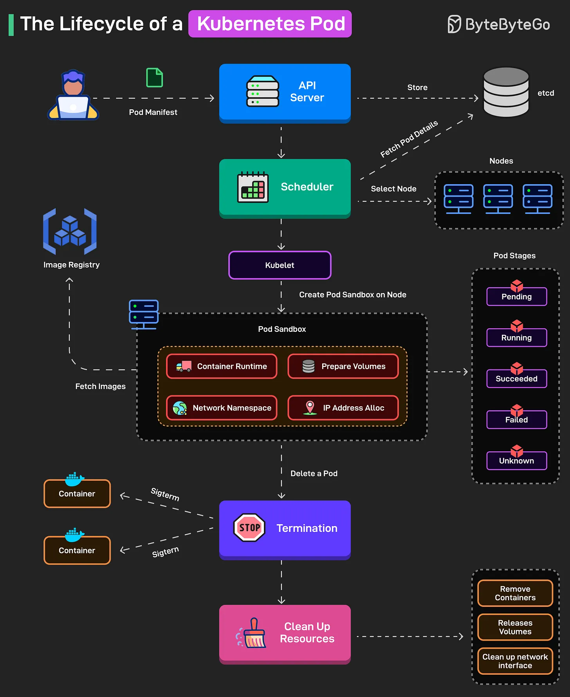

# 138 - Lifecycle của Kubernetes Pod

- Nguồn: ByteByteGo Big Archive System Design 2025
- Trang PDF: 288-289
- Ảnh minh họa: `../assets/138/figure-01.png`

## Hình minh họa

## Dịch sát

Pod manifest được submit tới API server và lưu trong etcd.

1. Scheduler chọn node cho Pod dựa trên resource, affinity rule và bind Pod vào node đó.

2. Kubelet chuẩn bị Pod bằng cách tạo network namespace, assign IP, mount volume và pull image nếu cần.

3. Container chuyển từ Waiting sang Running, với kubelet monitoring health probe cho liveness và readiness.

4. Kubernetes track high-level phase của Pod từ Pending tới Running tới Succeeded/Failed/Unknown.

5. Khi termination, Kubernetes gửi SIGTERM và SIGKILL nếu cần cho từng container trong Pod.

6. Sau termination, resource được clean up và Pod detail được remove khỏi etcd.

Câu hỏi dành cho bạn: Bạn sẽ thêm gì để hiểu Kubernetes Pod Lifecycle?

## Dịch nội dung trong hình

- Developer submit `Pod Manifest` tới `API Server`, API Server store pod status/detail trong `etcd`.
- `Scheduler` select node dựa trên resource/rule.
- `Kubelet` tạo pod sandbox trên node: container runtime, network namespace, prepare volumes, IP address allocation.
- Kubelet fetch image từ image registry, container chuyển qua các stage `Pending`, `Running`, `Succeeded`, `Failed`, `Unknown`.
- Khi delete pod, Kubernetes gửi signal termination, remove container/volume/network interface và clean up resources.

## Tóm tắt & giải thích dễ hiểu

Pod lifecycle bắt đầu từ manifest, đi qua API server, scheduler, kubelet rồi mới chạy container thật. Kubernetes liên tục theo dõi trạng thái pod và container. Khi pod bị xóa hoặc job hoàn tất, Kubernetes cố gắng terminate graceful trước, rồi mới force kill nếu cần.

Hiểu lifecycle giúp debug lỗi pod Pending, ImagePullBackOff, CrashLoopBackOff, readiness fail hoặc pod không terminate đúng.

## Ví dụ thực tế - không nằm trong tài liệu gốc

Nếu pod mãi Pending, kiểm tra scheduler event có thiếu CPU/memory hoặc node affinity không. Nếu pod Running nhưng không nhận traffic, kiểm tra readiness probe. Nếu deploy chậm, kiểm tra image pull time, volume mount và init container.

## Thuật ngữ chính

- `Pod manifest`: YAML khai báo pod.
- `API Server`: entry point của Kubernetes control plane.
- `etcd`: key-value store lưu cluster state.
- `Scheduler`: chọn node chạy pod.
- `Kubelet`: agent trên node quản lý pod.
- `Readiness probe`: kiểm tra sẵn sàng nhận traffic.
- `Liveness probe`: kiểm tra container còn sống.
- `SIGTERM/SIGKILL`: signal dừng process.

