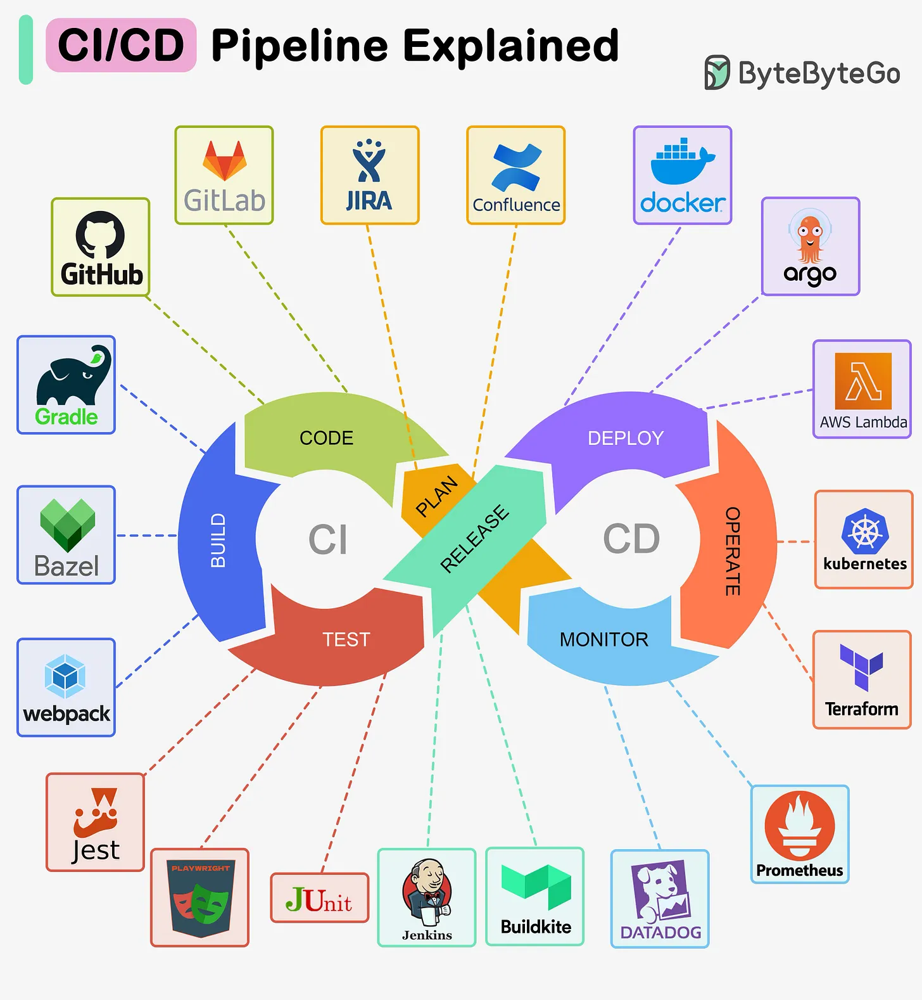

# 139 - Giải thích CI/CD Pipeline

- Nguồn: ByteByteGo Big Archive System Design 2025
- Trang PDF: 290
- Ảnh minh họa: `../assets/139/figure-01.png`

## Hình minh họa

## Dịch sát

CI/CD pipeline là một tool automate process build, test và deploy software.

Nó integrate các stage khác nhau của software development lifecycle, bao gồm code creation và revision, testing và deployment, vào một workflow duy nhất, cohesive.

Sơ đồ bên dưới minh họa một số tool thường được dùng.

## Dịch nội dung trong hình

- Vòng CI gồm `Code`, `Build`, `Test`, `Plan`, `Release`.
- Vòng CD gồm `Deploy`, `Operate`, `Monitor`.
- Tool minh họa: GitHub, GitLab, Jira, Confluence, Docker, Argo, AWS Lambda, Kubernetes, Terraform, Prometheus, Datadog, Buildkite, Jenkins, JUnit, Jest, webpack, Bazel, Gradle và các tool test/security khác.

## Tóm tắt & giải thích dễ hiểu

CI/CD biến việc release phần mềm thành pipeline có kiểm soát. CI tập trung merge code thường xuyên, build và test tự động. CD tập trung đưa artifact đã kiểm tra qua environment và deploy an toàn. Pipeline tốt giúp phát hiện lỗi sớm, release nhỏ hơn và rollback dễ hơn.

## Ví dụ thực tế - không nằm trong tài liệu gốc

Một flow phổ biến: developer push lên GitHub, CI chạy lint/unit test/build Docker image, push image lên registry, deploy staging qua ArgoCD, chạy smoke test, sau đó production rollout bằng canary và Prometheus/Datadog monitor error rate.

## Thuật ngữ chính

- `CI`: Continuous Integration.
- `CD`: Continuous Delivery/Deployment.
- `Pipeline`: chuỗi bước tự động.
- `Artifact`: output build như image/package.
- `Smoke test`: test nhanh sau deploy.
- `Canary`: rollout từng phần.
- `Rollback`: quay lại version trước.

## Câu hỏi ôn tập + trả lời + thinking học tập + liên hệ

> Đây là phần học tập thêm ở cuối file. Câu hỏi ưu tiên lấy từ tài liệu gốc và được trả lời trực tiếp; nếu bài không có câu hỏi riêng thì dùng tiêu đề/nội dung chính để tạo câu hỏi tự kiểm tra.

### Câu hỏi 1

**Nguồn câu hỏi:** Suy ra từ tiêu đề/nội dung chính vì bài gốc không có câu hỏi riêng.

**Câu hỏi:** Sau khi đọc bài “CI/CD Pipeline Explained”, ý chính cần trả lời và áp dụng vào system design là gì?

**Trả lời:** Trọng tâm cần đem vào thực tế là: CI/CD biến việc release phần mềm thành pipeline có kiểm soát. CI tập trung merge code thường xuyên, build và test tự động. CD tập trung đưa artifact đã kiểm tra qua environment và deploy an toàn. Pipeline tốt giúp phát hiện lỗi sớm, release nhỏ hơn và rollback dễ hơn. Khi áp dụng vào hệ thống thật, hãy kiểm thêm độ phức tạp vận hành, rollback, cost, kỹ năng team, observability và blast radius khi hỏng.

**Thinking học tập + liên hệ:** Liên hệ `Giải thích CI/CD Pipeline` bằng một scenario thật sẽ giúp thấy trade-off rõ hơn so với chỉ đọc định nghĩa. Lens chính là độ phức tạp vận hành, rollback, cost, kỹ năng team, observability và blast radius khi hỏng. Khi đưa lên production, hãy map từng thành phần vào deploy, rollback, monitoring, alerting, secret, cost và ownership rõ ràng. Khi ghi chú lại, hãy giải thích được các keyword: `CI`, `CD`, `Pipeline`, `Artifact`, `Smoke test`.
