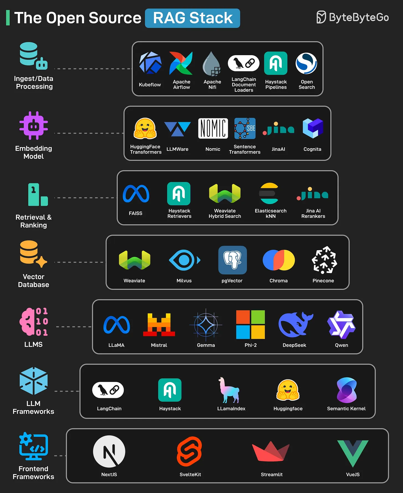

# 140 - Open Source RAG Stack

- Nguồn: ByteByteGo Big Archive System Design 2025
- Trang PDF: 291-292
- Ảnh minh họa: `../assets/140/figure-01.png`

## Hình minh họa

## Dịch sát

1. Frontend Frameworks: Dùng để build frontend interface cho RAG app. Một số tool có thể giúp là NextJS, VueJS, SvelteKit và Streamlit.

2. LLM Frameworks: High-level orchestration của LLM pipeline, prompt và chain. Bao gồm các tool như LangChain, LlamaIndex, Haystack, HuggingFace và Semantic Kernel.

3. LLMs: Generate final response bằng large language model. Một số open-source option gồm Llama, Mistral, Gemma, Phi-2, DeepSeek, Qwen, v.v.

4. Retrieval and Ranking: Retrieve relevant chunk và rank chúng dựa trên relevance. Tool như Meta FAISS, Haystack Retrievers, Weaviate Hybrid Search, ElasticSearch kNN và JinaAI Rerankers có thể hỗ trợ.

5. Vector Database: Store và enable similarity search trên vector embedding. Option phổ biến gồm Weaviate, Milvus, Postgres pgVector, Chroma và Pinecone.

6. Embedding Mode: Convert text/data thành vector representation bằng ML. Một số open-source tool gồm HuggingFace Transformers, LLMWare, Nomic, Sentence Transformers, JinaAI và Cognita.

7. Ingest/Data Processing: Extract, cleanse và prepare raw data cho indexing và retrieval. Tool như Kubeflow, Apache Airflow, Apache NiFi, LangChain Document Loads, Haystack Pipelines và OpenSearch có thể giúp.

Câu hỏi dành cho bạn: Bạn sẽ thêm open-source tool nào khác vào danh sách?

## Dịch nội dung trong hình

- `Frontend Framework`: NextJS, SvelteKit, Streamlit, VueJS.
- `LLM Framework`: LangChain, Haystack, LlamaIndex, Hugging Face, Semantic Kernel.
- `LLMs`: Llama, Mistral, Gemma, Phi-2, DeepSeek, Qwen.
- `Vector Database`: Weaviate, Milvus, pgVector, Chroma, Pinecone.
- `Retrieval & Ranking`: FAISS, Haystack Retriever, Weaviate Hybrid Search, Elasticsearch kNN, JinaAI Rerankers.
- `Embedding Model`: HuggingFace Transformers, LLMWare, Nomic, Sentence Transformers, JinaAI, Cognita.
- `Ingest/Data Processing`: Kubeflow, Apache Airflow, Apache NiFi, LangChain Document Loaders, Haystack Pipelines, OpenSearch.

## Tóm tắt & giải thích dễ hiểu

Open-source RAG stack gồm các lớp từ UI, orchestration, model, vector store, retrieval/ranking, embedding tới data ingestion. RAG production cần cả pipeline offline để ingest/index dữ liệu và pipeline online để retrieve context rồi gọi LLM.

Điểm quan trọng là chất lượng retrieval quyết định phần lớn chất lượng answer. Nếu chunk sai, embedding kém hoặc ranking yếu, LLM sẽ trả lời kém dù model mạnh.

## Ví dụ thực tế - không nằm trong tài liệu gốc

Bạn có thể build RAG local bằng Streamlit UI, LlamaIndex, Sentence Transformers embedding, pgvector, rerank bằng JinaAI, model Llama/Mistral qua Ollama và Airflow job để ingest tài liệu định kỳ.

## Thuật ngữ chính

- `RAG`: Retrieval-Augmented Generation.
- `Chunk`: đoạn dữ liệu nhỏ để index.
- `Embedding model`: model tạo vector.
- `Vector database`: database search vector.
- `Retriever`: component lấy context.
- `Reranker`: xếp hạng lại kết quả.
- `Ingestion`: nạp/xử lý dữ liệu vào index.

