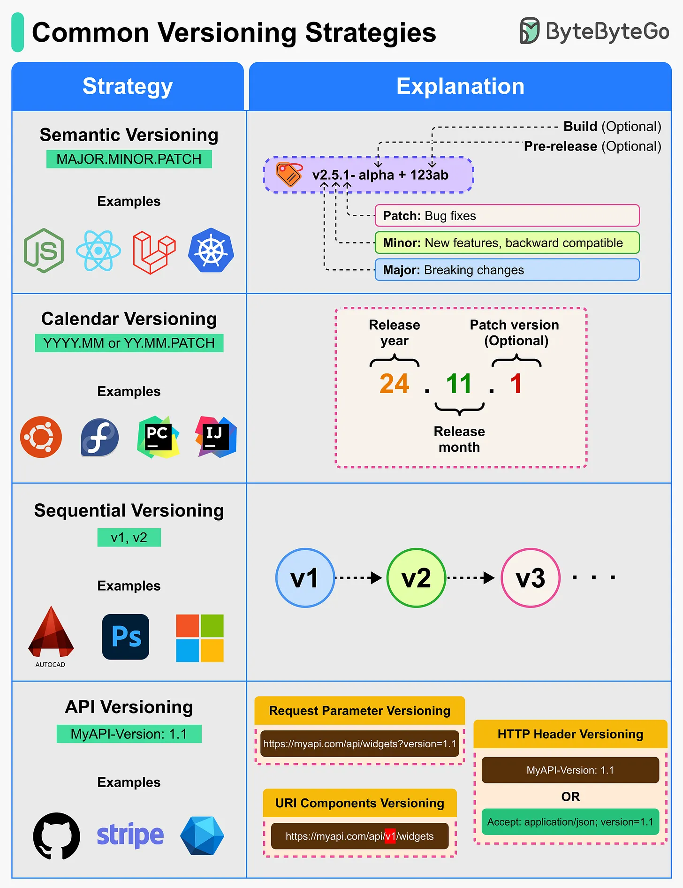

# 141 - Một số versioning strategy phổ biến là gì?

- Nguồn: ByteByteGo Big Archive System Design 2025
- Trang PDF: 293
- Ảnh minh họa: `../assets/141/figure-01.png`

## Hình minh họa

## Dịch sát

Versioning giúp developer communicate release change rõ ràng, dù là cho software package, API hay operating system.

- Semantic Versioning (SemVer): Một versioning scheme truyền đạt ý nghĩa về scope của change trong release bằng format `MAJOR.MINOR.PATCH`.

- Calendar Versioning (CalVer): Một scheme dùng release date, gồm year và month, làm version number để chỉ ra release xảy ra khi nào.

## Dịch nội dung trong hình

- `Semantic Versioning`: `MAJOR.MINOR.PATCH`, có thể có pre-release và build metadata; patch fix bug, minor thêm feature backward-compatible, major có breaking change.
- `Calendar Versioning`: dùng `YYYY.MM` hoặc `YY.MM.PATCH`, ví dụ release year/month và patch version optional.
- `Sequential Versioning`: version tăng tuần tự như `v1`, `v2`, `v3`.
- `API Versioning`: map API version, ví dụ request parameter versioning, HTTP header versioning hoặc URI component versioning.

## Tóm tắt & giải thích dễ hiểu

Versioning là contract kỳ vọng giữa maintainer và user. SemVer phù hợp package/library vì nó nói rõ breaking change. CalVer phù hợp sản phẩm release theo lịch như Ubuntu. Sequential versioning đơn giản nhưng ít thông tin. API versioning giúp thay đổi API mà không phá client cũ.

## Ví dụ thực tế - không nằm trong tài liệu gốc

Library npm nên dùng SemVer để developer biết update `1.2.3` lên `1.3.0` ít rủi ro hơn `2.0.0`. API public có thể dùng `/v1/orders` và giữ `/v1` trong khi phát triển `/v2` để client migrate dần.

## Thuật ngữ chính

- `SemVer`: Semantic Versioning.
- `CalVer`: Calendar Versioning.
- `MAJOR`: version có breaking change.
- `MINOR`: feature mới backward-compatible.
- `PATCH`: bug fix backward-compatible.
- `Pre-release`: bản alpha/beta/rc.
- `API versioning`: chiến lược version cho API.

## Câu hỏi ôn tập + trả lời + thinking học tập + liên hệ

> Đây là phần học tập thêm ở cuối file. Câu hỏi ưu tiên lấy từ tài liệu gốc và được trả lời trực tiếp; nếu bài không có câu hỏi riêng thì dùng tiêu đề/nội dung chính để tạo câu hỏi tự kiểm tra.

### Câu hỏi 1

**Nguồn câu hỏi:** Suy ra từ tiêu đề/nội dung chính vì bài gốc không có câu hỏi riêng.

**Câu hỏi:** What are some of the most popular versioning strategies?

**Trả lời:** Sau bài này, phần đáng nhớ nhất là: Versioning là contract kỳ vọng giữa maintainer và user. SemVer phù hợp package/library vì nó nói rõ breaking change. CalVer phù hợp sản phẩm release theo lịch như Ubuntu. Sequential versioning đơn giản nhưng ít thông tin. API versioning giúp thay đổi API mà không phá client cũ. Khi áp dụng vào hệ thống thật, hãy kiểm thêm actor, trust boundary, dữ liệu nhạy cảm, lifetime của token/key, quyền truy cập và cơ chế revoke.

**Thinking học tập + liên hệ:** Ôn tập `Một số versioning strategy phổ biến là gì?` bằng cách biến khái niệm thành quyết định thiết kế cụ thể: chọn gì, bỏ gì, đo gì và ai chịu trách nhiệm. Lens chính là actor, trust boundary, dữ liệu nhạy cảm, lifetime của token/key, quyền truy cập và cơ chế revoke. Khi làm API thật, một endpoint chạy được chưa đủ; phải kiểm thêm abuse, audit log, error leakage, rate limit và quyền ở service chứa dữ liệu. Khi ghi chú lại, hãy giải thích được các keyword: `SemVer`, `CalVer`, `MAJOR`, `MINOR`, `PATCH`.
