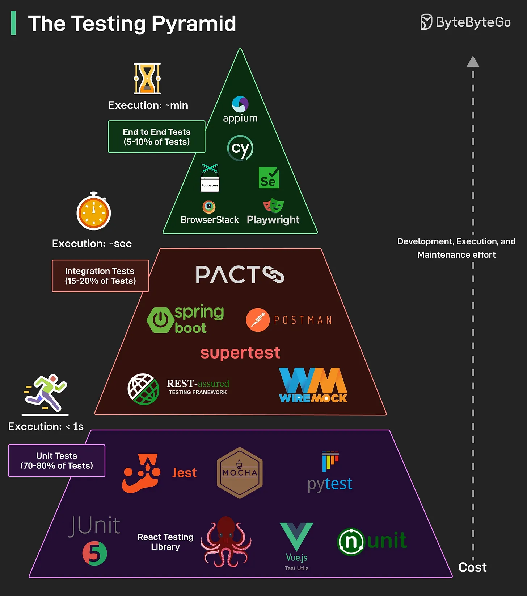

# 142 - Testing Pyramid

- Nguồn: ByteByteGo Big Archive System Design 2025
- Trang PDF: 294
- Ảnh minh họa: `../assets/142/figure-01.png`

## Hình minh họa

## Dịch sát

Testing là backbone của reliable software. Testing Pyramid là một strategy được chấp nhận rộng rãi để cấu trúc test thành ba layer chính:

- Unit Tests: Đây là foundation của pyramid. Unit test nhanh, isolated và low-cost để viết và maintain. Chúng test từng function, method hoặc component riêng lẻ.

- Integration Tests: Các test này validate interaction giữa component, chẳng hạn API, database và external service. Chúng chậm hơn unit test và cần setup nhiều hơn.

- E2E Tests: Các test này simulate real user flow từ đầu tới cuối trên full system. Chúng đắt để viết và maintain, đồng thời thường chạy chậm.

Càng đi lên phía trên pyramid, cost của test development, execution và maintenance càng tăng.

Câu hỏi dành cho bạn: Layer nào bạn thấy có giá trị nhất trong testing strategy của mình, và vì sao?

## Dịch nội dung trong hình

- Đáy pyramid: `Unit Tests` chiếm 70-80% test, execution rất nhanh, tool như JUnit, Jest, Mocha, pytest, React Testing Library, Vue Test Utils, NUnit.
- Tầng giữa: `Integration Tests` chiếm 15-20%, execution tính bằng giây, tool như Spring Boot, Postman, Supertest, REST-assured, WireMock.
- Đỉnh: `End-to-End Tests` chiếm 5-10%, execution tính bằng phút, tool như Cypress, Selenium, Playwright, Appium, BrowserStack.
- Càng lên cao, cost development/execution/maintenance càng tăng.

## Tóm tắt & giải thích dễ hiểu

Testing pyramid khuyên viết nhiều unit test vì nhanh/rẻ, một số integration test để kiểm tra component nói chuyện đúng, và ít E2E test cho user journey quan trọng. Nếu có quá nhiều E2E test, test suite thường chậm, flaky và khó maintain.

## Ví dụ thực tế - không nằm trong tài liệu gốc

Checkout flow nên có unit test tính giá/discount, integration test API order + database + payment mock, và một E2E test cho user mua hàng thành công. Không nên test mọi rule discount bằng E2E vì sẽ rất chậm và dễ flaky.

## Thuật ngữ chính

- `Unit test`: test đơn vị nhỏ.
- `Integration test`: test tích hợp component.
- `E2E test`: test end-to-end theo flow user.
- `Flaky test`: test lúc pass lúc fail không ổn định.
- `Test maintenance`: chi phí bảo trì test.
- `Mock`: đối tượng giả lập dependency.
- `User journey`: luồng người dùng.

## Câu hỏi ôn tập + trả lời + thinking học tập + liên hệ

> Đây là phần học tập thêm ở cuối file. Câu hỏi ưu tiên lấy từ tài liệu gốc và được trả lời trực tiếp; nếu bài không có câu hỏi riêng thì dùng tiêu đề/nội dung chính để tạo câu hỏi tự kiểm tra.

### Câu hỏi 1

**Nguồn câu hỏi:** Câu hỏi trong tài liệu gốc.

**Câu hỏi:** Layer nào bạn thấy có giá trị nhất trong testing strategy của mình, và vì sao?

**Trả lời:** Layer có giá trị nhất thường là integration/contract test, vì nhiều bug production không nằm trong một function riêng lẻ mà nằm ở chỗ các module/service hiểu sai contract của nhau. Unit test vẫn cần để feedback nhanh, end-to-end test vẫn cần cho flow quan trọng, nhưng integration/contract test thường bắt được lỗi thực tế với chi phí thấp hơn E2E toàn diện.

**Thinking học tập + liên hệ:** Ôn tập `Testing Pyramid` bằng cách biến khái niệm thành quyết định thiết kế cụ thể: chọn gì, bỏ gì, đo gì và ai chịu trách nhiệm. Lens chính là feedback loop, rollback, collaboration, code review và mức tự động hóa phù hợp team. Khi áp dụng vào team thật, hãy nhìn developer workflow như một hệ thống: commit, review, test, deploy và rollback đều phải giảm rủi ro production. Khi ghi chú lại, hãy giải thích được các keyword: `Unit test`, `Integration test`, `E2E test`, `Flaky test`, `Test maintenance`.
