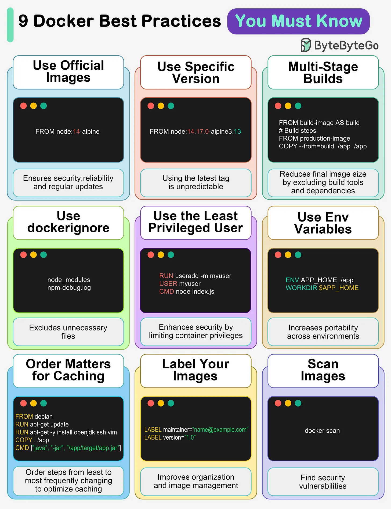

# 143 - 9 Docker best practice bạn nên biết

- Nguồn: ByteByteGo Big Archive System Design 2025
- Trang PDF: 295-296
- Ảnh minh họa: `../assets/143/figure-01.png`

## Hình minh họa

## Dịch sát

1. Use official images
   Điều này bảo đảm security, reliability và regular update.

2. Use a specific image version
   Default latest tag unpredictable và gây unexpected behavior.

3. Multi-Stage builds
   Giảm final image size bằng cách loại bỏ build tool và dependency.

4. Use .dockerignore
   Exclude unnecessary file, tăng tốc build và giảm image size.

5. Use the least privileged user
   Tăng security bằng cách giới hạn container privilege.

6. Use environment variables
   Tăng flexibility và portability qua nhiều environment khác nhau.

7. Order matters for caching
   Sắp xếp step từ ít thay đổi nhất tới thay đổi thường xuyên nhất để optimize caching.

8. Label your images
   Cải thiện organization và giúp image management.

9. Scan images
   Tìm security vulnerability trước khi chúng trở thành problem lớn hơn.

Câu hỏi dành cho bạn: Bạn sẽ thêm Docker best practice nào khác vào danh sách?

## Dịch nội dung trong hình

- Dùng official image như `node:...-alpine`.
- Dùng version cụ thể thay vì `latest`.
- Dùng multi-stage build để tách build image và runtime image.
- Dùng `.dockerignore` để bỏ `node_modules`, debug log, file thừa.
- Chạy bằng least privileged user, không chạy root nếu không cần.
- Dùng env variable như `APP_HOME`, `WORKDIR`.
- Sắp thứ tự layer để tối ưu cache.
- Label image với maintainer/version.
- Scan image bằng `docker scan` hoặc tool tương đương.

## Tóm tắt & giải thích dễ hiểu

Docker image production nên nhỏ, reproducible, bảo mật và dễ quản lý. Pin version giúp tránh build hôm nay khác build ngày mai. Multi-stage và `.dockerignore` giảm size. Non-root user giảm blast radius. Layer order tốt giúp build nhanh. Scan image giúp phát hiện CVE sớm.

## Ví dụ thực tế - không nằm trong tài liệu gốc

Với Node.js app, copy `package*.json` và install dependency trước, rồi mới copy source code để tận dụng cache. Build bằng image có compiler, sau đó copy artifact sang runtime image nhỏ hơn. Chạy user `node` thay vì root.

## Thuật ngữ chính

- `Official image`: image chính thức từ vendor/community đáng tin.
- `latest tag`: tag mặc định dễ thay đổi.
- `Multi-stage build`: build nhiều stage trong Dockerfile.
- `.dockerignore`: file loại trừ khỏi build context.
- `Least privilege`: cấp quyền tối thiểu.
- `Layer cache`: cache từng layer Docker build.
- `Image scanning`: quét lỗ hổng image.

