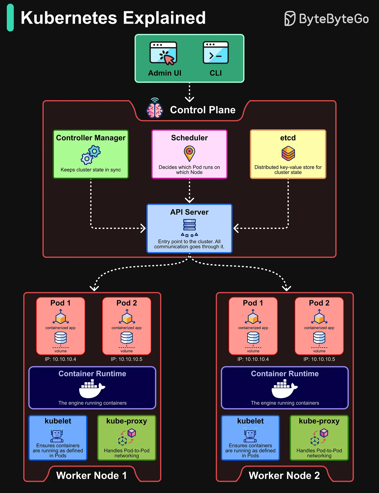

# 144 - Kubernetes được giải thích

- Nguồn: ByteByteGo Big Archive System Design 2025
- Trang PDF: 297-298
- Ảnh minh họa: `../assets/144/figure-01.png`

## Hình minh họa

## Dịch sát

Kubernetes là de facto standard cho container orchestration. Nó automate deployment, scaling và management của containerized application.

Control Plane:

- API Server: Đóng vai trò communication hub giữa user, control plane và worker node.

- Scheduler: Quyết định Pod nào chạy trên Node nào.

- Controller Manager: Giữ cluster state đồng bộ.

- etcd: Một distributed key-value store giữ state của cluster.

Worker Nodes:

- Pods: Smallest deployable unit trong Kubernetes, đại diện cho một hoặc nhiều container.

- Container Runtime: Engine như Docker hoặc containerd chạy container.

- kubelet: Bảo đảm container đang chạy như được định nghĩa trong Pod.

- kube-proxy: Xử lý networking giữa các Pod và bảo đảm communication.

## Dịch nội dung trong hình

- User dùng `Admin UI` hoặc `CLI` để tương tác với Kubernetes.
- `Control Plane` gồm Controller Manager, Scheduler, etcd và API Server.
- API Server là entry point, mọi thao tác đi qua API Server.
- `Worker Node 1` và `Worker Node 2` chạy nhiều pod; mỗi node có container runtime, kubelet và kube-proxy.
- Pod có IP riêng; kube-proxy xử lý Pod-to-Pod networking.

## Tóm tắt & giải thích dễ hiểu

Kubernetes quản lý desired state của ứng dụng container. Control plane ra quyết định và lưu state; worker node chạy workload thật. Bạn khai báo muốn chạy gì, bao nhiêu replica, expose ra sao; Kubernetes cố gắng giữ cluster đúng với khai báo đó.

Nếu Docker giúp chạy một container, Kubernetes giúp vận hành nhiều container trên nhiều node với scheduling, scaling, networking và self-healing.

## Ví dụ thực tế - không nằm trong tài liệu gốc

Khi bạn apply Deployment 3 replica, API Server nhận manifest, lưu state vào etcd, Scheduler chọn node, kubelet trên node pull image và chạy pod. Nếu một node chết, controller/scheduler sẽ tạo pod thay thế trên node khác.

## Thuật ngữ chính

- `Container orchestration`: điều phối container.
- `Control Plane`: lớp điều khiển cluster.
- `API Server`: cổng giao tiếp chính.
- `Scheduler`: chọn node cho pod.
- `etcd`: key-value store lưu cluster state.
- `Pod`: đơn vị deploy nhỏ nhất.
- `kubelet`: agent chạy trên worker node.
- `kube-proxy`: thành phần networking trên node.

## Câu hỏi ôn tập + trả lời + thinking học tập + liên hệ

> Đây là phần học tập thêm ở cuối file. Câu hỏi ưu tiên lấy từ tài liệu gốc và được trả lời trực tiếp; nếu bài không có câu hỏi riêng thì dùng tiêu đề/nội dung chính để tạo câu hỏi tự kiểm tra.

### Câu hỏi 1

**Nguồn câu hỏi:** Suy ra từ tiêu đề/nội dung chính vì bài gốc không có câu hỏi riêng.

**Câu hỏi:** Sau khi đọc bài “Kubernetes Explained”, ý chính cần trả lời và áp dụng vào system design là gì?

**Trả lời:** Bài này muốn người đọc nắm: Kubernetes quản lý desired state của ứng dụng container. Control plane ra quyết định và lưu state; worker node chạy workload thật. Bạn khai báo muốn chạy gì, bao nhiêu replica, expose ra sao; Kubernetes cố gắng giữ cluster đúng với khai báo đó. Nếu Docker giúp chạy một container, Kubernetes giúp vận hành nhiều container trên nhiều node với scheduling, scaling, networking và self-healing. Khi áp dụng vào hệ thống thật, hãy kiểm thêm độ phức tạp vận hành, rollback, cost, kỹ năng team, observability và blast radius khi hỏng.

**Thinking học tập + liên hệ:** Khi học `Kubernetes được giải thích`, hãy thử viết một checklist áp dụng vào project: input, output, owner, rủi ro và metric kiểm chứng. Lens chính là độ phức tạp vận hành, rollback, cost, kỹ năng team, observability và blast radius khi hỏng. Khi đưa lên production, hãy map từng thành phần vào deploy, rollback, monitoring, alerting, secret, cost và ownership rõ ràng. Khi ghi chú lại, hãy giải thích được các keyword: `Container orchestration`, `Control Plane`, `API Server`, `Scheduler`, `etcd`.
