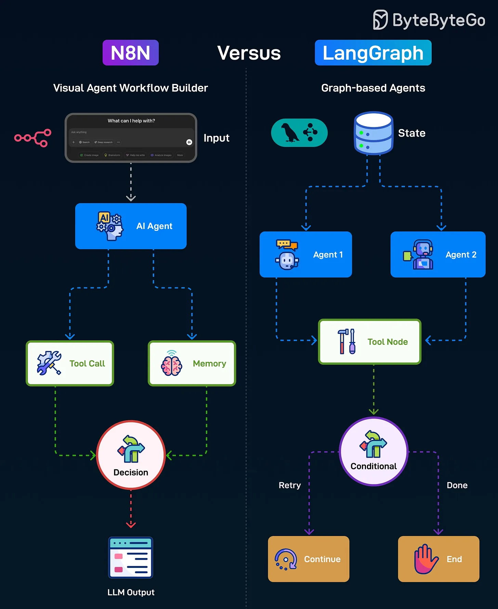

# 145 - N8N so với LangGraph

- Nguồn: ByteByteGo Big Archive System Design 2025
- Trang PDF: 299-300
- Ảnh minh họa: `../assets/145/figure-01.png`

## Hình minh họa

## Dịch sát

N8N là một open-source automation tool cho phép bạn build workflow trực quan bằng cách kết nối nhiều service, API và AI tool theo sequence. Đây là cách nó hoạt động:

1. Bắt đầu với Input từ user.

2. Chuyển input đó tới AI Agent để xử lý.

3. AI Agent có thể thực hiện Tool Call hoặc access Memory.

4. Decision node chọn action tiếp theo và tạo final LLM output cho user.

LangGraph là một Python framework để build AI Agent workflow bằng flexible graph structure hỗ trợ branching, looping và multi-agent collaboration. Đây là cách nó hoạt động:

1. Bắt đầu với shared State chứa workflow context.

2. Có thể route task tới các agent khác nhau.

3. Agent tương tác với Tool Node để thực hiện task.

4. Conditional node quyết định retry hay mark process done.

Câu hỏi dành cho bạn: Bạn đã dùng N8N hoặc LangGraph chưa?

## Dịch nội dung trong hình

- `N8N`: visual agent workflow builder; input đi vào AI Agent, agent gọi Tool Call hoặc Memory, Decision node tạo LLM Output.
- `LangGraph`: graph-based agents; shared State route tới Agent 1/Agent 2, agent gọi Tool Node, Conditional node quyết định `Retry`, `Continue` hoặc `End`.

## Tóm tắt & giải thích dễ hiểu

N8N phù hợp khi bạn muốn kéo-thả workflow automation và nối nhanh nhiều tool/SaaS/API. LangGraph phù hợp khi bạn cần viết agent workflow bằng code Python, kiểm soát state, branching, loop, retry và multi-agent phức tạp hơn.

Nói ngắn gọn: N8N thiên về no-code/low-code automation; LangGraph thiên về code-first agent orchestration.

## Ví dụ thực tế - không nằm trong tài liệu gốc

Nếu muốn tự động lấy form submission, gọi LLM tóm tắt rồi gửi Slack, N8N rất nhanh. Nếu muốn agent debug code nhiều vòng: đọc file, chạy test, quyết định sửa, retry khi fail và lưu state theo graph, LangGraph phù hợp hơn.

## Thuật ngữ chính

- `Workflow`: luồng bước xử lý.
- `AI Agent`: agent dùng LLM/tool để hành động.
- `Tool Call`: gọi API/tool bên ngoài.
- `State`: trạng thái/context của workflow.
- `Conditional node`: node rẽ nhánh theo điều kiện.
- `Branching`: rẽ nhánh.
- `Looping`: lặp lại bước.

## Câu hỏi ôn tập + trả lời + thinking học tập + liên hệ

> Đây là phần học tập thêm ở cuối file. Câu hỏi ưu tiên lấy từ tài liệu gốc và được trả lời trực tiếp; nếu bài không có câu hỏi riêng thì dùng tiêu đề/nội dung chính để tạo câu hỏi tự kiểm tra.

### Câu hỏi 1

**Nguồn câu hỏi:** Câu hỏi trong tài liệu gốc.

**Câu hỏi:** Bạn đã dùng N8N hoặc LangGraph chưa?

**Trả lời:** Với `N8N so với LangGraph`, cách liên hệ tốt nhất là chọn một workload nhỏ rồi kiểm chứng bằng số liệu thay vì chọn theo cảm tính. Nên kiểm bằng workload nhỏ trước: latency, độ ổn định, khả năng debug, cost và rủi ro vận hành. Phần cốt lõi cần đem theo từ bài là: N8N phù hợp khi bạn muốn kéo-thả workflow automation và nối nhanh nhiều tool/SaaS/API. LangGraph phù hợp khi bạn cần viết agent workflow bằng code Python, kiểm soát state, branching, loop, retry và multi-agent phức tạp hơn. Nói ngắn gọn: N8N thiên về no-code/low-code automation; LangGraph thiên về code-first agent orchestration.

**Thinking học tập + liên hệ:** Khi tự liên hệ `N8N so với LangGraph`, hãy viết ra một project cụ thể, lý do chọn công nghệ và lỗi vận hành có thể xảy ra. Lens chính là quality, latency, cost/token, privacy, cập nhật tri thức và rủi ro hallucination. Khi build AI app, hãy nối model với pipeline thật: data vào đâu, context lấy từ đâu, output được kiểm thế nào và chi phí tăng theo traffic ra sao. Khi ghi chú lại, hãy giải thích được các keyword: `Workflow`, `AI Agent`, `Tool Call`, `State`, `Conditional node`.
