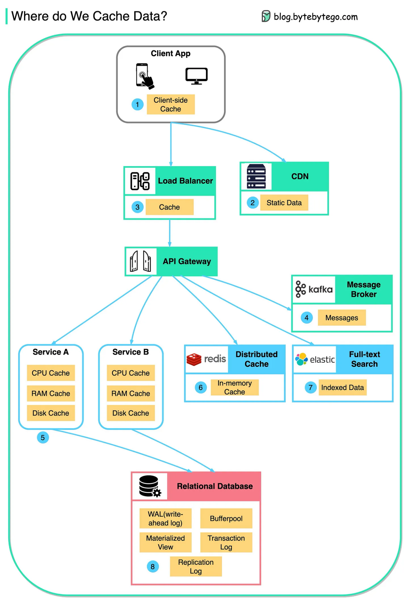

# 146 - Chúng ta cache data ở đâu?

- Nguồn: ByteByteGo Big Archive System Design 2025
- Trang PDF: 301-302
- Ảnh minh họa: `../assets/146/figure-01.png`

## Hình minh họa

## Dịch sát

Data được cache ở mọi nơi, từ frontend tới backend!

Diagram này minh họa nơi chúng ta cache data trong một architecture điển hình.

Có nhiều layer dọc theo flow.

1. Client apps: HTTP response có thể được browser cache. Chúng ta request data qua HTTP lần đầu, và data được trả về cùng expiry policy trong HTTP header; khi request data lần nữa, client app cố retrieve data từ browser cache trước.

2. CDN: CDN cache static web resource. Client có thể retrieve data từ CDN node gần đó.

3. Load Balancer: Load Balancer cũng có thể cache resource.

4. Messaging infra: Message broker lưu message trên disk trước, rồi consumer retrieve chúng theo tốc độ riêng. Tùy retention policy, data được cache trong Kafka cluster trong một khoảng thời gian.

5. Services: Có nhiều layer cache trong một service. Nếu data không được cache trong CPU cache, service sẽ thử retrieve data từ memory. Đôi khi service có second-level cache để lưu data trên disk.

6. Distributed Cache: Distributed cache như Redis giữ key-value pair cho nhiều service trong memory. Nó cung cấp read/write performance tốt hơn database rất nhiều.

7. Full-text Search: Đôi khi chúng ta cần dùng full-text search như Elastic Search cho document search hoặc log search. Một copy của data cũng được index trong search engine.

8. Database: Ngay cả trong database, chúng ta có nhiều level cache khác nhau:
   - WAL (Write-ahead Log): data được write vào WAL trước khi build B-tree index.
   - Bufferpool: memory area được allocate để cache query result.
   - Materialized View: pre-compute query result và store chúng trong database table để có query performance tốt hơn.
   - Transaction log: record tất cả transaction và database update.
   - Replication Log: dùng để record replication state trong database cluster.

Câu hỏi dành cho bạn: Khi data được cache ở nhiều level như vậy, làm sao chúng ta bảo đảm sensitive user data bị xóa hoàn toàn khỏi system?

## Dịch nội dung trong hình

- `Client App`: client cache.
- `Load Balancer`: cache ở edge/lb layer.
- `CDN`: static data.
- `API Gateway`: điểm đi vào backend.
- `Service A/B`: CPU cache, RAM cache, disk cache.
- `Message Broker`: Kafka message cache.
- `Distributed Cache`: Redis, in-memory cache.
- `Full-text Search`: Elasticsearch indexed data.
- `Relational Database`: WAL/undo-redo log, buffer pool, materialized view, replication log.

## Tóm tắt & giải thích dễ hiểu

Cache không chỉ là Redis. Dữ liệu có thể nằm trong browser, CDN, load balancer, gateway, memory service, Kafka, Redis, search index và cả database internal cache/log. Điều này giúp hệ thống nhanh hơn nhưng làm invalidation, bảo mật và xóa dữ liệu nhạy cảm khó hơn.

## Ví dụ thực tế - không nằm trong tài liệu gốc

Nếu user yêu cầu xóa dữ liệu cá nhân, chỉ xóa row database chưa đủ. Hệ thống có thể cần purge CDN, xóa Redis key, xóa search index, expire browser cache bằng header phù hợp, xử lý Kafka retention và đảm bảo backup/log tuân thủ policy.

## Thuật ngữ chính

- `Browser cache`: cache trên trình duyệt.
- `CDN cache`: cache ở mạng phân phối nội dung.
- `Distributed cache`: cache dùng chung nhiều service.
- `WAL`: Write-ahead Log.
- `Buffer pool`: vùng memory cache page/query trong DB.
- `Materialized view`: view lưu sẵn kết quả.
- `Cache invalidation`: làm cache hết hiệu lực/cập nhật.

## Câu hỏi ôn tập + trả lời + thinking học tập + liên hệ

> Đây là phần học tập thêm ở cuối file. Câu hỏi ưu tiên lấy từ tài liệu gốc và được trả lời trực tiếp; nếu bài không có câu hỏi riêng thì dùng tiêu đề/nội dung chính để tạo câu hỏi tự kiểm tra.

### Câu hỏi 1

**Nguồn câu hỏi:** Câu hỏi trong tài liệu gốc.

**Câu hỏi:** Khi data được cache ở nhiều level như vậy, làm sao chúng ta bảo đảm sensitive user data bị xóa hoàn toàn khỏi system?

**Trả lời:** Muốn xóa sensitive data khỏi nhiều tầng cache thì không thể chỉ xóa một key ở Redis. Cần thiết kế data classification, key naming nhất quán, TTL ngắn cho dữ liệu nhạy cảm, cache purge theo user/object id, event invalidation tới CDN/app/browser cache, và không cache PII khi không thật cần. Với dữ liệu bắt buộc cache, nên encrypt, version key theo policy và có audit log cho lệnh purge để kiểm chứng đã xóa ở các tầng quan trọng.

**Thinking học tập + liên hệ:** Cache làm hệ thống nhanh hơn nhưng cũng tạo bản sao dữ liệu ở nhiều nơi, nên quyền được xóa dữ liệu phải được thiết kế từ đầu. Khi liên hệ production, hãy inventory mọi cache layer, TTL, key pattern, event invalidation và cách chứng minh purge đã chạy thành công. Các keyword cần tự giải thích lại: `Browser cache`, `CDN cache`, `Distributed cache`, `WAL`, `Buffer pool`.
