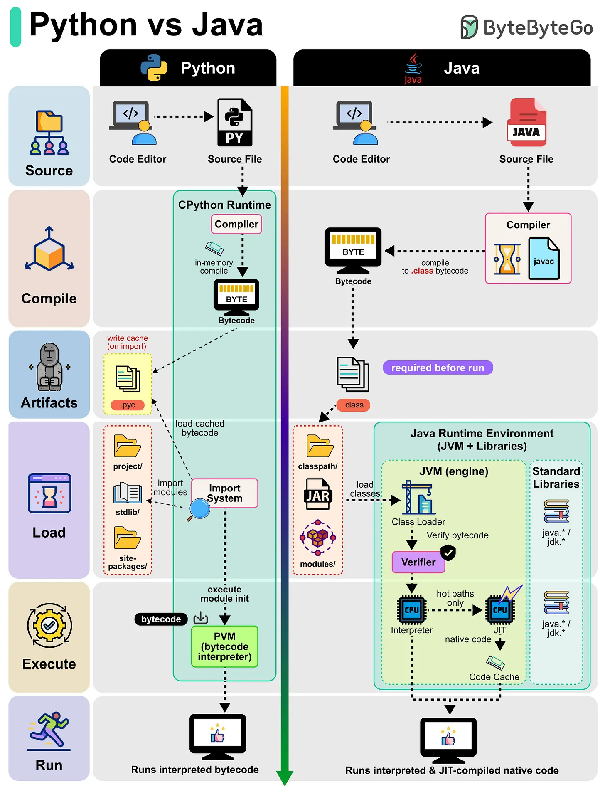

# 147 - Python vs Java

- Nguồn: ByteByteGo Big Archive System Design 2025
- Trang PDF: 303-304
- Ảnh minh họa: `../assets/147/figure-01.png`

## Hình minh họa

## Dịch sát

Bạn từng tự hỏi điều gì xảy ra phía sau khi chạy một Python script hoặc Java program chưa? Hãy cùng tìm hiểu:

Python (CPython Runtime):

- Python source code (`.py`) được compile tự động thành bytecode trong memory.
- Bytecode cũng có thể được cache trong file `.pyc`, giúp re-run nhanh hơn bằng cached version.
- Import System load module và dependency.
- Python Virtual Machine (PVM) interpret bytecode từng dòng, làm Python flexible nhưng tương đối chậm hơn.

Java (JVM Runtime):

- Java source code (`.java`) được compile thành `.class` bytecode bằng `javac`.
- Class Loader load bytecode vào Java Runtime Environment (JVM).
- Bytecode được verify và execute.
- JVM dùng cả Interpreter và JIT Compiler; code được dùng thường xuyên (hot paths) được convert thành native machine code, giúp Java nhanh hơn.

## Dịch nội dung trong hình

- Python: source file đi qua CPython runtime compiler thành bytecode, cache `.pyc` trong `__pycache__`, import system load dependency, PVM interpret bytecode và run.
- Java: `.java` source compile bằng compiler thành `.class` bytecode, load vào JVM, verifier kiểm tra bytecode, interpreter chạy ban đầu, JIT compile hot path thành native code, code cache lưu native code.

## Tóm tắt & giải thích dễ hiểu

Cả Python và Java đều không chạy source code trực tiếp theo nghĩa thô. Chúng dùng bytecode và runtime. Python CPython thường interpret bytecode, nên linh hoạt nhưng chậm hơn. Java JVM có JIT compiler tối ưu hot path thành machine code, nên sau warm-up có thể chạy rất nhanh.

## Ví dụ thực tế - không nằm trong tài liệu gốc

Script automation ngắn, data munging hoặc prototype thường hợp Python vì viết nhanh. Backend service high-throughput, long-running với type system mạnh và JIT optimization có thể hợp Java. Tuy vậy performance còn phụ thuộc library, I/O, architecture và cách viết code.

## Thuật ngữ chính

- `CPython`: implementation Python phổ biến nhất.
- `Bytecode`: mã trung gian cho VM.
- `.pyc`: file cache bytecode Python.
- `PVM`: Python Virtual Machine.
- `JVM`: Java Virtual Machine.
- `JIT`: Just-In-Time compiler.
- `Hot path`: đoạn code chạy thường xuyên.

## Câu hỏi ôn tập + trả lời + thinking học tập + liên hệ

> Đây là phần học tập thêm ở cuối file. Câu hỏi ưu tiên lấy từ tài liệu gốc và được trả lời trực tiếp; nếu bài không có câu hỏi riêng thì dùng tiêu đề/nội dung chính để tạo câu hỏi tự kiểm tra.

### Câu hỏi 1

**Nguồn câu hỏi:** Suy ra từ tiêu đề/nội dung chính vì bài gốc không có câu hỏi riêng.

**Câu hỏi:** Sau khi đọc bài “Python vs Java”, ý chính cần trả lời và áp dụng vào system design là gì?

**Trả lời:** Điểm khác nhau nên nhìn từ boundary và trách nhiệm chính. Với `Python vs Java`, hãy tách rõ mỗi bên giải quyết vấn đề gì, dữ liệu đi qua đâu, ai sở hữu state và lỗi sẽ lan như thế nào. Ý chính để giữ lại là: Cả Python và Java đều không chạy source code trực tiếp theo nghĩa thô. Chúng dùng bytecode và runtime. Python CPython thường interpret bytecode, nên linh hoạt nhưng chậm hơn. Java JVM có JIT compiler tối ưu hot path thành machine code, nên sau warm-up có thể chạy rất nhanh.

**Thinking học tập + liên hệ:** Khi so sánh trong `Python vs Java`, hãy tách responsibility, boundary, state, failure mode và cost vận hành thay vì chỉ so tên công nghệ. Lens chính là requirement, constraint, traffic, dữ liệu, failure mode và khả năng vận hành của team. Khi gặp system design thật, hãy biến khái niệm thành quyết định: boundary ở đâu, data flow thế nào, bottleneck nào đến trước và rollback ra sao. Khi ghi chú lại, hãy giải thích được các keyword: `CPython`, `Bytecode`, `.pyc`, `PVM`, `JVM`.
